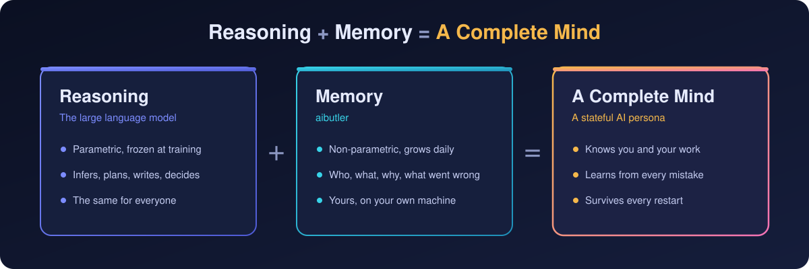
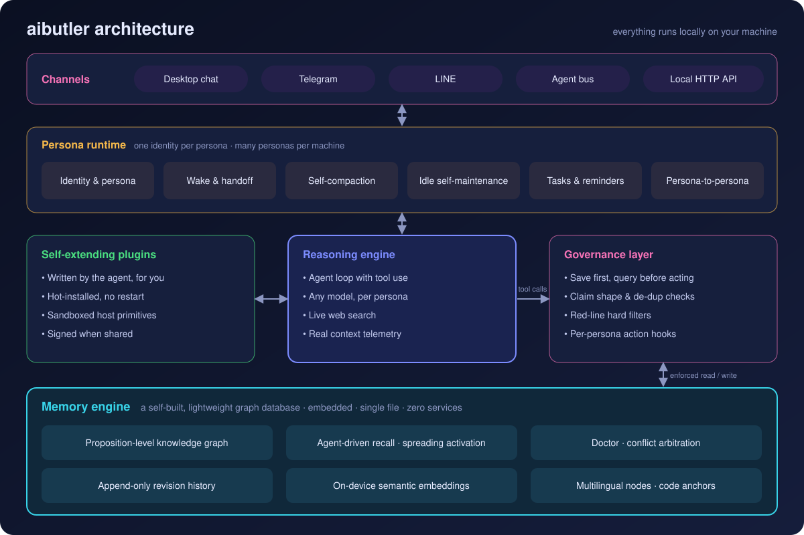
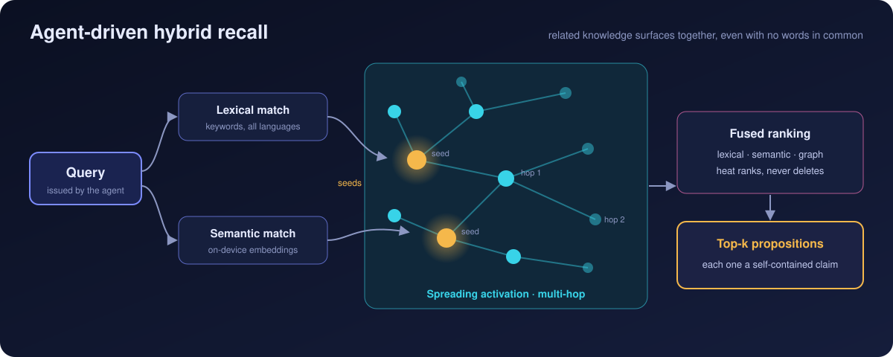
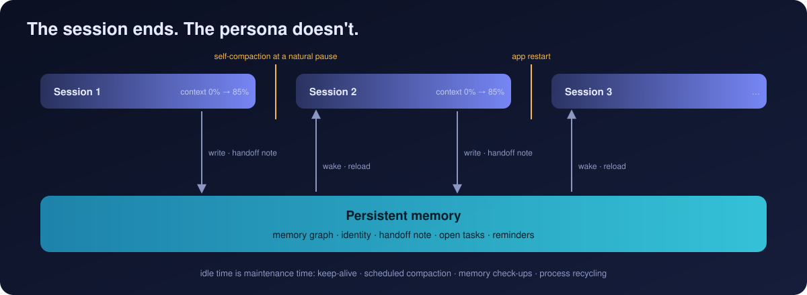
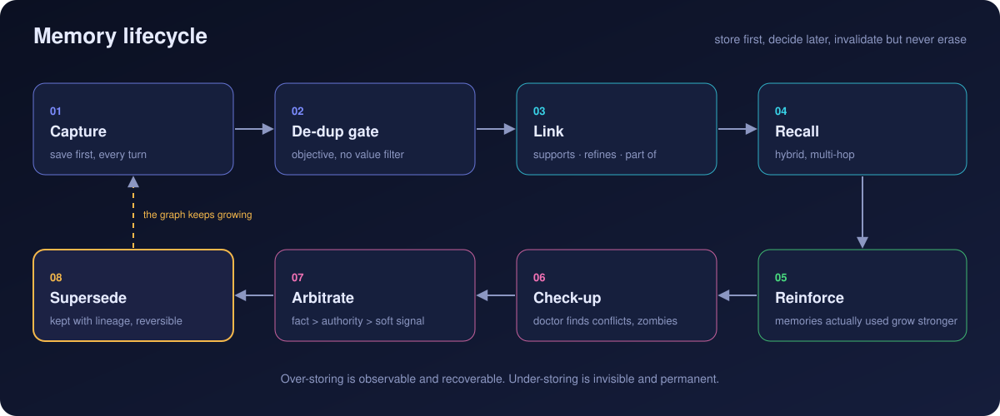
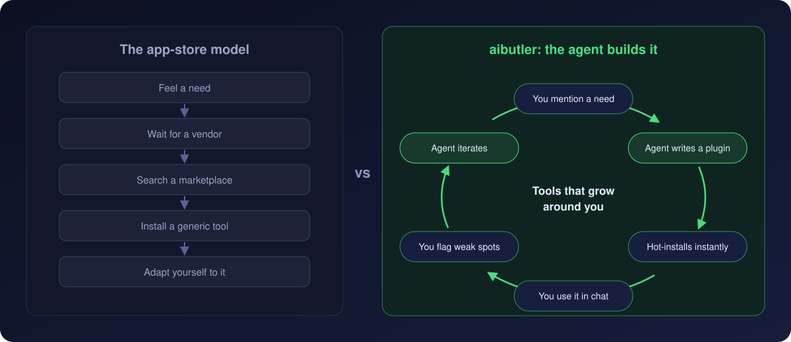

# aibutler

**English** · [简体中文](README.zh-CN.md)

[](https://github.com/fantasyxxj/aibutler/releases)
[](LICENSE)


> **Reasoning is solved. Memory is the missing half of the mind.**
>
> aibutler is a desktop runtime for long-running AI agents. Every persona has its own persistent memory, identity and tools, carries its thread across sessions, context compactions and restarts, and grows sharper the longer it works with you.

<p align="center"></p>

## How it started

aibutler grew out of my own day-to-day work as a developer. It began with the official AI extension in VS Code. The AI helped enormously, but the deeper I went, the clearer its limits became:

- **Memory was one ever-growing file.** It kept getting more bloated, and the one note that mattered got buried in it.
- **It could not sustain long-running work across several projects.** Once a session ended or the context filled up, the whole backstory had to be explained again.
- **It only answered when asked.** It could not keep working on its own around the clock; when I stepped away, the work stopped.

That is where the idea for this tool came from. Drawing on years of development experience and reading through research on cognitive science and agent memory, I gradually arrived at the approach behind aibutler: **treat memory as the other half of the mind, as important as reasoning**, so that an AI persona remembers, looks things up and looks after itself, and can keep working over the long run.

## Who uses it

A small group of users runs aibutler today: some use it for software development, some for quantitative trading, and some as a private tutor.

Apart from me, its most dedicated user is my child, who is in middle school. They use it to study every school subject and to explore all kinds of interests, and they call their AI persona "Teacher".

In the back-and-forth with "Teacher", whatever my child imagines gets an answer quickly. Wanting to practise Traditional Chinese characters led "Teacher" to build a character-tracing plugin, and many small tools like it followed. Imagination turning straight into something usable is the clearest picture of what we mean by tools that grow around their user.

## Highlights

- **Purpose-built graph memory engine**: embedded, single-file, entirely on your machine. The unit of memory is a proposition, and recall fuses three signals (lexical · on-device embeddings · spreading activation over the graph).
- **Engine-enforced memory governance**: save before replying, query before acting, red lines hard-blocked, all enforced at the tool-call layer rather than left to the model's goodwill.
- **Persistent identity**: when the context fills, the persona compacts itself, writes a handoff and wakes up with its thread intact. A persona exports to one file and moves machines whole.
- **Plugins the agent writes for you**: the persona builds small tools with their own UI on the spot. They hot-install and run sandboxed.
- **Model-agnostic**: a native agent engine that connects to official APIs, OpenAI-compatible endpoints or your own gateway, with a model chosen per persona.
- **Event-driven, plugs into any software**: a persona doesn't just wait for you to speak. A script, a scheduled job, a monitoring alert or another system sends one `POST /v1/poke` and the named persona wakes up to handle it. It checks its memory before acting and records what it concludes, so the next event of the same kind finds it already knowing what to do.
- **Many channels**: desktop, Telegram, LINE and the agent bus. Wherever you are, the persona is reachable.

## Quick start

1. Download from [Releases](https://github.com/fantasyxxj/aibutler/releases): `.dmg` for macOS (Apple Silicon), `Setup .exe` for Windows.
2. Install, launch, and follow the guide to create your first persona.
3. Pick a model and enter an API key in Settings, and start talking.

To run from source, see [Build from source](#build-from-source).

## What you can do with it

| | |
|---|---|
| **A chief of staff that actually knows you**<br>Remembers your preferences, commitments and open threads, follows up with reminders, and stays reachable from Telegram when you are away from your desk. | **A coding partner with institutional memory**<br>Remembers the architecture, the root cause of every past bug and every rule you have taught it. Code anchors let it re-verify a fact in a single read. |
| **A tutor that builds its own drills**<br>Tracks your weak points across months, writes practice tools aimed at exactly those, and reshapes them as you improve. | **A research companion whose knowledge compounds**<br>Every finding becomes a proposition. Contradictions are surfaced and arbitrated instead of silently piling up. |
| **A team of specialists on one desk**<br>A writer, an analyst, a reviewer: each persona has its own identity and memory, and they consult one another. Across machines, they talk over the agent bus. | **Your own tools, on demand**<br>Trackers, checklists, calculators, dashboards. Describe what you need and the agent builds it into your workspace in minutes. |

---

## Architecture

<p align="center"></p>

| Layer | Directory | Responsibility |
|---|---|---|
| Kernel | `core/` | Graph memory engine, governance hooks, plugin runtime and primitives, command dispatch |
| Desktop | `personal/` | Electron main process and UI, persona management, channels, local API, settings |
| Reasoning | `agent-sdk/` | Native agent loop: tool use, streaming, hooks, multi-model access |
| Tooling | `scripts/` | Build, packaging, plugin bundling and signing, memory-engine tests |

One turn, end to end: a message arrives on some channel → the persona consults its memory → it reasons and calls tools (every call passes the governance hooks) → results and new conclusions are written to memory → it replies on the channel the message came from.

## Core: the memory engine

### 1 · A purpose-built graph database engine

At the core is a **lightweight graph database engine we designed and built ourselves** for agent memory: embedded, single-file, zero external services, entirely on your machine.

- **Proposition-level knowledge graph.** Nodes are claims, edges are typed relations (supports, refines, supersedes, …). The schema is deliberately light: no ontology to design up front, and the graph grows with the work.
- **Agent-driven recall.** Recall is initiated by the persona itself: it reads the problem, decides what to look for, and rephrases and searches again when the first attempt misses. Passive injection is kept to light hints.
- **Hybrid ranking.** Every query fuses three signals into one ranking: lexical match, on-device semantic embeddings, and **multi-hop spreading activation** along graph edges, so related knowledge surfaces together even when it shares no words with the query. This puts it in the family of HippoRAG (NeurIPS 2024).
- **Conflict detection and arbitration.** A built-in "doctor" pass finds candidate contradictions, zombie projects and stale claims. A ruling supersedes the loser and keeps the lineage.
- **Code anchors.** A claim about code carries `path:line` anchors, so checking it costs one read.
- **Multilingual by design.** One node holds several translations, retrieval scores every language, and display falls back gracefully.
- **Full revision history.** Every write is an append-only revision. Nothing is silently overwritten.

<p align="center"></p>

### 2 · Engine-enforced memory governance

Most agent-memory systems *ask* the model to remember. aibutler **enforces** it at the tool-call layer:

- **Save first.** A new decision, fact or correction is persisted before the reply is written.
- **Query before acting.** Before certain actions, the runtime requires the persona to consult its memory first.
- **Claims must be claims.** Writes are checked for shape: a falsifiable proposition, linked to where it belongs, de-duplicated against what already exists.
- **Red lines are hard filters.** Rules marked as red lines are denied outright by a pre-execution hook.
- **Action hooks.** Each persona maintains its own map from "about to use this tool" to "here is the memory you need right now", so knowledge arrives at the moment of action instead of sitting in an ever-growing system prompt.

### 3 · Persistent identity and continuity

<p align="center"></p>

- **Identity that survives compaction.** When the context window fills, the persona compacts itself at a natural pause, writes a handoff note and wakes up in a fresh session with its thread intact.
- **Self-maintenance while idle.** Keep-alive, scheduled compaction, memory check-ups and process recycling run in the background.
- **Many personas, one machine.** Each persona has its own identity, memory and tools, and personas can consult one another directly.
- **Portable.** A persona exports to a single file and moves to another machine whole.

<p align="center"></p>

## Features

| Area | Features |
|---|---|
| Memory | Proposition graph store · three-signal hybrid recall · conflict arbitration · code anchors · multilingual nodes · revision history · pinned rules and red lines |
| Personas | Many personas side by side · separate identity and memory · self-compaction and handoff · personas consult each other · whole-persona export / import |
| Reasoning | Native agent loop · model and credentials per persona · web search · real context telemetry |
| Workflow | Task lists · timed reminders · action hooks · background self-maintenance |
| Plugins | Agent-written plugins · hot install · sandboxed primitives · local vault for secrets · signature checks for delivered plugins |
| Channels | Desktop · Telegram · LINE (via relay) · agent bus · local HTTP API |
| Interface | Tables, charts, flowcharts, math and clickable form controls rendered right in the chat |

## Plugin development

A plugin is one JSON package: its own UI (`html` / `css` / `js`), command declarations and local state. Personas write them on their own, and you can write them by hand. The smallest complete example is the bundled counter: [`core/config/plugins/counter.json`](core/config/plugins/counter.json).

```json
{
  "type": "ui",
  "id": "counter",
  "version": "1.0.1",
  "title": "Counter",
  "commands": {
    "say": { "primitive": "speak", "summary": "Read the current count aloud",
             "params": { "text": { "required": true } } }
  },
  "html": "…", "css": "…", "js": "…"
}
```

- **Where it goes**: `packages.local/` under the data directory, one `.json` per plugin. It hot-installs immediately, and plugins you write yourself need no signature.
- **Two shapes**: single-screen tools (`ui`) and multi-step guided flows (`workflow`).
- **Sandbox**: the UI runs sandboxed with no `require` / `fetch` / `eval` / `localStorage`, and exactly one host object, `butlerUI` (`onInit` · `onPush` · `call` · `setState` · `resize`).
- **Primitives**: every command maps onto a fixed set of primitives: `speak` `save_file` `state` `message` `db` `mail` `ai_access` `web` `secret` `record` `pron` `bus`.
- **Network access**: use the `web` primitive with a top-level `net` allowlist. Hosts outside the list are rejected at registration. Secrets go into the local vault through the `secret` primitive, and the plugin never sees them in plain text.
- **Two-way with the persona**: buttons send structured results back to the persona, and commands marked for AI use can be called by the persona directly.
- **Distribution**: plugins delivered from elsewhere must pass signature verification. See `scripts/build-ui-package.js` and `scripts/sign-package.js`.

<p align="center"></p>

## Local API

Once enabled in the persona manager window, aibutler listens on `127.0.0.1` only (port 8787 by default). Scripts, timers, monitoring alerts or your own programs can wake a persona with a single POST:

```bash
curl -X POST http://127.0.0.1:8787/v1/poke \
  -H 'Content-Type: application/json' \
  -d '{
    "persona": "Researcher",
    "text": "The nightly CI build failed. Find out why and record the root cause.",
    "from": "ci-bot",
    "idempotency_key": "build-2041"
  }'
# → {"ok":true,"persona":"Researcher","delivered":true}
```

| Field | Required | Meaning |
|---|---|---|
| `persona` | yes | Name of the persona to wake |
| `text` | yes | The message to hand it |
| `from` | no | Source label, shown to the persona |
| `idempotency_key` | no | Repeated deliveries with the same key take effect once |

The call returns as soon as the message is delivered. The persona works on it in the background.

## Build from source

Requires Node.js 20 or later.

```bash
git clone https://github.com/fantasyxxj/aibutler.git
cd aibutler
npm install
npm run build:agent-sdk   # build the bundled reasoning layer
npm start                 # launch in development mode
```

Packaging:

```bash
npm run dist:mac   # → release/*.dmg
npm run dist:win   # → release/*.exe
```

## Configuration and data

- **Models and credentials**: set in Settings. Each persona can pick its own model, endpoint and key.
- **Data directory**: all memory, personas and plugins stay on your machine.
  - macOS: `~/Library/Application Support/butler`
  - Windows: `%APPDATA%\butler`
  - Development mode: `~/.butler-dev`, override with the `BUTLER_DATA_DIR` environment variable
- **Your own plugins**: `packages.local/` under the data directory.

## Theory: proposition-level memory

aibutler is built on an explicit theory of long-running agent memory. Its central thesis:

> **The hard problem of a long-lived memory is not remembering. It is deciding what to do with what has already been remembered.**

The unit of memory is a **proposition**: one atomic, self-contained, falsifiable claim, following the criteria of *Dense X Retrieval* (Chen et al., EMNLP 2024). Four principles follow:

1. **Store-then-Decide.** The write path has no value filter, only an objective de-duplication gate. Judging "will this matter?" moves to read time.
2. **Low retrieval strength ≠ low value.** Following Bjork & Bjork's *New Theory of Disuse* (1992), heat ranks memories and never deletes them.
3. **Classify before you arbitrate, and let facts win.** Most apparent conflicts are scope differences or the passage of time. Real ones are resolved by an evidence hierarchy. *Newer is not truer.*
4. **Invalidate, never erase.** A superseded memory is down-weighted and linked to whatever overturned it. The provenance model aligns with W3C PROV-O.

Recall is grounded in cognitive science: spreading activation (Collins & Loftus, 1975) for associative recall over the graph, and the testing effect (Roediger & Karpicke, 2006) for strengthening memories that were actually used.

## Roadmap

- Local audio playback for plugins
- Finer-grained memory export and import
- More channels

## Contributing

Issues and pull requests are welcome. For larger changes, please open an issue first so we can agree on the direction.

## License

[Apache License 2.0](LICENSE)

## Acknowledgements and references

- Lewis, P. et al. *Retrieval-Augmented Generation for Knowledge-Intensive NLP Tasks.* NeurIPS 2020.
- Chen, T. et al. *Dense X Retrieval: What Retrieval Granularity Should We Use?* EMNLP 2024.
- Gutiérrez, B. J. et al. *HippoRAG: Neurobiologically Inspired Long-Term Memory for Large Language Models.* NeurIPS 2024.
- Collins, A. M. & Loftus, E. F. *A Spreading-Activation Theory of Semantic Processing.* Psychological Review, 1975.
- Bjork, R. A. & Bjork, E. L. *A New Theory of Disuse and an Old Theory of Stimulus Fluctuation.* 1992.
- Roediger, H. L. & Karpicke, J. D. *Test-Enhanced Learning.* Psychological Science, 2006.
- W3C. *PROV-O: The PROV Ontology.* W3C Recommendation, 2013.
