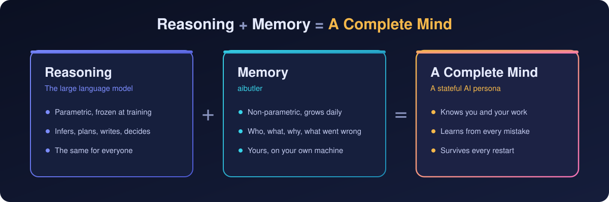
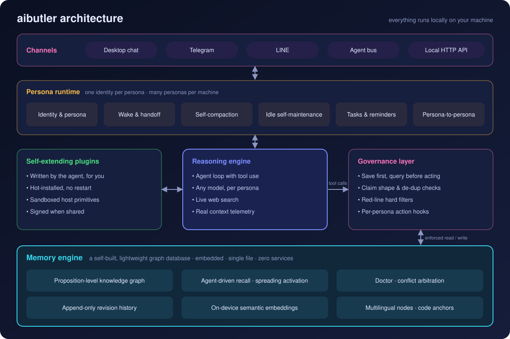
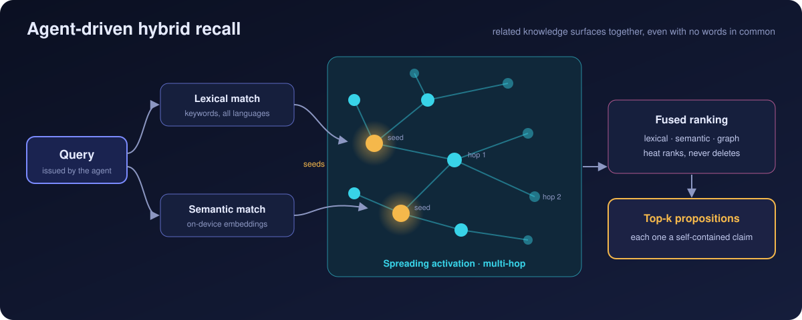
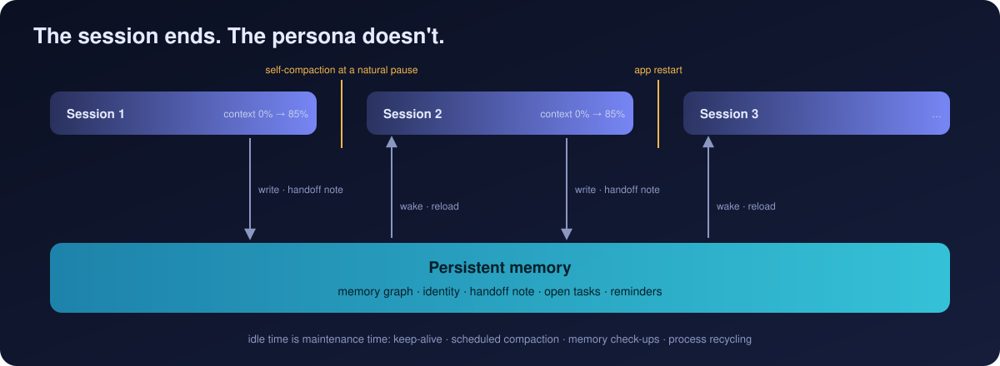
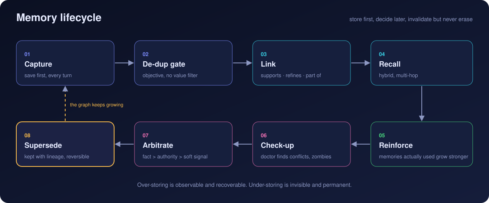
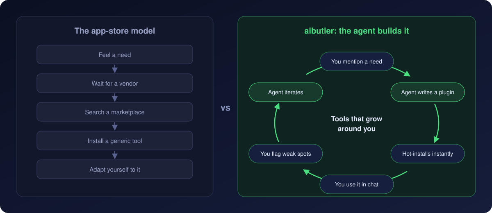

# aibutler

[English](README.md) · **简体中文**

[](https://github.com/fantasyxxj/aibutler/releases)
[](LICENSE)


> **推理已经解决，记忆是大脑缺失的另一半。**
>
> aibutler 是面向长期运行智能体的桌面运行时：每个 AI 人格都有自己的持久记忆、身份和工具，跨会话、跨上下文压缩、跨重启都接得上，和你共事越久越精准。

<p align="center"></p>

## 缘起

aibutler 起步于我自己的开发日常。最早是在 VS Code 里用官方的 AI 插件写代码，AI 帮了很大的忙，但用得越深，短板越明显：

- **记忆靠一份越写越长的文件。** 文件越来越臃肿，真正要用的那一条反而淹没在里面。
- **撑不住多项目、长时间的工作。** 会话一断、上下文一满，前面的来龙去脉就得重新交代一遍。
- **只能一问一答。** 它没法 7×24 小时自己连续干活，人一离开，事情就停了。

于是有了做这个工具的念头。我结合自己多年的开发经验，查阅了认知科学和智能体记忆方向的研究资料，一点点形成了现在这套思路：**把记忆当作和推理同等重要的另一半来设计**，让 AI 人格自己记、自己查、自己照看自己，能长期、连续地工作下去。

## 谁在用

目前有一个小规模的用户群在用这个工具：有人用它做软件项目开发，有人用它做量化交易，也有人把它当作私人教师。

其中用得最深的，除了我本人，是我上初中的孩子。他用它补习各科知识，也用它学各种兴趣，还把自己的 AI 人格叫作「老师」。

在和「老师」一来一回的互动里，孩子冒出来的想法很快就能得到回应。想练繁体字，「老师」就做了一个繁体字描红插件，类似的小工具还有不少。想象力能立刻变成手边能用的东西，这也是我们说「工具围绕用户生长」最直观的样子。

## 亮点

- **自研图记忆引擎**：嵌入式、单文件、数据全在本机；记忆单元是命题，召回三路融合（词面 · 本机语义向量 · 图上扩散激活）。
- **引擎强制的记忆治理**：先存后答、先查后办、红线硬拦，在工具调用层执行，不靠模型自觉。
- **持久身份**：上下文快满时人格自己压缩、写交接、醒来接着干；可整体导出搬到另一台机器。
- **AI 自造插件**：人格当场为你写带界面的小工具，热装即用，在沙箱里运行。
- **与模型无关**：自带 agent 引擎，官方 API、OpenAI 兼容端点、自建网关都能接，每个人格各选各的模型。
- **事件驱动，对接任何软件**：人格不只等你开口。脚本、定时任务、监控告警或其他系统发一个 `POST /v1/poke`，就能叫醒指定人格去处理；它先查记忆再动手，结论沉淀下来，下次同类事件来时已经知道怎么办。
- **多通道**：桌面、Telegram、LINE、智能体总线，你在哪里，人格就在哪里。

## 快速开始

1. 到 [Releases](https://github.com/fantasyxxj/aibutler/releases) 下载安装包：Apple Silicon 的 Mac 用 `arm64.dmg`，Intel 的 Mac 用 `x64.dmg`（都要 macOS 11 或更高），Windows 用 `setup.exe`。
2. 安装后打开，按引导创建第一个人格。
3. 在设置里选模型、填 API key，就可以开始对话。

想从源码跑，见 [从源码构建](#从源码构建)。

## 能拿来做什么

| | |
|---|---|
| **真正懂你的私人幕僚**<br>记得你的偏好、答应过的事和没收尾的线头，到点提醒、主动跟进；人不在电脑前，用 Telegram 也能找到它。 | **有「组织记忆」的编程搭档**<br>记得项目架构、每个老 bug 的根因、你教过它的每条规矩；代码锚点让它读一行就能重新核实一个事实。 |
| **会自己出题的私教**<br>跨月追踪你的薄弱点，针对这些点写出专项练习工具，随你的进步不断调整。 | **知识会复利的研究伙伴**<br>每个发现都沉淀成一条命题；矛盾会被摆出来仲裁，而不是悄悄堆在一起。 |
| **一张桌上的专家团队**<br>写手、分析师、审稿人，每个人格有独立的身份和记忆，彼此可以请教；跨机器则经智能体总线对话。 | **按需生长的个人工具**<br>记录器、清单、计算器、看板，说出你要什么，几分钟后它就做好放进你的工作台。 |

---

## 架构

<p align="center"></p>

| 层 | 目录 | 职责 |
|---|---|---|
| 内核 | `core/` | 图记忆引擎、记忆治理钩子、插件运行时与原语、命令分发 |
| 桌面端 | `personal/` | Electron 主进程与界面、人格管理、通道接入、本机接口、设置 |
| 推理层 | `agent-sdk/` | 自带的 agent 循环：工具调用、流式输出、钩子、多模型接入 |
| 工具 | `scripts/` | 构建、打包、插件打包与签名、记忆引擎测试 |

一轮对话的流向：消息从某个通道进来 → 人格先查记忆 → 推理并调用工具（每次调用都经过治理钩子）→ 结果和新结论落进记忆 → 从原通道回复。

## 核心：记忆引擎

### 1 · 自研轻量级图数据库引擎

内核是一套**我们自己设计和实现的轻量级图数据库引擎**，专为智能体记忆而生：嵌入式、单文件、不依赖任何外部服务，数据完全留在你的机器上。

- **命题级知识图。** 节点是命题，边是有类型的关系（支撑、细化、推翻……）。模式刻意保持轻量：零本体启动，图随工作自然生长。
- **以智能体主动召回为主。** 召回由人格自己发起：先理解问题，再决定查什么，没查到就换个说法再查。被动注入只给轻量提示。
- **混合排序。** 每次查询都把三路信号融合为一个排序：词面匹配、本机语义向量，以及沿图边的**多跳扩散激活**。即使与查询没有一个字相同，相关知识也会一起浮现。路线上与 HippoRAG（NeurIPS 2024）同属一族。
- **冲突检出与仲裁。** 内置的体检会找出疑似矛盾、僵尸项目和过期结论；裁决之后，输的一方被推翻，来龙去脉完整保留。
- **代码锚点。** 关于代码的命题挂着 `路径:行号`，核对一次只需读一行。
- **原生多语言。** 一个节点可以同时有多种语言的译文，检索时每种语言都参与打分，显示时按语言回落。
- **完整修订史。** 每次写入都是只追加的修订记录，任何内容都不会被悄悄覆盖。

<p align="center"></p>

### 2 · 引擎强制的记忆治理

多数智能体记忆系统是「请」模型去记。aibutler 在工具调用这一层**强制**执行：

- **先存。** 新的决定、事实、纠正，先落库再回话。
- **先查后办。** 执行特定动作之前，运行时要求人格先查阅自己的记忆。
- **命题必须是命题。** 写入时检查形状：可被证伪、挂到它该在的位置、与已有记忆查重。
- **红线是硬过滤。** 标为红线的规矩由执行前钩子直接拒绝。
- **动作钩子。** 每个人格自己维护一张映射：「要用这个工具了」对应「此刻你需要的那条记忆」。知识在动手的那一刻送达，而不是堆在越来越长的系统提示里。

### 3 · 持久身份与连续性

<p align="center"></p>

- **身份跨越压缩。** 上下文快满时，人格在自然停顿点自我压缩，写下交接记录，在新会话里醒来，线程完整接上。
- **空闲期自我维护。** 保活、定时压缩、记忆体检、进程回收都在后台进行。
- **一台机器，多个人格。** 每个人格有独立的身份、记忆和工具，人格之间可以直接互相请教。
- **可迁移。** 一个人格可以整体导出成一个文件，搬到另一台机器。

<p align="center"></p>

## 功能一览

| 类别 | 功能 |
|---|---|
| 记忆 | 命题图存储 · 三路融合召回 · 冲突仲裁 · 代码锚点 · 多语言节点 · 修订史 · 常驻规矩与红线 |
| 人格 | 多人格并存 · 独立身份与记忆 · 自我压缩与交接 · 人格之间互相请教 · 整体导出导入 |
| 推理 | 自带 agent 循环 · 每个人格自选模型与凭据 · 联网搜索 · 真实上下文用量 |
| 工作流 | 任务清单 · 定时提醒 · 动作钩子 · 后台自我维护 |
| 插件 | AI 自造插件 · 热装 · 沙箱原语 · 本机金库存密钥 · 外来插件验签 |
| 通道 | 桌面 · Telegram · LINE（经中继）· 智能体总线 · 本机 HTTP 接口 |
| 界面 | 对话里直接渲染表格、图表、流程图、公式、可点的表单控件 |

## 插件开发

插件是一个 JSON 包：自带界面（`html` / `css` / `js`）、命令声明和本地状态。人格会自己写，你也可以手写。最小的完整示例是出厂自带的计数器：[`core/config/plugins/counter.json`](core/config/plugins/counter.json)。

```json
{
  "type": "ui",
  "id": "counter",
  "version": "1.0.1",
  "title": "计数器",
  "commands": {
    "say": { "primitive": "speak", "summary": "把当前计数念出来",
             "params": { "text": { "required": true } } }
  },
  "html": "…", "css": "…", "js": "…"
}
```

- **放哪里**：放进数据目录下的 `packages.local/`，一个插件一个 `.json`，立即热装，自己写的插件不用签名。
- **两种形态**：单屏小工具 `ui`，多步引导流程 `workflow`。
- **沙箱**：界面跑在沙箱里，没有 `require` / `fetch` / `eval` / `localStorage`，只有一个 `butlerUI` 对象（`onInit` · `onPush` · `call` · `setState` · `resize`）。
- **原语**：命令只能落在一组固定原语上：`speak` `save_file` `state` `message` `db` `mail` `ai_access` `web` `secret` `record` `pron` `asset` `bus`。
- **本地媒体**：图片、音频、视频放进数据目录下的 `plugin-assets/<包id>/`，或用 `asset` 原语的 `pick` 让用户自己选文件。`url` 交回一个地址，填进界面自己的 ``、`<audio>`、`<video>` 就能显示和播放，大视频也能拖进度；插件拿不到文件路径，也读不到原始字节。
- **联网**：用 `web` 原语，包顶层写 `net` 域名白名单，名单外的主机在登记时就被拒绝；密钥用 `secret` 原语存进本机金库，插件拿不到原文。
- **和人格联动**：按钮可以把结构化结果送回人格；标注为 AI 可用的命令，人格可以直接调用。
- **分发**：从外部下发的插件必须先通过签名校验，见 `scripts/build-ui-package.js` 与 `scripts/sign-package.js`。

<p align="center"></p>

## 本机接口

在人格管理窗口里打开本机接口后，aibutler 只在 `127.0.0.1` 上监听（默认端口 8787）。脚本、定时器、监控告警，或者你自己的程序，发一个 POST 就能叫醒指定人格：

```bash
curl -X POST http://127.0.0.1:8787/v1/poke \
  -H 'Content-Type: application/json' \
  -d '{
    "persona": "研究员",
    "text": "CI 夜间构建失败，查一下原因并记下根因",
    "from": "ci-bot",
    "idempotency_key": "build-2041"
  }'
# → {"ok":true,"persona":"研究员","delivered":true}
```

| 字段 | 必填 | 说明 |
|---|---|---|
| `persona` | 是 | 要叫醒的人格名 |
| `text` | 是 | 交给它的消息 |
| `from` | 否 | 来源标记，人格会看到是谁发来的 |
| `idempotency_key` | 否 | 同一个 key 重复投递只生效一次 |

投递后立即返回，人格在后台处理。

## 从源码构建

需要 Node.js 20、22 或 24，推荐 22（仓库带 `.nvmrc`）。Node 26 暂不支持：Electron 33 的安装脚本在 Node 26 下解压失败，`npm start` 会报 `Electron failed to install correctly`。可以用 [n](https://github.com/tj/n) 或 nvm 切换版本：

```bash
n 22        # 或 nvm use
```

```bash
git clone https://github.com/fantasyxxj/aibutler.git
cd aibutler
npm install
npm run build:agent-sdk   # 构建自带的推理层
npm start                 # 开发模式启动
```

打包：

```bash
npm run dist:mac         # → release/*.dmg（本机架构）
npm run dist:mac:intel   # → release/*-x64-intel.dmg
npm run dist:win         # → release/*.exe
```

语音输入用本机的 whisper.cpp。官方安装包已经内置；从源码构建时，macOS 上先 `brew install whisper-cpp`，Windows 上首次使用会自动下载。

## 配置与数据

- **模型与凭据**：在设置里配置，每个人格可以单独选模型、端点和 key。
- **数据目录**：所有记忆、人格、插件都在本机。
  - macOS：`~/Library/Application Support/butler`
  - Windows：`%APPDATA%\butler`
  - 开发模式：`~/.butler-dev`，可用环境变量 `BUTLER_DATA_DIR` 指到别处
- **自写插件**：数据目录下的 `packages.local/`。

## 理论：命题级记忆

aibutler 建立在一套明确的长期智能体记忆理论之上。核心论点是：

> **长期运行的记忆系统，难点不在记住，而在如何对待已经记住的东西。**

记忆的基本单元是**命题**：一句原子化、上下文自足、可被证伪的结论，与 *Dense X Retrieval*（Chen et al., EMNLP 2024）对命题的判据一致。由此推出四项原则：

1. **先存后判。** 写入端不设价值过滤，只设客观的查重闸；「有没有用」的判断后移到读取端。
2. **提取强度低不等于没价值。** 依据 Bjork & Bjork 的新失用理论（1992），热度只用来排序，不用来删除。
3. **先分类冲突再裁决，事实优先。** 多数表面冲突是适用范围不同或时间演进；真冲突按证据层级裁决，**新的不一定对**。
4. **失效不删除。** 被推翻的记忆降权保留，并连到推翻它的那一条；来源模型与 W3C PROV-O 对齐。

召回机制有认知科学依据：图上联想召回用扩散激活（Collins & Loftus, 1975），用过的记忆得到强化则依据提取练习效应（Roediger & Karpicke, 2006）。

## 路线图

- 插件播放本地音频
- 更细粒度的记忆导出与导入
- 更多通道接入

## 参与贡献

欢迎提 Issue 和 Pull Request。提交较大的改动前，请先开一个 Issue 讲清楚想法，我们一起对齐方向。

## 许可证

[Apache License 2.0](LICENSE)

## 致谢与参考文献

- Lewis, P. et al. *Retrieval-Augmented Generation for Knowledge-Intensive NLP Tasks.* NeurIPS 2020.
- Chen, T. et al. *Dense X Retrieval: What Retrieval Granularity Should We Use?* EMNLP 2024.
- Gutiérrez, B. J. et al. *HippoRAG: Neurobiologically Inspired Long-Term Memory for Large Language Models.* NeurIPS 2024.
- Collins, A. M. & Loftus, E. F. *A Spreading-Activation Theory of Semantic Processing.* Psychological Review, 1975.
- Bjork, R. A. & Bjork, E. L. *A New Theory of Disuse and an Old Theory of Stimulus Fluctuation.* 1992.
- Roediger, H. L. & Karpicke, J. D. *Test-Enhanced Learning.* Psychological Science, 2006.
- W3C. *PROV-O: The PROV Ontology.* W3C Recommendation, 2013.
