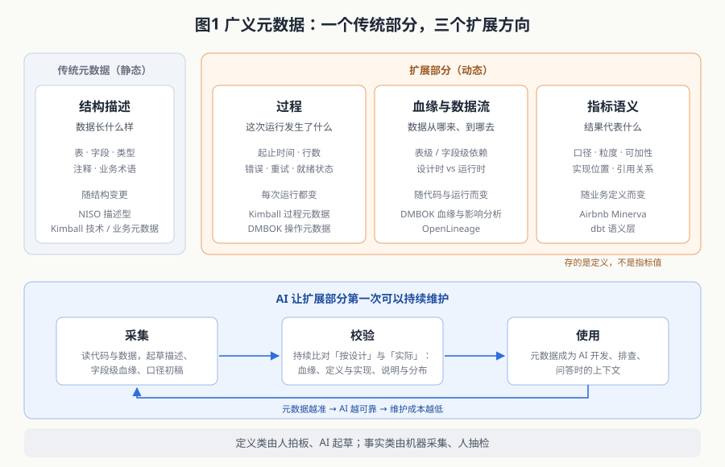
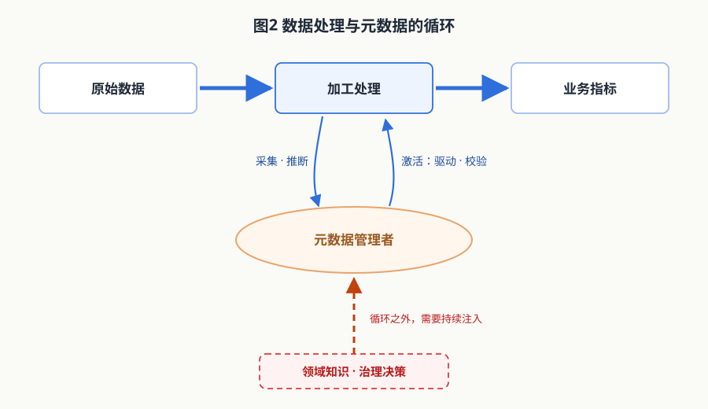

> 上一篇的结论是：工具决定数据能不能跑，元数据、模型、指标决定数对不对。这一篇从元数据讲起，提出一个扩展：广义元数据。

## 一、经典定义：数据的数据

元数据最常见的定义只有四个字：数据的数据。美国国家信息标准组织（NISO）的《Understanding Metadata》开篇就说：经典定义是字面的，来自这个词本身——元数据就是「关于数据的数据」（data about data）。NISO 把它分为三类：描述型（帮助找到、理解资源的内容信息）、结构型（资源各部分之间的关系）、管理型（管理资源所需的信息）。

在数据仓库领域，分类更贴近工程。Kimball 把数仓的元数据分成三类：

- **技术元数据**：定义构成数仓系统的对象和过程，例如表结构、字段类型、ETL 作业；
- **业务元数据**：用业务语言描述数仓里的内容——有什么数据、从哪里来、是什么意思、和其他数据什么关系；
- **过程元数据**：描述数仓各项操作的运行结果。

DAMA 的《数据管理知识体系指南》（DMBOK2）同样分三类，名称是业务、技术、操作。它对「数据的数据」这个定义的评价很直接：简单得具有误导性（misleadingly simple）。按 DMBOK 的说法，元数据还包括技术和业务流程、数据规则与约束、逻辑和物理结构。

几种权威分类放在一起看，有一个共同点：**理论上，元数据从来不只是「表和字段的说明」**。Kimball 的过程元数据、DMBOK 的操作元数据，描述的都是数据被加工、被访问时发生了什么；DMBOK 在技术和业务两类下都列入了数据血缘与影响分析。

但实践里，大多数元数据系统只做到了第一层：表名、字段名、类型、注释。它们是静态的，建表时写一次，之后很少有人更新。理论与实践之间的这道落差，就是本文要讨论的问题。

## 二、广义元数据：三个扩展方向

本文把「广义元数据」界定为：**描述数据本身、数据如何产生与流动、以及数据结果代表什么含义的全部机器可读信息**。相对传统的静态描述，它向三个方向扩展。

### 2.1 过程：每次运行发生了什么

作业什么时候开始、什么时候结束、读了多少行、写了多少行、有没有报错、有没有重试。Kimball Group 在 2014 年的一篇 Design Tip 里专门讨论过用过程元数据做数仓的自我监控，举的例子正是 ETL 的开始时间、结束时间、耗时、CPU 占用、输入与装载行数。DMBOK 的操作元数据也列出了批处理作业的运行日志、调度异常、审计与平衡控制结果、错误日志。

这类元数据回答的问题是：**这份数据此刻是不是完整的、可信的**。上一篇提到的「读到半成品」「上游晚到漏算」，在组件层看不出任何异常，只有过程元数据能暴露出来。

### 2.2 血缘与数据流：数据从哪里来、到哪里去

一张表由哪些表加工而来，一个字段由哪些字段计算而来，下游又有哪些表、哪些报表在用它。血缘回答两个方向的问题：往上追溯——这个数为什么是这样；往下推演——改了这里会影响谁。

血缘需要区分两种：

- **设计时血缘**：从 SQL 和作业定义里解析出来，表示「按代码应该怎么流」；
- **运行时血缘**：从每次实际运行中采集，表示「这一次实际怎么流的」。

两者不一定相同：同一份代码，分支条件不同、参数不同、某个上游这次没就绪，实际流向就会不同。开源标准 OpenLineage（2021 年加入 Linux 基金会旗下的 LF AI & Data，现为毕业项目）把后者标准化了：它的定位是「在作业运行时采集元数据和血缘的开放标准」，模型由作业（Job）、运行（Run）、数据集（Dataset）三类对象组成，每次运行的状态事件都可以携带本次读写的输入和输出数据集。血缘由此从「人画的图」变成「系统自动上报的流水」。

### 2.3 指标语义：结果代表什么

一个指标在什么粒度上计算、分子分母各是什么、能不能跨维度相加、由哪张表的哪段逻辑实现、被哪些报表引用。上一篇开头那个「上周平均日活」的错误，根源就是这一层缺失。

业界的做法是把指标定义从散落各处的 SQL 里抽出来集中管理。Airbnb 在 2021 年公开的指标平台 Minerva，出发点是「定义一次，处处使用」（define metrics once, use them everywhere），作为分析、报表和实验的唯一事实来源；dbt 的语义层也以集中定义指标为核心——指标定义在一处修改，所有调用它的地方随之更新。

这里需要分清一个概念：**进入元数据的是指标的定义，不是指标的值**。「日活」这个指标在某天是多少，那是数据；「日活」按什么口径计算、在什么粒度上去重、能不能跨渠道相加，这才是元数据。把指标的值也当成元数据，会让元数据系统变成又一个数据仓库，失去意义。

### 2.4 四个部分放在一起

| 部分 | 回答的问题 | 典型内容 | 变化频率 | 理论出处 |
|---|---|---|---|---|
| 结构描述 | 数据长什么样 | 表、字段、类型、注释、业务术语 | 随结构变更 | NISO 描述型；Kimball 技术与业务元数据 |
| 过程 | 这次运行发生了什么 | 起止时间、行数、错误、重试、就绪状态 | 每次运行 | Kimball 过程元数据；DMBOK 操作元数据 |
| 血缘与数据流 | 数据从哪来、到哪去 | 表级与字段级依赖、设计时与运行时血缘 | 随代码与运行 | DMBOK 血缘与影响分析；OpenLineage |
| 指标语义 | 结果代表什么 | 口径、粒度、可加性、实现位置、引用关系 | 随业务定义 | Minerva；dbt 语义层 |

第一部分是传统意义上的元数据，后三部分是扩展。要强调的是，这三个方向都不是凭空提出的，每一个在权威体系里都有位置；广义元数据的主张在于：**把它们当作一个整体来建设和管理，而不是分散在调度系统、日志、文档和个人记忆里**。

## 三、为什么过去管不起来

既然理论早已覆盖，为什么实践中扩展部分大多停留在纸面上？原因不在认识，而在维护方式。

### 3.1 人工维护的三个结构性问题

**第一，写和改是分离的。** 代码改了，说明文档要另找时间改；口径调了，指标说明要另外通知。两个动作之间只要有一次没跟上，元数据就开始和事实不一致。

**第二，规模随业务线性增长。** 结构描述还勉强能跟上，因为表和字段的数量有限；但运行记录每天成千上万条，依赖关系是一张随表数量增长的图，指标定义随业务不断增加。这些已经不是人能逐条维护的量级。

**第三，变化是持续的。** 过程元数据每次运行都在变，血缘随每次代码发布在变，指标口径随业务调整在变。人工维护注定滞后。

这三点叠加，会形成一个负循环：元数据不准 → 没人敢用 → 没人用就更没人维护 → 更不准。最终元数据系统变成一个「建好了但没人看」的目录。一个常见的现象是：指标库里大多数条目是自动扫表生成的占位记录，只有一小部分经过人工确认口径，其余的实体、事件归属靠批量猜测填写，互相对不上。

### 3.2 一个反例：从人工登记到自动采集

Google 在 SIGMOD 2016 发表的 GOODS 系统给出了另一条路。面对公司内部海量数据集，它没有要求工程师去登记元数据，而是「在数据集被各种流水线创建、访问或更新之后，事后收集并汇总元数据」，并且「在后台以非侵入的方式运行」，自动推断数据集的属主、结构和来源。

这个思路的意义在于：**元数据的可维护性，取决于它能在多大程度上脱离人工填写**。能从运行中自动采集的，就不应该让人填。

## 四、AI 改变了什么

过程元数据和运行时血缘，借助工程手段（运行日志、OpenLineage 这类事件上报）已经可以自动采集。真正卡住的，是需要「理解」才能产出的部分：字段的业务含义、SQL 背后的口径、两个指标定义之间是否矛盾、代码变更对下游意味着什么。这些过去只能靠人，现在 AI 可以承担很大一部分。具体体现在三个环节。

### 4.1 采集：从人工填写到自动生成

大语言模型可以读 SQL、读代码、读样例数据，生成表和字段的描述，解析出字段级血缘，从计算逻辑反推出指标口径的初稿。2025 年的一项研究用检索增强的大模型为数据目录生成表和字段描述，87%～88% 的结果被数据管理员直接采纳或只做少量修改。

这个数字同时说明了两件事：AI 已经能承担大部分起草工作；剩下的一成多仍然需要人判断。

### 4.2 校验：持续比对设计与实际

Gartner 在 2021 年发布的《主动元数据管理市场指南》中，把主动元数据界定为：对用户、数据管理、系统与基础设施、数据治理等各方面实际情况的持续分析，用以判断数据「按设计应当如何」与「实际如何」之间的一致与例外。

这正是 AI 擅长的工作：持续地拿设计时血缘对照运行时血缘，拿指标定义对照实现代码，拿字段说明对照实际数据分布，发现不一致就提示。过去靠人定期巡检做不到的频率和覆盖面，现在可以做到。

### 4.3 使用：元数据成为 AI 的上下文

上一篇引用过一项研究：同样的业务问题，大模型直接对着 SQL 库回答，准确率约 16%；基于带业务语义的知识图谱回答，升到约 54%。模型没变，变的是语义有没有被说清楚。

这构成一个循环：AI 帮助生产和校验元数据，元数据又反过来成为 AI 完成开发、排查、问答任务的上下文。元数据越完整准确，AI 越可靠；AI 越可靠，维护元数据的成本越低。

### 4.4 循环的缺口：提取规则从哪里来

把前三个环节合起来看，数据处理与元数据之间构成一个循环。主线上，原始数据经过加工处理，成为业务指标；加工处理的过程中，元数据管理者从代码、作业和运行记录里采集和推断元数据；元数据又被激活，反过来驱动加工、校验结果。这里的「管理者」泛指承担元数据生产的一方，可以是人、程序，也可以是 AI。

这个结构在自治计算领域有现成的模型。Kephart 与 Chess 在 2003 年提出自治计算的构想：受管资源由一个自治管理器照看，按「监控、分析、规划、执行」循环运转，各步共享一个知识库，即 MAPE-K 闭环。系统之所以能自我管理，前提是管理员给定了高层目标。对应到这里，加工处理是受管资源，元数据管理者是自治管理器，而目标和知识，来自循环之外。

这个循环看上去可以自我运转，实际上缺一个输入。采集和推断不是自然发生的：提取什么、从哪里提取、按什么规则解析，都要事先写成程序固定下来。以字段级血缘为例，OpenLineage 通过遍历 Spark 的逻辑执行计划收集输入和输出字段；其官方说明，这一能力主要覆盖 Spark SQL 和 Data Source V2，不经过表的 DataFrame 写入不在覆盖范围之内。运行时拼接的 SQL、自定义函数，也会让字段级解析残缺。

规则一旦固定，就会落后于变化。Lehman 的软件演化定律中，第一条「持续变更律」指出：在真实环境中使用的系统必须持续适配，否则会变得越来越不令人满意。提取规则正是这样的系统，变化至少来自三个方向：

1. **数据的依赖条件在变**。新增数据源，上游口径调整，分区方式或就绪时间改变，原来正确的提取结果随之失效。
2. **代码的写法在变**。换计算引擎，换开发框架，SQL 改由程序生成，原有的解析规则可能直接识别不了。
3. **业务对元数据的要求在变**。新指标需要新的属性和校验，这些在提取规则编写时并不存在。

Sculley 等人在分析机器学习系统的技术债时指出，依赖不稳定的数据来源，上游代码的任何改动都可能让下游出错。元数据的提取逻辑面临同样的处境：它依赖的对象在持续变化，它自己却不会跟着变。

因此，提取规则的升级、新口径的确定、定义冲突的裁决，都无法在循环内部完成，需要从外部持续注入领域知识和治理决策。专家系统的奠基人 Feigenbaum 在 1977 年就指出，智能系统的能力主要来自它所掌握的领域知识，而不是推理机制本身；而把专家知识形式化，恰恰是最慢、最难的一步，他称之为「知识获取瓶颈」。历史元数据再完整，记录的也只是过去的结论，推不出新业务所需的元数据。

过去，这部分外部输入由资深工程师提供，元数据难以持续维护，很大程度上正是因为这样的人力稀缺。把管理者换成 AI，问题依然存在：只读取已发布元数据的 AI，掌握的只是**公共知识**，即对所有使用者都一致的那部分；要持续产出正确的元数据，它还需要关于这个组织的**私有知识**：业务如何运转，口径为什么这样定，冲突由谁裁决。私有知识如何获取和积累，本系列将另文讨论。

### 4.5 前提与边界

AI 让广义元数据「可以管理」，但不是「自动正确」。有三个前提：

1. **元数据必须结构化、机器可读**。散在 Wiki、聊天记录和代码注释里的知识，AI 能读到，但无法稳定地校验和复用。
2. **定义类元数据由人决定，AI 辅助**。指标口径是业务决策，不是技术推断。AI 可以起草、比对、提示矛盾，但「日活按什么口径算」必须由负责人确认。
3. **采集类元数据由机器产出，人抽检**。过程、血缘这类事实性元数据，应当尽量由系统自动产出，人负责抽检和处理异常，而不是反过来。

## 五、方法：建设广义元数据的五条原则

1. **单一事实来源**：规则、口径、映射只在元数据里定义一处，代码从元数据读取或由元数据生成，而不是代码里写一份、文档里再写一份。
2. **能自动采集的不手填**：过程元数据和运行时血缘从作业运行中自动上报；结构描述从库表元信息同步。
3. **定义与实现挂钩**：每个指标定义都要能指向它的实现位置，每段实现都要能回指它对应的定义；只有定义没有实现，或只有实现没有定义，都是缺陷。
4. **设计与实际持续比对**：设计时血缘对运行时血缘、定义对实现、说明对数据分布，持续比对，差异即告警。
5. **人机分工明确**：定义类由人拍板、AI 起草；事实类由机器采集、人抽检；所有 AI 产出在确认前标记为待确认状态，不与已确认内容混用。

## 六、结语

元数据的经典定义是「数据的数据」，而权威理论早已把过程、血缘和语义纳入其中。过去这些扩展部分管不起来，不是因为不重要，而是因为规模大、变化快、只能靠人维护，准确率注定衰减，最终没人敢用。

AI 改变的正是这一点：它让需要「理解」才能产出和校验的元数据，第一次有了可持续维护的方式。广义元数据从一个正确但难以落地的理念，变成了可以建设的工程对象。

但数据处理与元数据之间的循环并不能自我完善：提取规则会落后于数据、代码和业务的变化，需要外部持续注入业务知识和决策。让 AI 承担这部分输入，前提是它掌握组织的私有知识，这是下一步要讨论的问题。

这个系列会持续更新。

## 参考资料

1. Jenn Riley. [*Understanding Metadata: What is Metadata, and What is it For?*](https://www.niso.org/publications/understanding-metadata-2017) NISO, 2017.
2. Kimball Group. [Technical DW/BI System Architecture](https://www.kimballgroup.com/data-warehouse-business-intelligence-resources/kimball-techniques/kimball-dw-bi-lifecycle-method/technical-dw-bi-system-architecture/).
3. Bob Becker. [Design Tip #170: Leverage Process Metadata for Self-Monitoring DW Operations](https://www.kimballgroup.com/2014/11/design-tip-170-leverage-process-metadata-self-monitoring-dw-operations/). Kimball Group, 2014.
4. DAMA International. *DAMA-DMBOK: Data Management Body of Knowledge*, 2nd Edition, Chapter 12 Metadata Management. Technics Publications, 2017.（[DAMA 官网介绍](https://www.dama.org/cpages/body-of-knowledge)）
5. OpenLineage. [Object Model](https://openlineage.io/docs/spec/object-model)；LF AI & Data. [OpenLineage joins LF AI & Data as new Sandbox project](https://lfaidata.foundation/blog/2021/07/22/openlineage-joins-lf-ai-data-as-new-sandbox-project/), 2021.
6. Airbnb Engineering. [How Airbnb Achieved Metric Consistency at Scale (Minerva Part I)](https://medium.com/airbnb-engineering/how-airbnb-achieved-metric-consistency-at-scale-f23cc53dea70), 2021.
7. dbt Labs. [dbt Semantic Layer documentation](https://docs.getdbt.com/docs/use-dbt-semantic-layer/dbt-sl).
8. A. Halevy et al. [Goods: Organizing Google's Datasets](https://research.google/pubs/goods-organizing-googles-datasets/). SIGMOD 2016.
9. Gartner. Market Guide for Active Metadata Management, 2021.
10. Singh et al. Leveraging Retrieval Augmented Generative LLMs For Automated Metadata Description Generation to Enhance Data Catalogs. [arXiv:2503.09003](https://arxiv.org/abs/2503.09003), 2025.
11. J. Sequeda, D. Allemang, B. Jacob. A Benchmark to Understand the Role of Knowledge Graphs on Large Language Model's Accuracy for Question Answering on Enterprise SQL Databases. [arXiv:2311.07509](https://arxiv.org/abs/2311.07509), 2023.
12. Michael Robinson. [The Current State of Column-level Lineage](https://openlineage.io/blog/column-lineage/). OpenLineage Blog, 2022.
13. D. Sculley et al. [Hidden Technical Debt in Machine Learning Systems](https://papers.nips.cc/paper/5656-hidden-technical-debt-in-machine-learning-systems). NeurIPS 2015.
14. J. O. Kephart, D. M. Chess. [The Vision of Autonomic Computing](https://doi.org/10.1109/MC.2003.1160055). IEEE Computer, 36(1): 41–50, 2003.
15. M. M. Lehman. [Programs, Life Cycles, and Laws of Software Evolution](https://doi.org/10.1109/PROC.1980.11805). Proceedings of the IEEE, 68(9), 1980.
16. E. A. Feigenbaum. The Art of Artificial Intelligence: [Themes and Case Studies of Knowledge Engineering](https://www.ijcai.org/Proceedings/77-2/Papers/092.pdf). IJCAI, 1977.
