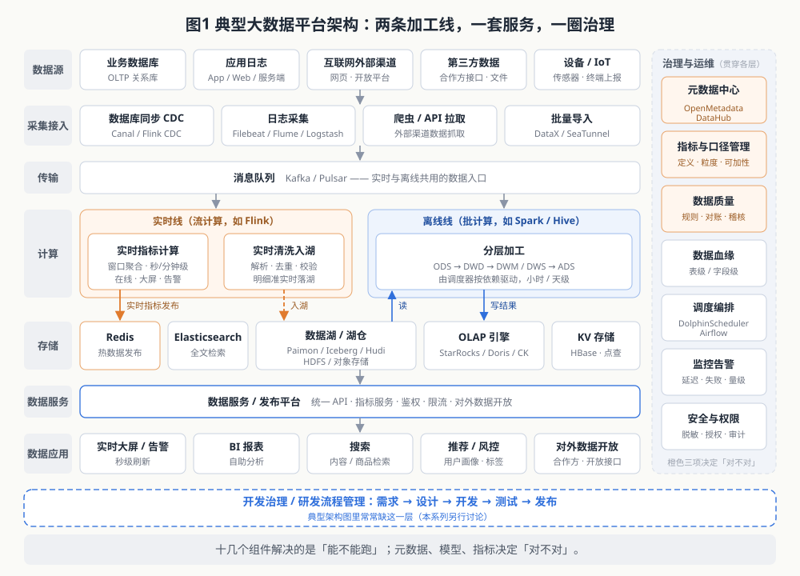
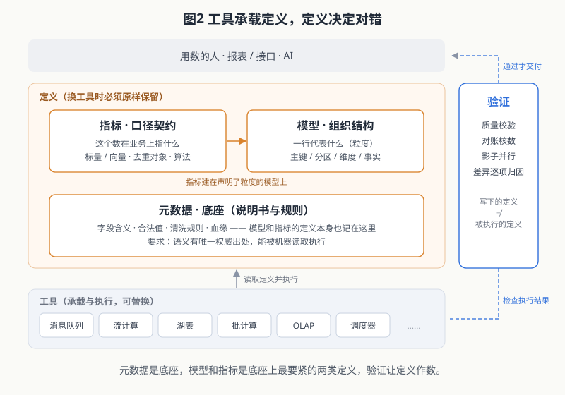
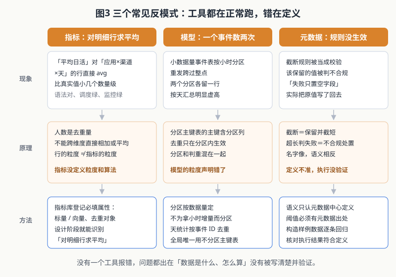
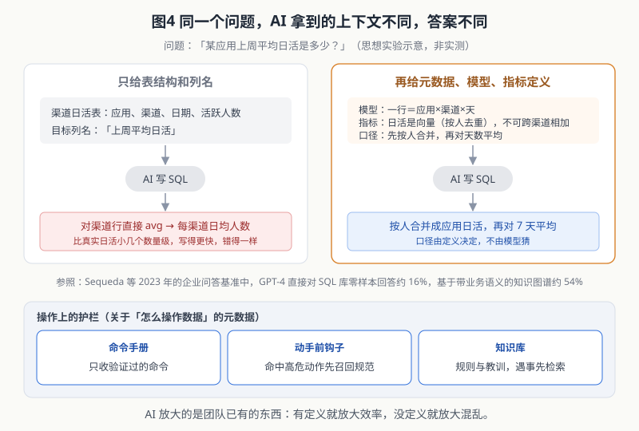

> 系列开篇。这个系列讨论大数据开发与管理的方法论、实践和方向。第一篇讲一个判断：大数据的地基是什么。

## 一、一个典型现象

先看一种很常见的错误。

报表上有一列「上周平均日活」，字段注释这么写，接口文档这么写，页面上它和「日活」「周活」「月活」并排展示。底层读的是一张「应用 × 渠道 × 天」粒度的渠道日活表，SQL 直接对上周所有行求平均。

算出来的是「每个渠道每天平均多少人」，不是「应用每天平均多少人」。渠道越多，这个数离真实日活越远，差出几个数量级并不罕见。正确的算法是先把每天各渠道的活跃用户按人合并成应用日活（人数不能跨渠道直接相加，同一个人可能出现在多个渠道），再对 7 天求平均。

这类错误的特点是：SQL 没有语法错误，调度每天准点成功，监控一片绿，可以长期没人察觉。名字起对了，算法写错了，而名字恰好让所有人放了心。

没有任何一个工具出错。出错的是：这个指标从来没有被定义过——在什么粒度上算、数的是人还是行、能不能跨渠道相加——全凭写 SQL 的人当场理解。

## 二、典型架构：工具两只手数不过来

一个典型的大数据平台，自上而下大致分六层。数据源有业务数据库、应用日志、互联网等外部渠道、第三方数据、设备上报；采集接入层用 CDC 同步数据库变更，用日志采集器收日志，用爬虫或开放 API 从外部渠道拉数据，再加上批量导入工具；采集来的数据先进入消息队列（Kafka、Pulsar 等），作为实时和离线共用的入口。

从消息队列往下分成两条加工线。实时线用流计算（如 Flink）：一路做实时指标计算，按窗口聚合出秒级、分钟级的指标，直接发布到 Redis 或 OLAP，供实时大屏和告警使用；另一路做实时清洗，把解析、去重、校验后的明细准实时写进数据湖（Paimon、Iceberg、Hudi 等，底层是 HDFS 或对象存储）。离线线用批计算（如 Spark、Hive），在调度器驱动下从湖里读数据，逐层加工出 ODS / DWD / DWM / DWS / ADS，结果写入 OLAP 引擎（StarRocks、Doris、ClickHouse 等）。

存储层除了湖和 OLAP，通常还有 Redis 放热数据、做低延迟发布，Elasticsearch 做全文检索，HBase 这类 KV 存储做明细点查和 ID 映射。这些数据再经由数据服务 / 发布平台统一对外：统一 API、指标服务、鉴权限流，以及对合作方的数据开放；最上面才是 BI 报表、实时大屏、搜索、推荐风控这些应用。

旁边还有贯穿各层的一圈：元数据中心（OpenMetadata、DataHub 等，表的登记通常落在 Hive Metastore）、指标与口径管理、数据质量、数据血缘，再加上调度编排、监控告警、安全与权限。

### 2.1 复杂在哪：三个层面

这张图的复杂不是一种复杂。把它拆开，至少有三个层面，每个层面回答的问题、需要的知识、出错时的表现都不一样：

| 层面 | 回答的问题 | 需要的知识 | 这些知识在哪里 | 出错时的表现 |
|---|---|---|---|---|
| 组件层 | 能不能跑 | 各组件的配置、接口、运维 | 官方文档、社区，公开且通用 | 任务失败、报错、告警 |
| 数据流层 | 数据怎么走 | 来源、加工层次、表间依赖、就绪顺序 | 散落在代码、调度配置和个人经验里 | 读到半成品、上游晚到漏算，任务照常成功 |
| 语义层 | 结果对不对 | 粒度、口径、可加性、下游引用关系 | 大多只在写 SQL 的人脑子里 | 数字错了，但没有任何报错 |

搭积木解决的是组件层。这一层是一切的前提——组件不通，后两层无从谈起，所以选型、部署、调通本身并没有问题。问题在于，大部分学习时间停在了这一层，而开头那张报表的错误出在语义层：调度准点、监控全绿，组件层挑不出任何毛病。组件层做得再好，回答的也只是「能不能跑」。

### 2.2 为什么靠人记不住

后两层的知识有三个特点，决定了它们不可能长期靠人脑维护：

1. **规模随业务线性增长**。组件也就二十来个，但表、字段、依赖边和指标会随业务增长到成千上万；任何一次改动都要求知道它影响了哪些下游，这是一个图上的推理问题，不是记忆问题。
2. **组织私有，没有公共文档**。组件层的知识可以搜到，数据流和口径只属于这一家，写下来之前只存在于少数人的记忆里，人走了就跟着走了。
3. **持续变化**。组件会换代，链路随需求增减，口径随业务调整。三层同时在变，昨天正确的认知今天就可能过时。

所以，问题不是「人够不够努力」，而是这类知识的形态——规模大、私有、易变、需要推理——本来就不适合放在人脑里。

### 2.3 出路：把知识从人脑里搬出来

唯一可行的办法，是把后两层知识显式化，变成机器可读、可检索、可校验的东西：数据流层落成血缘和依赖元数据，语义层落成数据模型和指标定义。

这一步同时解决两件事。第一，它是判断「对不对」的依据：没有写下来的口径，就没有可以对照的标准。第二，它是 AI 能参与的前提：AI 擅长在大规模结构化知识上做检索和推理，恰好补上人脑在规模和变化上的短板，但它只能基于被写下来的部分工作，没写下来的，它和新人一样一无所知。第五节会回到这一点。

图上还有一层值得一提：开发治理，也就是需求、设计、开发、测试、发布这套研发流程怎么被管住。上面这些知识什么时候写下、由谁写、改动时如何同步，本质上都是开发治理的问题。典型架构图里常常缺这一层，本系列会单独讨论。

最后，三个层面的变化速度不同。组件层的知识会过时，工具换了一轮又一轮，这是常态；但数据的血缘、指标的口径必须跨越工具换代保持稳定，不能跟着变。这几样不能变的东西，就是本文要讨论的。

## 三、「对不对」由什么决定

### 3.1 理论怎么划分

DAMA 国际的《数据管理知识体系指南》（DMBOK2）把数据管理分成 11 个知识领域，数据治理居中，其余 10 个围成一圈：数据架构、数据建模与设计、数据存储与运营、数据安全、数据集成与互操作、文档与内容管理、参考数据与主数据、数据仓库与商务智能、元数据管理、数据质量。

把典型架构里的工具往这张图上放，大部分落在「存储与运营」「集成与互操作」两格。建模、元数据、质量，没有一格能靠装一个软件解决。

数据模型这边，Kimball 的维度建模设计分四步：选择业务过程、声明粒度、确定维度、确定事实。他的原话是：声明粒度是维度设计中最关键的一步，粒度确切规定了事实表的一行代表什么。Inmon 一派主张先建规范化的企业级仓库，和 Kimball 争了多年，但在「先说清数据代表什么再建表」上没有分歧。

指标这边，业界是被问题逼出来的。Airbnb 介绍过他们的指标平台 Minerva，出发点就是同一个指标在不同报表里数不一样；之后 dbt Semantic Layer 这类「指标层 / 语义层」产品相继出现，思路都是指标只定义一次、到处复用。headless BI 说的也是这件事：把口径从报表工具里剥出来，成为独立的一层。

元数据这边，Gartner 在 2021 年停掉了元数据管理的魔力象限，改发《主动元数据管理市场指南》，强调元数据要被持续访问和处理、去驱动其他系统，而不只是给人翻的目录。数据契约（data contract，可参考 Andrew Jones 2023 年的专著）把同样的意思推到生产方：字段结构、含义、质量要求写成生产方和消费方之间可以被机器校验的约定。

### 3.2 「元数据、指标、模型」这个提法成立吗

常听到一种说法：元数据、指标、数据模型是最基础的三样，像承重墙。对照上面的理论，我的结论是：大方向对，需要补两点。

**第一，三者不是并列的三根柱子，而是有依赖关系。** 严格说，模型定义和指标口径本身也属于元数据（DMBOK 里的业务元数据就包括术语定义和计算规则）。之所以单独拎出来，是因为三者出错的方式不同、负责的人不同：

- **元数据**回答「每个字段是什么、合法值长什么样、不合规怎么处理」，是数据的说明书和规则；
- **模型**回答「一行代表什么、按什么切分、靠什么判重」，是数据的组织结构，核心是粒度；
- **指标**回答「这个数在业务上指什么、怎么从模型上算出来」，是对用数人的口径契约。

指标建在粒度清楚的模型上，模型的字段要有元数据说明。开头那张报表，就是指标没落到正确的粒度上。

**第二，少了一个闭环：验证。** DMBOK 把数据质量单列一个领域有它的道理：写下来的定义和被执行的定义可能是两回事。Gartner 讲「主动」、数据契约讲「可校验」，指向同一件事：定义要能被机器执行和检查，否则只是一份文档。

所以我更愿意这样表述：**元数据是底座，模型和指标是底座上最要紧的两类定义，验证让定义作数；工具负责承载和执行它们。**

至于「承重墙」这个比喻，有一个更好用的判据：**迁移**。迁移应当坚持一条原则：只换数据源，口径一个字不改；新数据源支持不了原口径，就说做不到、去补数据源，而不是拿近似值凑。凑出来的数能跑、量级也对，但已经是另一个指标，等于悄悄换掉了用数人在看的数。

能换的是工具，不能换的是口径、粒度、清洗规则。**换工具时必须原样保留的东西，才是地基。**

## 四、三个常见反模式：现象、原理、方法

### 4.1 指标：对明细行求平均

**现象**：就是开头那张报表。「平均日活」「人均时长」这类指标，直接对某张中间表的行做 `avg` 或 `sum`。

**原理**：人数是去重量，不能跨维度直接相加或平均；中间表每一行的粒度，未必是指标要求的粒度。

**方法**：让指标带上机器可读的属性。在指标库里，把一个指标是「标量」（可直接相加，如金额、次数）还是「向量」（去重人数这类集合，必须先合并再计数）、按什么对象去重，作为必填项登记。有了这两个属性，「对渠道行求平均」在设计阶段就能被识别出来，而不是上线后靠人眼发现。

### 4.2 模型：小表按小时分区，一个事件被数两次

**现象**：下单、消耗这类数据量不大的事件表，跟大表一样按小时分区，主键里带着小时。客户端没收到确认会重发，重发落在下一个整点之后，就进了另一个小时分区。按天汇总时，笔数明显虚高，重发越频繁的事件偏得越多。

**原理**：湖表和 OLAP 的分区主键表，主键通常必须包含分区列，去重也只在分区内生效。主键里放了小时，等于在模型上声明「跨小时的同一事件算两件事」——分区（物理组织）和判重（业务语义）被混在了一起。工具没错，它严格执行了给它的主键。

**方法**：**分区按数据量定，不为拿小时增量而分区。** 小表用天分区；天粒度统计一律按事件 ID 去重；确实需要全局唯一时，用不分区的主键表，或在查询侧按业务键判重。这就是 Kimball 说的「声明粒度」：一行代表一次事件，判重就必须在事件粒度上完成。

### 4.3 元数据：规则配了，不等于执行了

**现象一**：清洗规则里常有两类名字很像的规则——「截断规则」（超长就截到 N 个字符，数据保留）和「超长判失败规则」（超过 N 判为不合规，再按配置整行丢弃或只把字段置空）。两者语义正好相反。补数或修复脚本把截断当成校验，该保留的值被判不合规，产出一批错误数据。

**现象二**：规则定义是「失败时只置空字段」，引擎实现里先把字段置空，后面又把原值写了回去。规则说置空，实际保留原值，只多出一条脏数据记录。

**原理**：元数据要起作用，得同时满足两个条件：语义有唯一、准确的定义，并且执行结果与定义一致。只配不验，比没有规则更糟：所有人都以为有。

**方法**：规则语义只认元数据中心里的定义说明，不认脚本注释，不凭印象；脚本里出现的阈值必须能在元数据里找到出处；对清洗引擎做规则级的回归核对——构造超长、非法、缺失的样例数据，逐条核对输出是否符合定义。

## 五、AI 时代：它放大的是你已经有的东西

AI 已经大量进入数据开发和运维：写 SQL、审代码、补数、排查问题。

AI 写 SQL 很强，但它对口径的理解只能来自你给它的东西。2023 年 Sequeda 等人做过一个企业问答基准：GPT-4 直接对着 SQL 库零样本回答业务问题，准确率约 16%；同样的问题改为基于知识图谱（带业务语义的数据表示）回答，升到约 54%。模型没变，变的是语义有没有被说清楚。

把开头那张渠道日活表和「上周平均日活」这个列名交给 AI，它大概率写出一模一样的 `avg`，而且更快。没有指标定义，AI 只会更高效地复制错误。

操作上也一样。两种常见的反模式：让 AI 不先检查集群健康，就在生产查询库上做整天重算，把查询库压垮；让 AI 单独重跑一张按天累积的表中间某一天，当天增量被重复累加，行数不变、不报错，事后很难发现。

兜底的办法有三类：命令手册只收验证过的命令；动手前加钩子，命中「重跑累积表」「大范围重算」这类高危动作时强制先召回对应规范；把规则和教训存进可检索的知识库，遇到同类问题先查。这三样本身也是元数据——关于「怎么操作数据」的元数据。

结论很直接：**AI 会放大有元数据、有口径、有模型的团队的效率，也会放大没有这些的团队的混乱。**

## 六、结语

工具决定数据能不能跑起来，元数据、模型、指标决定跑出来的数对不对。工具可以换，这三样不能乱。

这个系列会持续更新，沿着元数据、模型、指标、开发治理和 AI 协作几条线往下写。

---

**参考资料**

- DAMA International. *DAMA-DMBOK: Data Management Body of Knowledge*, 2nd Edition. Technics Publications, 2017.
- Ralph Kimball, Margy Ross. *The Data Warehouse Toolkit*, 3rd Edition. Wiley, 2013；Kimball Group：[Four-Step Dimensional Design Process](https://www.kimballgroup.com/data-warehouse-business-intelligence-resources/kimball-techniques/dimensional-modeling-techniques/four-4-step-design-process/)、[Grain](https://www.kimballgroup.com/data-warehouse-business-intelligence-resources/kimball-techniques/dimensional-modeling-techniques/grain/)
- W. H. Inmon. *Building the Data Warehouse*. Wiley, 1992 初版.
- Airbnb Engineering. [How Airbnb Achieved Metric Consistency at Scale](https://medium.com/airbnb-engineering/how-airbnb-achieved-metric-consistency-at-scale-f23cc53dea70), 2021.
- Gartner. Market Guide for Active Metadata Management, 2021.
- Andrew Jones. *Driving Data Quality with Data Contracts*. Packt, 2023.
- Juan Sequeda, Dean Allemang, Bryon Jacob. [A Benchmark to Understand the Role of Knowledge Graphs on Large Language Model's Accuracy for Question Answering on Enterprise SQL Databases](https://arxiv.org/abs/2311.07509), 2023.
