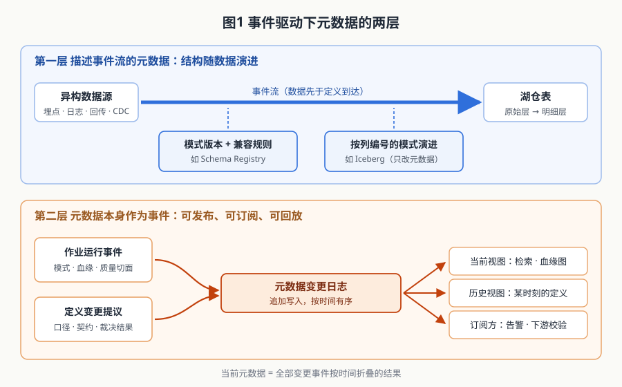
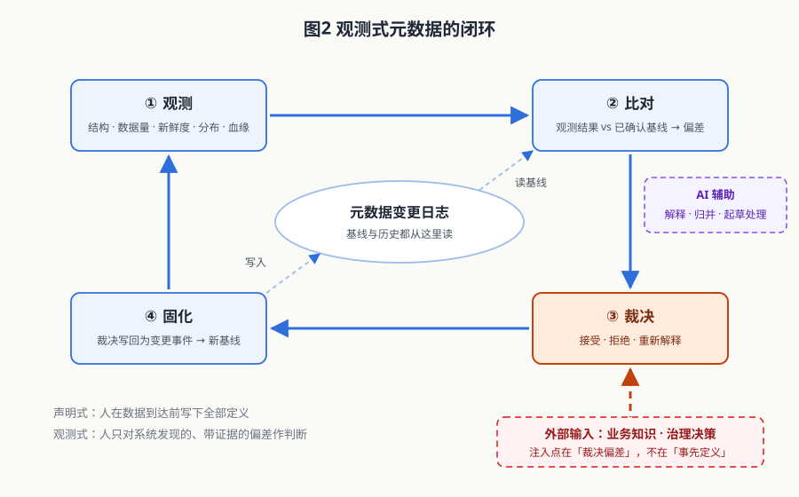

> 上一篇的结论是：数据处理与元数据之间的循环不能自我完善。提取规则一旦写成程序固定下来，就会落后于数据、代码和业务的变化。这一篇讨论这个缺口的一种解法：元数据从「事先声明」走向「持续观测」，并回答随之而来的问题：零散到达的裁决结果存在哪里，怎样被召回。

## 一、声明式元数据和它的前提

传统数仓的元数据是声明出来的。先建表，定字段和类型，写注释，然后才有数据写进来。写入时校验结构，不符合就拒绝，这就是通常说的「写时模式」（schema-on-write）。

Delta Lake 的设计者在介绍模式强制（schema enforcement）时打过一个比方：它像一家只接受预订的餐厅前台，逐个核对来客是否在名单上，不在的一律挡在门外[1]。定义在前、数据在后，定义就是门槛。

这套做法隐含三个前提：

1. **数据来源少且稳定**。主要来自业务数据库，表结构由同一批人设计；
2. **结构变化慢**。一张表的字段几个月才调整一次，每次调整都有评审；
3. **变化可控**。改结构的人和用数据的人在同一个流程里，先改定义，再改数据。

在这三个前提下，「先声明」成本很低，也最可靠：元数据就是设计文档，设计文档就是事实。

## 二、前提在接入层失效

实时、异构的数据入湖，把这三个前提逐一打破。

一个典型的数据平台，接入层同时面对客户端埋点、服务端日志、第三方回传、数据库变更流（CDC）。埋点字段由客户端版本决定，新版本上线，新字段就到了；第三方回传的格式由对方决定，对方改了，这边事先不会知道。**数据先于定义到达**，是常态，不是例外。

伯克利的 Hellerstein 等人在 CIDR 2017 发表的 Ground 论文，对这一变化有准确的描述[2]。他们指出，数据湖的实践以开放式的「用时模式」（schema-on-use）为特征，在这种情况下，描述数据如何被解释的「应用上下文」往往是**相对的**——同一份数据有多套模式——而且是**复杂的**，需要自定义代码来解释数据。传统元数据「只描述现在」，而他们主张把元数据扩展为完整的「数据上下文」，包括应用（Application）、行为（Behavior）和变更（Change）三类来源。

在这种环境里，事先声明有两种结局：要么定义永远追不上数据，元数据形同虚设；要么严格按定义拦截，新字段、新格式进不来，业务等不起。

工程上的第一个反应是推断。Spark SQL 可以自动推断 JSON 数据集的模式，默认采样全部输入；遇到无法解析的记录，默认的宽松模式（PERMISSIVE）把原始字符串放进一个专门的列，其余字段置空，而不是让作业失败[3]。这实际上已经是一种观测：结构不再由人写下，而是从数据里读出来。

但推断只回答了「这一批数据长什么样」，没有回答「它应不应该是这样」。接入层真正麻烦的，是结构的漂移。按发现的难度，大致可以分为四类：

| 漂移类型 | 表现 | 结构上能否发现 |
|---|---|---|
| 新增字段 | 新版本客户端带来新的属性 | 能，推断即可发现 |
| 类型变化 | 数值变成字符串，整数变成浮点 | 能，但需要和历史比对 |
| 字段消失 | 某个属性不再上报，或改了名字 | 能，但需要和历史比对 |
| 语义漂移 | 字段名和类型都没变，含义变了 | 不能，只能从取值分布发现 |

前三类是结构问题，第四类是语义问题。最后一类危害最大：结构校验全部通过，数却已经错了。

前提失效还有一层后果：**关于数据的知识，变成零散到达、持续变化的**。声明式下，知识集中产生在建表评审时；数据先到之后，不再有这样的时刻。字段为什么变了类型，是排障时问出来的；金额单位改了，是业务方的一句澄清；晚到数据怎样回补，是回补出错之后才定下的。知识每次只来一条，还会被修正、被推翻，写不成一份完整的文档，写成了也很快过时。

## 三、事件驱动：两层含义

要在数据先到的情况下仍然管住元数据，需要换一个视角：把元数据当作随事件流动、持续变化的东西，而不是一份静态文档。这里的「事件驱动」有两层含义，需要分开讲。

### 3.1 第一层：描述事件流的元数据

数据本身以事件流的形式到达，描述它的元数据也必须能演进。

在消息系统一侧，Confluent Schema Registry 的做法是给每个主题登记模式的版本历史，并在新版本注册时检查兼容性[4]。兼容规则分为向后（新消费者能读旧数据）、向前（旧消费者能读新数据）、完全兼容等几种。默认是向后兼容，官方文档给出的理由是：这样消费者可以从主题的开头重新消费。也就是说，**兼容规则的选择取决于数据会被怎样回放**，这本身就是一条元数据层面的决策。

在表格式一侧，Apache Iceberg 支持增加、删除、重命名、放宽类型、调整顺序五类模式变更，并且这些变更「只改元数据」，不需要重写数据文件[5]。它能保证变更之间互不影响，靠的是给每一列分配唯一编号：按名字追踪列的格式，名字被复用时会把已删除的列「复活」；按位置追踪列的格式，删列就会让其他列错位。

这两个设计说明了同一件事：在持续演进的环境里，元数据不能只记「现在是什么」，还要记「从什么变成了什么」，以及「什么样的变化是允许的」。

### 3.2 第二层：元数据本身作为事件

第二层更进一步：元数据的每一次变化，本身也是一个事件，可以被发布、订阅和回放。

LinkedIn 开源元数据平台 DataHub 的作者 Shirshanka Das 在 2020 年把元数据系统的架构分为三代[6]：

1. **第一代**，单体应用加爬取式采集。定期扫描数据源，负载是批量的、非增量的，元数据的新鲜度难以保证；
2. **第二代**，服务化加推送接口。生产者通过带模式的接口主动推送，生产者和元数据团队之间有了明确的契约，但没有变更日志，下游想知道「什么变了」只能轮询；
3. **第三代**，以事件日志为中心。按他的说法，元数据本身需要自由流动、基于事件、可以实时订阅。

DataHub 自己的实现是这一思路的样本：元数据的修改以「变更提议」（Metadata Change Proposal）的形式进入消息队列，服务端处理并落库后，再产出「变更日志」（Metadata Change Log）供下游订阅；处理失败的提议进入单独的失败主题[7]。

运行时一侧，上一篇提到的 OpenLineage 每次作业运行都会发出事件。事件上可以挂载「切面」（facet），即按名称标识的原子元数据片段[8]。标准切面包括数据集的模式、字段级血缘、数据质量指标和断言，也允许按命名规范自定义。这意味着每一次运行都在顺带报告：这一次读到的结构是什么，质量指标是多少。

元数据成为事件之后，有一个直接的推论。Martin Fowler 对事件溯源的表述是：系统状态的每一次变化都记录为事件，就能通过重放事件可靠地重建状态[9]。套用到元数据上，**当前的元数据是全部变更事件折叠的结果**。由此可以回答过去回答不了的问题：某个指标在三个月前是按什么口径算的，某个字段是哪一天开始变成字符串的。这正是 Ground 所说的「变更上下文」。

## 四、从声明到观测：外部知识的注入点后移

上一篇留下的问题是：提取规则写死之后，依赖条件在变、代码写法在变、业务要求在变，规则如何升级。事件驱动的元数据给出了一个结构性的回答。

### 4.1 闭环的四步

观测式的元数据管理可以概括为四步：

1. **观测**。从数据流和运行事件中持续采集元数据：推断出的结构、行数、新鲜度、取值分布、实际血缘；
2. **比对**。拿观测结果和已确认的元数据比较：结构是否多了、少了、变了；分布是否偏离基线；实际血缘是否和设计一致；
3. **裁决**。对比对发现的偏差作出决定；
4. **固化**。把裁决结果作为一次元数据变更事件写回，成为下一轮比对的基线。

第一步和第二步的内容，与业界所说的数据可观测性大体对应。Barr Moses 提出的五个支柱是新鲜度、质量、数据量、模式和血缘，覆盖了观测的主要维度[10]。

### 4.2 裁决是外部知识进入的地方

第三步是关键。偏差摆在面前，可选的处理只有三种：

- **接受**：这是合法的演进。新字段确有业务含义，更新契约，下游按新结构处理；
- **拒绝**：这是上游的错误。隔离这批数据，通知上游修复，契约不变；
- **重新解释**：结构没变但含义变了。旧口径和新口径各自版本化，并标注生效时间。

这三种处理没有一种能由算法自行决定。同一个字段从整数变成字符串，可能是上游的缺陷，也可能是业务有意扩展了编码规则；同一个指标突然下降三成，可能是采集丢了数据，也可能是真实的业务变化。区分它们靠的是业务知识。

和上一篇对照，变化在于：**外部知识的注入点，从「事先定义」移到了「裁决偏差」**。

声明式要求人在数据到达之前把所有字段、所有口径都写清楚，要预见一切；观测式只要求人在系统发现偏差时作出判断，判断的对象是具体的、带证据的。前者面对的是无限的可能，后者面对的是有限的事实。

**裁决即写入。** 一次裁决在处理偏差的同时产出一条规则，应当场沉淀为一条可证伪的命题，例如「某事件的金额字段自某版本起以分为单位」：独立成义，脱离当时的工单也读得懂，可以被后来的事实推翻。命题挂到所涉及的表、字段、指标上，附带证据、裁决人和生效时间。写入规则的时刻就是裁决的时刻，不必等「整理成文档」。

Lehman 的持续变更律说，系统必须持续适配环境，否则会越来越不令人满意[12]。在声明式下，适配依赖人主动发现变化；在观测式下，变化由系统发现并以偏差的形式送到人面前，适配的触发不再依赖人的注意力。提取规则仍然需要升级，但升级有了明确的入口：每一次裁决，都是一次有记录、可追溯的规则变更。

### 4.3 裁决之后：规则存在哪里，怎样再被想起

**不沉淀，同样的偏差会被反复裁决。** 裁决结果若只留在工单、聊天记录或个人记忆里，同类偏差再出现时，同一个问题被再问一遍，不同的人还可能给出不同的结论。所以「固化」的要求是三层递进的：沉淀下来，下次动手时准确召回，进而支撑判断。

**文档库只解决了第一层。** 整理进知识库能做到「存下来」，后两层却做不到，原因有四：

1. **按篇组织，规则没有独立身份**。一条规则埋在某篇记录的某一段，无法单独引用、单独作废，也无法被别的规则指向；
2. **检索拿不到关系**。关键词和语义相似检索返回「和问题最像的几段」，但数据问题常是多跳的：上游字段语义变了，受影响的是两三层之外的派生指标；同一条规则在两次裁决里措辞也可能完全不同。多跳检索的基准测试显示，现有检索增强方法在这类问题上表现不令人满意[13]；GraphRAG 也正是因为片段检索答不了需要全局结构的问题，才引入图结构[14]；
3. **没有生命周期**。口径改了，旧文档不会自己失效，新旧说法并存，检索时一样被找出、一样被采信；
4. **事后写给人看**。文档要等人想起来去查，而最需要规则的时刻是有人正在改表、回补分区，他未必知道该查什么。

**需要的是另一种组织方式。** 有研究提出以「命题」为记忆的最小单元，用图组织、沿关联召回，并把冲突仲裁纳入记忆治理[15]。落到元数据上，有四点：

- **命题为节点，与实体连边**。每条裁决是一个独立节点，连到它涉及的表、字段、指标和作业上；命题之间也有「取代」「依赖」「例外于」这类边。粒度也有影响：有研究比较按段落、句子和命题建索引，命题粒度的检索效果更好[16]。
- **从当前事件的实体出发，沿边扩散**。召回的起点不是一句问话，而是当前事件涉及的实体：漂移发生在哪个字段，作业要写哪张表。从这些节点沿血缘和推导关系扩散，逐跳衰减、多路汇聚处加强，带出上游字段的语义规则、下游指标的口径和同类偏差的旧裁决。HippoRAG 用个性化 PageRank 在知识图上做的正是这种扩散，在多跳问答上优于纯向量检索[17]。扩散也要约束，被大量引用的枢纽表要降权。
- **写入时仲裁，被取代者标注而非覆盖**。新命题写入时先找与之冲突的旧命题，区分作用域不同（两个「日活」分属不同端，补上作用域即可共存）、时间演进还是真冲突；仲裁先看可核验的事实，而不是「新的覆盖旧的」。被推翻的命题标为「被取代」并关闭有效时间窗，既能回答「当时按什么口径算」，也能撤销误判。Zep 的时序知识图用双时间轴让矛盾的旧事实失效而不删除[18]，是同一思路。
- **动手时主动召回**。写 SQL、改 ETL、回补数据之前，按动作涉及的表和操作类型，把相关规则主动递到面前。排序也不只看相似度：Generative Agents 的记忆流综合相关性、近因和重要性打分[19]；这里还要看命题状态，被取代的降权，红线规则不因久未触发而降权。

**数据领域恰好具备这些条件。** 一般场景的图记忆难在「点」从哪里来，要从文本中抽取实体并对齐。数据平台不同：表、字段、指标、作业都有稳定标识，可直接作为扩散起点；血缘和指标推导链本来就是边，并由运行事件持续上报。主流开源元数据平台本身就把元数据建模为以实体为节点、以具名关系为边的图[20]，裁决命题只需挂上去。

**人的记忆也是这样工作的。** 认知科学对语义记忆的经典刻画是扩散激活：概念是节点，激活沿关联向邻居扩散并随距离衰减[21]。再巩固研究表明，记忆被提取后会重新变得可修改，而新信息常作为平行痕迹另行巩固、与旧痕迹并存[22]，所以新口径应作为新命题与旧命题并存再仲裁，而不是悄悄改写旧的。提取诱发遗忘表明，反复提取同类中的部分条目，会压低其余条目日后被想起的概率[23]，常被召回的旧口径会挤掉新口径，竞争的命题不能交给热度。编码特异性原则指出，提取线索与编码情境越吻合，回忆越容易[24]：裁决时记下情境，动手时以同样的情境作线索，召回才准。

### 4.4 AI 在闭环中的位置

AI 可以显著降低这一闭环的成本，但不替代裁决本身。它适合做三件事：

1. **解释偏差**。结合代码变更、发布记录、上下游血缘，给出偏差最可能的原因；
2. **归并偏差**。同一次发版引起的几十个字段变化，归为一个待决事项，而不是几十条告警；
3. **起草处理**。召回同一实体上的历史裁决和相关规则，给出「接受、拒绝、重新解释」的建议、对应的契约修改，并指出它与哪些旧命题冲突。

第三件事依赖上一节的召回：召回不准，起草只能凭措辞去猜。最终决定由负责人作出，并以事件形式记录：谁、在什么时间、基于什么证据、作出了什么决定。这些命题积累下来，就是上一篇所说的「私有知识」中最具体、也最容易沉淀的一部分。

## 五、边界：哪一层观测，哪一层约束

观测式不是要取消定义，而是把定义后置，并要求定义有证据支撑。它的适用范围是有边界的。

| 层次 | 元数据从哪里来 | 结构变化怎么处理 | 校验失败怎么办 |
|---|---|---|---|
| 接入层 / 原始层 | 观测为主：推断、运行事件上报 | 宽进：先接收、记录漂移 | 隔离存放，不阻塞接收 |
| 明细层 | 观测结果经裁决后晋升为契约 | 按兼容规则演进，变更需裁决 | 拦截，不向下游传播 |
| 指标层 / 应用层 | 声明为主：口径、粒度、可加性 | 版本化，标注生效时间 | 拦截并告警 |

越靠近原始数据，变化越快、来源越杂，越适合观测；越靠近业务结果，越需要稳定、可解释，越需要强约束。召回也随之分层：原始层的规则多是观察和临时判断，召回时只作提示；明细层和指标层的规则是裁决过的契约和口径，召回时是强约束，动作与之冲突即拦截，先裁决再执行。

两种方式之间需要一道明确的闸门：**观测到的结构不能自动成为明细层的定义，必须经过裁决才能晋升为契约**。这里可以借用数据契约的做法。Linux 基金会 AI & Data 旗下 Bitol 项目维护的开放数据契约标准（ODCS），起源于 PayPal 统一企业内数据契约的需要，用 YAML 描述一份数据资产的模式、数据质量规则、服务等级等内容，并要求与平台无关[11]。契约就是闸门的具体形态：原始层接收一切，进入明细层的数据必须满足契约，契约的每一次修改都是一次裁决。

反过来也要防止另一种偏差：把观测当成放弃治理的理由。如果接入层「宽进」之后没有比对和裁决，原始层就会变成没人说得清的数据沼泽。观测式的前提，是比对和裁决真正在运转。

## 六、方法：六条原则

1. **原始层宽进，明细层严出**：接入时尽量不丢数据，进入明细层时严格按契约校验；
2. **元数据变更即事件**：结构、口径、血缘的每一次变化都以事件记录，可订阅、可回放，当前状态由事件折叠得出；
3. **偏差要有基线**：结构、数据量、新鲜度、分布都要有已确认的基线，没有基线的观测只是日志；
4. **裁决即写入**：每一次接受、拒绝、重新解释，当场沉淀为挂在表、字段、指标上的命题，记录决策人、时间、证据，回写为新的基线；冲突当场仲裁，被取代的标注而不删除；
5. **动手时召回**：从事件和动作涉及的实体出发，沿血缘与推导关系召回相关规则，主动呈现；
6. **AI 起草，人裁决**：AI 负责解释、归并偏差，召回历史裁决并起草处理，契约和口径的修改由负责人确认。

## 七、结语

声明式元数据建立在「先定义、后数据」之上。在来源少、变化慢、变化可控的环境里，这是最可靠的方式；在实时、异构的接入环境里，这个前提不再成立，数据先于定义到达成为常态。

事件驱动给出了两层回应：描述事件流的元数据要能演进，记住变化的历史和允许的规则；元数据自身也要成为事件，可以订阅、回放、追溯。在此基础上，元数据管理从「事先声明」转向「持续观测、比对偏差、人来裁决、回写固化」的闭环。

这一转变并没有让外部知识变得不重要，只是改变了它进入的位置：不再要求人预见一切，而是要求人对系统发现的、带证据的偏差作出判断。知识因此零散到达、持续变化，需要三层递进的机制：随时沉淀，动手时准确召回，进而辅助判断。文档库只承接了第一层；以命题为点、以血缘和推导为边的图三层都能承接，而数据领域的知识天然就是这种形状。把每一次裁决当作一次写入，每一次动手当作一次召回，裁决的记录才真正成为组织的私有知识，而不是又一份很快过时的文档。

这个系列会持续更新。

## 参考资料

1. B. Yavuz, B. Heintz, D. Lee. [Diving Into Delta Lake: Schema Enforcement & Evolution](https://www.databricks.com/blog/2019/09/24/diving-into-delta-lake-schema-enforcement-evolution.html). Databricks Blog, 2019.
2. J. M. Hellerstein et al. [Ground: A Data Context Service](https://www.cidrdb.org/cidr2017/papers/p111-hellerstein-cidr17.pdf). CIDR 2017.
3. Apache Spark. [JSON Files - Spark SQL Data Sources](https://spark.apache.org/docs/latest/sql-data-sources-json.html).
4. Confluent. [Schema Evolution and Compatibility for Schema Registry](https://docs.confluent.io/platform/current/schema-registry/fundamentals/schema-evolution.html).
5. Apache Iceberg. [Evolution](https://iceberg.apache.org/docs/latest/evolution/).
6. Shirshanka Das. [DataHub: Popular metadata architectures explained](https://www.linkedin.com/blog/engineering/data-management/datahub-popular-metadata-architectures-explained). LinkedIn Engineering, 2020.
7. DataHub. [MetadataChangeProposal & MetadataChangeLog Events](https://docs.datahub.com/docs/advanced/mcp-mcl).
8. OpenLineage. [Facets](https://openlineage.io/docs/spec/facets/)；[Object Model](https://openlineage.io/docs/spec/object-model).
9. Martin Fowler. [What do you mean by "Event-Driven"?](https://martinfowler.com/articles/201701-event-driven.html), 2017；[Event Sourcing](https://martinfowler.com/eaaDev/EventSourcing.html).
10. Barr Moses. [What Is Data Observability? 5 Key Pillars To Know](https://montecarlo.ai/blog-what-is-data-observability). Monte Carlo.
11. Bitol. [Open Data Contract Standard (ODCS)](https://bitol-io.github.io/open-data-contract-standard/latest/).
12. M. M. Lehman. [Programs, Life Cycles, and Laws of Software Evolution](https://doi.org/10.1109/PROC.1980.11805). Proceedings of the IEEE, 68(9), 1980.
13. Y. Tang, Y. Yang. [MultiHop-RAG: Benchmarking Retrieval-Augmented Generation for Multi-Hop Queries](https://arxiv.org/abs/2401.15391). arXiv:2401.15391, 2024.
14. D. Edge et al. [From Local to Global: A Graph RAG Approach to Query-Focused Summarization](https://arxiv.org/abs/2404.16130). arXiv:2404.16130, 2024.
15. [命题级图记忆——面向长期运行智能体的记忆表征、检索与治理](https://fantasyxxj.github.io/aibutler/docs/theory/memory-graph.html)（理论基础报告 v1.0 公开版），2026.
16. T. Chen et al. [Dense X Retrieval: What Retrieval Granularity Should We Use?](https://arxiv.org/abs/2312.06648) arXiv:2312.06648, 2024.
17. B. Jiménez Gutiérrez, Y. Shu, Y. Gu, M. Yasunaga, Y. Su. [HippoRAG: Neurobiologically Inspired Long-Term Memory for Large Language Models](https://arxiv.org/abs/2405.14831). NeurIPS 2024.
18. P. Rasmussen et al. [Zep: A Temporal Knowledge Graph Architecture for Agent Memory](https://arxiv.org/abs/2501.13956). arXiv:2501.13956, 2025.
19. J. S. Park et al. [Generative Agents: Interactive Simulacra of Human Behavior](https://arxiv.org/abs/2304.03442). arXiv:2304.03442, 2023.
20. DataHub. [The Metadata Model](https://docs.datahub.com/docs/metadata-modeling/metadata-model/).
21. A. M. Collins, E. F. Loftus. [A Spreading-Activation Theory of Semantic Processing](https://eric.ed.gov/?id=EJ135579). Psychological Review, 82(6): 407–428, 1975.（ERIC 题录与摘要，全文无公开版本）
22. K. Nader, G. E. Schafe, J. E. LeDoux. [Fear Memories Require Protein Synthesis in the Amygdala for Reconsolidation after Retrieval](https://www.nature.com/articles/35021052). Nature, 406: 722–726, 2000（页面可看摘要）；C. M. Alberini. [The Role of Reconsolidation and the Dynamic Process of Long-Term Memory Formation and Storage](https://pmc.ncbi.nlm.nih.gov/articles/PMC3056265/). Frontiers in Behavioral Neuroscience, 2011.
23. M. C. Anderson, R. A. Bjork, E. L. Bjork. [Remembering Can Cause Forgetting: Retrieval Dynamics in Long-Term Memory](https://pubmed.ncbi.nlm.nih.gov/7931095/). Journal of Experimental Psychology: Learning, Memory, and Cognition, 20(5): 1063–1087, 1994.（PubMed 摘要页）
24. E. Tulving, D. M. Thomson. [Encoding Specificity and Retrieval Processes in Episodic Memory](https://doi.org/10.1037/h0020071). Psychological Review, 80(5): 352–373, 1973.（出版方页面，需订阅）
