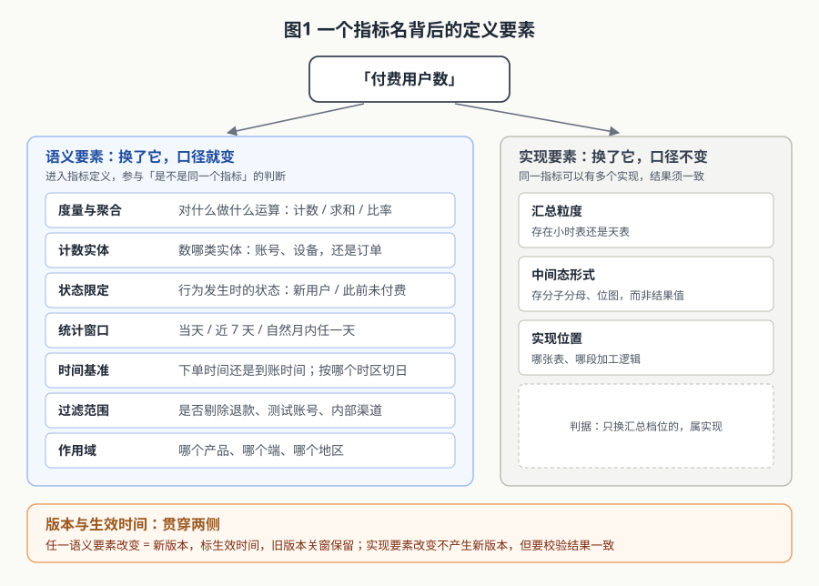
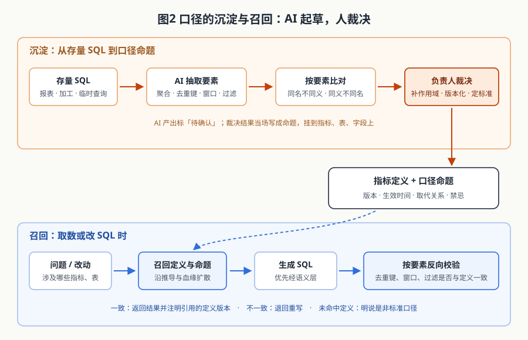

> 第二篇把指标语义列为广义元数据的第三个方向，只说到「定义一次、处处使用」；第三篇说指标层要强约束。这一篇往下拆一层：一个指标的定义到底由哪些要素组成，哪些属于语义、哪些只是实现；业界的集中定义解决了什么、解决不了什么；大模型取数为什么离不开它；口径冲突怎样裁决、沉淀，并在下一次动手时被召回。

## 一、现象：同一个名字，三个数

设想一个常见场景（数字为示意）。周一早会上，「昨日付费用户数」出现了三个数：运营看板 12,480，财务报表 11,930，实验平台 13,050。三方各自复核了一遍，都说自己没算错。

追下去，差异来自三处：

- **计数实体不同**。运营按账号去重；实验平台的分流单位是设备，于是按设备去重，一个账号在两台设备上付费算两个；
- **时间基准不同**。运营按下单时间，财务按到账时间，跨零点的订单落在不同的日子；如果两边切日用的时区不一样，差异还会更大；
- **过滤范围不同**。财务剔除了当日退款和内部测试账号，另外两方没有剔除。

三个数在各自的口径内都是对的。问题不在计算，而在于**名字相同，定义不同，而定义只存在于各自的 SQL 里**。看数的人只看得到名字，看不到 SQL。

这不是小公司才有的问题。Airbnb 在介绍其指标平台 Minerva 时回忆，CEO 问「上周哪个城市预订最多」这样简单的问题，数据科学和财务有时会给出不同的答案，原因是用了略有差异的表、指标定义和业务逻辑[1]。Uber 记录过一个更具体的例子：同一城市、同一时段的同一个指标，两个内部工具一个显示 653 万，一个显示 620 万，根因是其中一个工具的静态查询里过滤条件过期了，没有覆盖最新的状态列表[2]。

## 二、指标定义由什么组成

要让「是不是同一个指标」可以判断，先得把定义拆开。一个指标名背后至少有下面这些要素：

| 要素 | 回答的问题 | 以「付费用户数」为例 | 属于 |
|---|---|---|---|
| 度量与聚合 | 对什么做什么运算 | 对付费行为计数 | 语义 |
| 计数实体 | 数的是哪类实体 | 账号、设备，还是订单 | 语义 |
| 状态限定 | 实体在行为发生时须处于什么状态 | 不限；或只算新用户、此前从未付费的用户 | 语义 |
| 统计窗口 | 在多长的时间范围内去重或累计 | 当天、近 7 天、自然月 | 语义 |
| 时间基准 | 用哪个时间字段归属日期，按哪个时区切日 | 下单时间还是到账时间 | 语义 |
| 过滤范围 | 哪些记录不算 | 退款、测试账号、内部渠道 | 语义 |
| 作用域 | 在哪个范围内成立 | 哪个产品、哪个端、哪个地区 | 语义 |
| 汇总粒度 | 预先汇总到哪一档 | 小时表还是天表 | 实现 |
| 中间态形式 | 存什么才能继续汇总 | 存分子分母、位图，而不是结果值 | 实现 |
| 实现位置 | 由哪张表、哪段逻辑算出 | 某张汇总表的某个字段 | 实现 |

此外还有一个贯穿两侧的属性：**版本与生效时间**。任何一个语义要素改变，就是一个新版本，要标注生效时间，旧版本关闭有效期但保留；实现要素改变不产生新版本，但新旧实现的结果必须一致。

区分语义和实现的判据只有一条：**换了它，口径会不会变**。换了计数实体，数就变了，这是语义；把同一个指标从小时表挪到天表，数不应该变，这是实现。

计数实体还有一层更细的区分：同一类实体在一次行为里可能以不同身份出现。邀请注册里，邀请人和被邀请人都是用户；同一件商品，可以作为自用售出，也可以作为礼品售出。这时还要标明**角色**，即实体在这次行为中的身份。数邀请人和数被邀请人，是两个指标。

下面四个小节分别展开这张表里最容易出错的地方。

### 2.1 聚合函数决定了数能不能往上汇总

Kimball 把事实分为三类[3]：可加事实能沿所有维度相加；半可加事实只能沿部分维度相加，典型是余额，沿时间以外的维度可以相加，沿时间不行；不可加事实的典型是比率。

Gray 等人在 1997 年提出 Data Cube 算子时，从计算角度把聚合函数也分成三类[4]：

- **分布式**（distributive）：子集的结果可以直接合成整体的结果，如 SUM、COUNT、MIN、MAX；
- **代数式**（algebraic）：子集的结果可以用一个定长元组概括，如平均值，只要记住和与个数；
- **整体式**（holistic）：描述子集结果所需的存储没有常数上界，如中位数、众数。

两套分类说的是同一件事：**哪些数可以先算小块再拼起来，哪些不行**。落到指标设计上有两条直接的结论。

**比率要存分子和分母，不能存比值。** 付费率是代数式的：把各渠道的付费率求平均，得不到总付费率，必须把付费人数和活跃人数分别相加再相除。Kimball 给出的处理就是存可加的分量，汇总后再算比值[3]。不这样做的后果可能比误差更严重：辛普森悖论说明，一个关联在整体上和在子群上可以方向相反[5]。1973 年伯克利研究生录取数据在汇总层面看似对女性不利，按院系拆开后却是轻微有利，原因是女性更多申请了录取率低的院系[6]。

**去重计数要存可合并的中间态。** Gray 等人的原文没有点名去重计数；但按其定义，要合并两个子集的去重人数，必须知道两边各有哪些人，描述子集结果的存储随人数增长、没有常数上界，因此可以归入整体式，这是本文的推论。工程上的出路是改存可以合并的中间态：精确去重存位图，按并集合并；允许误差时存 HyperLogLog 这类基数估计草图，用固定大小的存储换取可控的相对误差[7]。小时表存的是每小时的「人数」，天表就没法从它算出来；存的是每小时的「人的集合」，天表就是 24 个集合的并。

### 2.2 统计窗口属于语义，汇总粒度属于实现

「月付费用户数」和「日付费用户数」是两个指标，因为窗口变了，去重范围就变了：一个人这个月付费了十天，在日指标里出现十次，在月指标里只算一次。月指标不等于日指标之和。

「当日付费用户数」存在小时表里还是天表里，是同一个指标的两个汇总档位。天表的数必须等于把 24 个小时的中间态合并后的结果，否则就是实现有错，而不是口径不同。

这两件事常被压成一个字段，比如在指标名里写「日」「周」「月」。这样会同时制造两种错误。对去重类指标，窗口是真正的语义差异，应当写清楚是「当天去重」还是「自然月内去重」，光写一个「月」字不够。对可加指标，例如付费金额，「日付费金额」「周付费金额」「月付费金额」其实是同一个指标在三个汇总档位上的结果，把它们登记成三个指标，就人为制造了三个名字。判据仍是那一条：**换了它口径会变的是语义；只换汇总档位、结果可以从下一档合成的，是实现**。

### 2.3 名字和定义：两种病

名字和定义之间的错位有两种：

- **同名不同义**：同一个名字，在不同报表里是不同的定义。第一节的三个数就是这种；
- **同义不同名**：同一个定义，被起了好几个名字。上一小节按粒度拆出来的三个名字就是这种。

Kimball 对一致性事实的要求恰好是这两种病的规范：同一个度量出现在不同事实表里，如果要放在一起比较或计算，技术定义必须完全相同；定义相同就用同一个名字，定义不同就**必须**用不同的名字，提醒使用者两者不能混算[8]。

作用域是定义的一部分，这一点最容易漏。两个「日活」分属不同的端，各自正确，问题只在于名字没带上作用域。补上作用域，它们就从冲突变成并存。

### 2.4 状态限定：以「首次充值人数」为例

「首次充值人数」看起来只是在付费用户数前面加了两个字。这两个字落在状态限定上：只数此前从未付费的实体。拆开看，它牵出三个分叉，每一个都会让数变：

1. **「首次」在什么范围内判断**。一个用户在 A 产品第一次充值，此前在 B 产品充过，算不算首充？按产品判断和按全平台判断是两个指标；按产品判断的首充人数逐产品相加，会大于全平台的首充人数。作用域在这里进入了状态的判断。
2. **哪些充值算数**。会员订阅、虚拟币购买、积分兑换是否都计入？只看会员订阅的「首次订阅人数」是另一个指标。这是过滤范围。
3. **往前看到哪一天**。系统上线以前的充值没有记录，老用户上线后的第一笔充值会被误判为首充。需要约定一个历史起点，并把起点以前的付费状态补齐；起点本身是定义的一部分，要随版本记录。

它还要和「新用户首充人数」分开。后者要求注册与首充发生在同一天，状态限定是「新用户」；前者的状态限定是「此前从未付费」。名字相近，状态不同，就是两个指标。

状态限定还带来一个可加性上的差别。首次充值对每个实体只发生一次，在作用域相同的前提下，逐日的首充人数直接相加就是当月的首充人数，不需要合并去重集合；普通的付费用户数没有这个性质（见 2.2）。

从建模的角度看，计数类指标都可以读成一句话：**某类实体，以某种角色、处在某种状态时，发生了某个行为，对这个行为做度量**。实体和角色回答「数谁」，状态回答「数什么时候的谁」，行为和度量回答「数什么」。状态通常由历史事件推出：新用户由注册事件推出，「此前从未付费」由支付事件推出。它因此适合单独命名、登记一次、被多个指标引用，而不是在每个指标的 SQL 里各写一遍；否则十个指标里的「新用户」，可能有人写成注册当天，有人写成注册七天内，又回到了同名不同义。

## 三、集中定义：业界做法与它解决不了的

### 3.1 从一致性维度到语义层

最早的答案来自维度建模。Kimball 的一致性维度要求不同事实表中的同名属性列名和取值域一致，只定义一次，到处复用，使得不同主题的结果可以对齐到同一行上比较[9]。总线矩阵就是围绕这些一致性维度组织整个数仓。

指标层面的集中定义，是大公司在吃过「多个答案」的亏之后做起来的：

- **Airbnb Minerva** 把指标定义集中放在代码仓库里，做版本控制和自动回填；发文时已有超过 12,000 个指标、4,000 个维度，200 多个数据生产者[1]；
- **Uber uMetric** 管理指标从定义、发现、计划、计算、质量到消费的全生命周期。早期标准化工作覆盖 30 多个团队、1 万多个指标；像「完成行程」这样的热门指标，按不同维度和过滤条件会衍生出十倍甚至百倍的实例[2]；
- **LinkedIn UMP** 在其工程团队页面的描述是：此前报表大多零散、各自为政，不同的人用不同的方法计算同一个指标，得到略有差异的结果；UMP 提供集中的指标计算流水线和模板[10]。

2021 年，Benn Stancil 把这件事概括为现代数据栈「缺失的一块」：指标公式散落在各个工具里，被反复重写，好的情况是随时间慢慢漂移，坏的情况是一开始就对不上；他主张建一个集中的指标层，像数据库代理一样把指标请求翻译成 SQL[11]。

此后这一层逐渐产品化。dbt 的 MetricFlow 把指标分为五种类型：简单、累积、派生、比率和转化[12]；比率指标的分子分母分别聚合再相除，而不是对行级比值求平均[13]，正是 2.1 那条原则的工程化；定义集中在建模层，改一处，处处刷新[14]。Looker 的 LookML 把查询结构和查询内容分开，SQL 表达式写一次、到处复用[15]。Cube 直接把自己定位为同时服务 AI 代理、BI 看板和嵌入式分析的语义层[16]。2025 年起，Snowflake 牵头、多家厂商参与制定开放语义交换规范 OSI，进入 Apache 孵化器后更名 Ossie。它的规范仓库开宗明义，要解决的正是「同一个 KPI 在不同工具里定义不同，团队花大量精力人工对齐定义，AI 代理基于不一致的业务逻辑给出不可靠的结果」[17]。

### 3.2 集中定义解决了什么，没解决什么

集中定义解决了四件事：定义只在一处，复用时保持一致；可加性在定义层就被约束，比率不会被误加；查询由定义自动生成，减少手写 SQL；定义变更有版本记录。

它解决不了的，至少有四件：

1. **存量迁不进来**。语义层只管它之后新登记的指标。在它之前，口径已经散落在几千段报表 SQL、加工脚本和临时查询里，每一段都可能藏着一个过滤条件。没有人能一段一段读完，迁移就一直停在「核心指标」；
2. **谁的口径算数**。三个「付费用户数」都对，选哪个做标准，是组织问题，不是技术问题。语义层只能登记结果，不能替人作出选择；
3. **定义在变**。业务调整、规则修订都会改口径。只保留当前定义的系统回答不了「上季度那份报告用的是哪个口径」；
4. **绕过它的取数不受约束**。临时 SQL、导出后的表格加工，以及越来越多的 AI 取数，并不经过语义层。定义得再好，没被调用就等于没有。

第四点在大模型普及之后变得尖锐。

## 四、AI 与指标语义

### 4.1 大模型取数为什么必须依赖口径

大模型能写出语法正确的 SQL，但它不知道「付费用户」在这家公司指什么。这一点在几个基准测试上都有体现。

BIRD 基准包含 95 个真实数据库、一万多个问题，专门为每个问题提供「外部知识证据」，其中一类就是领域知识，例如金融指标的计算方法。在测试集上，GPT-4 不给证据时执行准确率为 34.88%，给了证据后升到 54.89%；人类在给证据的条件下是 92.96%[18]。Spider 2.0 用 632 个真实企业级任务测试，SQL 常超过一百行，基于 o1-preview 的代理框架只解决了 21.3%，而同一框架在 Spider 1.0 上是 91.2%[19]。

Sequeda 等人在一个 199 张表的保险业数据模型上做了对照：GPT-4 直接在 SQL 库上零样本回答，准确率 16.7%；在由本体和映射构成的知识图谱上回答，准确率 54.2%。在模式复杂、问题涉及指标的象限里，直接查 SQL 库的准确率是 0[20]。

三组结果指向同一个结论：**取数错，主要错在不知道业务语义，而不是不会写 SQL**。语义要素必须作为上下文递给模型。

但语义层不可能事先写全。有研究指出，要求事先在语义层里写好所有对应关系的做法，在专业领域往往不完整，因为领域惯例本来就没有被充分记录；他们的做法是让多个假设并存，用执行结果择一，再沉淀为可复用的记忆[21]。这和上一篇的结论一致：知识零散到达、持续变化，只能边用边补。

### 4.2 AI 从存量 SQL 反推口径

3.2 的第一个难题是存量迁不进来。这恰好是 AI 最能发挥作用的地方：读几千段 SQL 并从中抽取结构化要素，对人是苦役，对模型是它擅长的事。

已有研究和产品验证了这条路。AT&T 的研究者把查询日志分析作为自动抽取元数据的手段之一，从 BIRD 开发集的查询里挖出的有用等值约束比文档记录的多 25%，还挖出了字段级的计算公式，例如带条件的去重计数；他们指出，这类公式在基准里靠人工提示提供，实践中没有人提供，但可以从查询日志中抽取[22]。Snowflake 的语义视图自动生成功能会从历史查询中识别最常见的查询类型，作为语义视图的候选，并从查询中抽取表之间的关系[23]。

落到指标上，做法分三步：

1. **按要素抽取**。对每一段产出某个指标的 SQL，抽出度量与聚合、计数实体与去重键、状态限定、窗口、时间字段、过滤条件、作用域，形成一份要素草稿；
2. **按要素比对**。同名的指标逐要素对比，找出同名不同义；要素完全相同而名字不同的，找出同义不同名。比对的对象是要素，不是 SQL 文本，所以写法不同但口径相同的 SQL 不会被误报；
3. **标为待确认**。AI 产出的都是草稿，进入裁决队列，不直接成为定义。

为什么必须按要素而不是按文本？因为同一个口径可以有很多种写法，不同的口径也可能只差一个 WHERE 条件。要素表把「是不是同一个指标」变成了逐项可比的问题，这也是第二节那张表的用处。

### 4.3 口径冲突的裁决与沉淀

比对出的冲突，大致分三类，处理方式不同：

| 冲突类型 | 判断依据 | 处理 |
|---|---|---|
| 作用域不同 | 分属不同产品、端或地区，各自正确 | 补上作用域，两个定义并存 |
| 时间演进 | 同一指标在不同时期按不同规则计算 | 版本化，标注各自生效时间 |
| 真冲突 | 同一作用域、同一时期，定义不同 | 指标负责人裁决，选定标准定义，其余改名或下线 |

AI 能把冲突归类、列出证据，前两类往往可以直接给出处理建议；第三类必须由人决定，因为它本质上是 3.2 所说的组织问题。

裁决的结果按上一篇的方式沉淀：**当场写成一条可证伪的命题，挂到指标、表和字段上**，例如「付费用户数自某日起剔除内部测试账号」「付费率不得对渠道明细的比率求平均」。命题记录裁决人、时间、证据和生效时间；被取代的旧口径标为失效而不删除，这样才能回答「当时按什么口径算」。

### 4.4 动手时召回，生成后反校验

沉淀下来的命题，要在有人取数或改 SQL 的那一刻回到面前。流程是：

1. **确定种子**。从问题或改动中识别涉及的指标和表；
2. **召回定义与命题**。从这些节点出发，沿指标的推导关系和表的血缘扩散，带出标准定义、当前版本、作用域，以及「禁忌」类命题；
3. **生成 SQL**。优先经语义层生成；语义层覆盖不到的，以召回的要素为约束手写；
4. **按要素反向校验**。从生成的 SQL 中再抽一次要素，与定义逐项比对：计数实体、状态限定、窗口、时间基准、过滤条件是否一致。不一致就退回重写；
5. **注明出处**。返回结果时注明引用的定义及其版本；没有命中任何定义的，明说这是非标准口径。

第 4 步是 4.2 的方法反过来用：同一套要素抽取，既能从存量 SQL 里反推口径，也能检查新生成的 SQL 是否守住了口径。这让 AI 取数从「看起来对」变成「逐项核过」。

召回之所以要从指标和表出发，而不是从一句问话出发，有认知上的理由。编码特异性原则指出，提取线索与编码时的情境越吻合，回忆越容易[24]；口径命题是在某个指标、某张表上裁决出来的，取数时以同一批实体作线索，召回才准。扩散激活理论把语义记忆刻画为节点网络，激活沿关联向邻居扩散并逐跳衰减[25]；指标的推导链和表的血缘就是现成的关联。工程上，HippoRAG 在知识图上用个性化 PageRank 做扩散，在多跳问答上优于纯向量检索[26]；按命题而不是按段落建索引，检索效果也更好[27]。

## 五、边界：哪些强约束，哪些只提示

不是所有取数都要走同样严格的流程。

| 场景 | 约束强度 | 做法 |
|---|---|---|
| 对外报表、财务、实验核心指标 | 强约束 | 只能经语义层或标准定义；与定义冲突即拦截 |
| 日常经营分析 | 默认约束 | 默认用标准定义；改要素须声明，结果标「调整口径」 |
| 探索性分析 | 提示 | 允许自定义，结果标「非标准口径」，不进对外材料 |
| AI 生成的取数 | 必须可追溯 | 注明引用的定义版本；未命中定义的显式说明 |

越接近对外承诺和决策，越需要强约束；越接近探索，越需要灵活。但无论哪一档，**结果都要能说清自己是按什么口径算的**。

## 六、方法：六条原则

1. **名字不是定义**：指标按七项语义要素登记，缺一项不得发布；
2. **窗口属语义，粒度属实现**：换了它口径会变的进定义，只换汇总档位的不产生新指标，但各档结果必须一致；
3. **存可合并的中间态**：比率存分子分母，去重计数存位图或草图，不存不能再汇总的结果值；
4. **口径有版本**：语义要素一变就是新版本，标注生效时间，被取代的关闭有效期而不删除；
5. **动手时召回，生成后反校验**：取数和改 SQL 前从涉及的指标和表召回口径，生成后按要素逐项核对；
6. **AI 起草，人裁决**：AI 负责抽取要素、比对冲突、起草处理，标准口径由指标负责人确定。

## 七、结语

一个数字有三个答案，通常不是因为有人算错，而是因为同一个名字背后有三套定义，而定义只存在于 SQL 里。

把名字和定义分开，是第一步：一个指标由度量与聚合、计数实体、状态限定、统计窗口、时间基准、过滤范围、作用域这些语义要素决定，汇总粒度、中间态和实现位置只是实现。有了要素，「是不是同一个指标」就从争论变成逐项比对。

集中定义的语义层，让新登记的指标保持一致，但管不到存量口径、组织选择、口径演进和绕过它的取数。大模型让最后一点变得尖锐，同时也提供了解法：AI 能从存量 SQL 中按要素反推口径、找出冲突，由人裁决后沉淀为挂在指标上的命题；下一次取数时，从涉及的指标和表出发召回这些命题，生成之后再按要素反校验。

指标语义因此不是一次性的定义工作，而是持续的沉淀、召回和判断。定义写在一处只是开始，能在每一次取数时被想起、被核对，才算真正生效。

回头看前四篇，背后是同一组主张，也是我们搭建数据开发与管理平台时遵循的理念：

- **定义与实现分开，并且互相找得到**。表、字段、指标先有定义再有实现；每个定义能指向它的实现，每段实现能回指它的定义，只有一边的就是缺陷；
- **规则沉淀为命题，在动手时召回**。口径、约束和禁忌一经裁决，就写成可证伪的命题，挂到相关的实体上；写 SQL、改加工、取数之前，它们主动回到面前，完成之后再逐项核对；
- **AI 起草，人裁决**。抽取、比对、归类和起草交给 AI，标准由对结果负责的人确定；在被裁决之前，AI 的产出只是草稿。

这个系列会持续更新。

## 参考资料

1. A. Pahwa et al. [How Airbnb Achieved Metric Consistency at Scale](https://medium.com/airbnb-engineering/how-airbnb-achieved-metric-consistency-at-scale-f23cc53dea70). The Airbnb Tech Blog, 2021.
2. X. Wang, W. Meng, W. Yu, Y. Wu. [The Journey Towards Metric Standardization](https://www.uber.com/us/en/blog/umetric/). Uber Engineering Blog, 2021.
3. Kimball Group. [Additive, Semi-Additive, and Non-Additive Facts](https://www.kimballgroup.com/data-warehouse-business-intelligence-resources/kimball-techniques/dimensional-modeling-techniques/additive-semi-additive-non-additive-fact/). Dimensional Modeling Techniques.
4. J. Gray, S. Chaudhuri, A. Bosworth, A. Layman, D. Reichart, M. Venkatrao, F. Pellow, H. Pirahesh. [Data Cube: A Relational Aggregation Operator Generalizing Group-By, Cross-Tab, and Sub-Totals](https://arxiv.org/abs/cs/0701155). Data Mining and Knowledge Discovery, 1(1): 29–53, 1997.
5. J. Sprenger, N. Weinberger. [Simpson's Paradox](https://plato.stanford.edu/entries/paradox-simpson/). Stanford Encyclopedia of Philosophy, 2021（2026 修订）.
6. P. J. Bickel, E. A. Hammel, J. W. O'Connell. [Sex Bias in Graduate Admissions: Data from Berkeley](https://www.science.org/doi/10.1126/science.187.4175.398). Science, 187(4175): 398–404, 1975.（出版方页面，需订阅）
7. P. Flajolet, É. Fusy, O. Gandouet, F. Meunier. [HyperLogLog: the analysis of a near-optimal cardinality estimation algorithm](https://dmtcs.episciences.org/3545). AofA 2007, DMTCS Proceedings.
8. Kimball Group. [Conformed Facts](https://www.kimballgroup.com/data-warehouse-business-intelligence-resources/kimball-techniques/dimensional-modeling-techniques/conformed-fact/). Dimensional Modeling Techniques.
9. Kimball Group. [Conformed Dimensions](https://www.kimballgroup.com/data-warehouse-business-intelligence-resources/kimball-techniques/dimensional-modeling-techniques/conformed-dimension/). Dimensional Modeling Techniques.
10. LinkedIn Engineering. [Unified Metrics Platform (UMP)](https://engineering.linkedin.com/teams/data/analytics-platform-apps/analytics-platforms/ump).
11. B. Stancil. [The missing piece of the modern data stack](https://benn.substack.com/p/metrics-layer). 2021.
12. dbt Labs. [Metrics overview](https://docs.getdbt.com/docs/build/metrics-overview).
13. dbt Labs. [Ratio metrics](https://docs.getdbt.com/docs/build/ratio).
14. dbt Labs. [dbt Semantic Layer](https://docs.getdbt.com/docs/use-dbt-semantic-layer/dbt-sl).
15. Google Cloud. [What is LookML?](https://docs.cloud.google.com/looker/docs/what-is-lookml)
16. Cube. [Data modeling overview](https://docs.cube.dev/docs/data-modeling/overview).
17. Apache Ossie (incubating, formerly Open Semantic Interchange). [Specification repository](https://github.com/apache/ossie)；Omni. [Announcing the Open Semantic Interchange](https://omni.co/blog/announcing-the-open-semantic-interchange), 2025.
18. J. Li et al. [Can LLM Already Serve as A Database Interface? A BIg Bench for Large-Scale Database Grounded Text-to-SQLs](https://arxiv.org/abs/2305.03111). NeurIPS 2023.
19. F. Lei et al. [Spider 2.0: Evaluating Language Models on Real-World Enterprise Text-to-SQL Workflows](https://arxiv.org/abs/2411.07763). ICLR 2025.
20. J. Sequeda, D. Allemang, B. Jacob. [A Benchmark to Understand the Role of Knowledge Graphs on Large Language Model's Accuracy for Question Answering on Enterprise SQL Databases](https://arxiv.org/abs/2311.07509). arXiv:2311.07509, 2023.
21. Lee, Kim, Hwang. [Bootstrapping Semantic Layer from Execution for Text-to-SQL](https://arxiv.org/abs/2606.05634). arXiv:2606.05634, 2026.
22. V. Shkapenyuk, D. Srivastava, T. Johnson, P. Ghane. [Automatic Metadata Extraction for Text-to-SQL](https://arxiv.org/abs/2505.19988). arXiv:2505.19988, 2025.
23. Snowflake. [Semantic View Autopilot](https://docs.snowflake.com/en/user-guide/views-semantic/autopilot).
24. E. Tulving, D. M. Thomson. [Encoding Specificity and Retrieval Processes in Episodic Memory](https://doi.org/10.1037/h0020071). Psychological Review, 80(5): 352–373, 1973.（出版方页面，需订阅）
25. A. M. Collins, E. F. Loftus. [A Spreading-Activation Theory of Semantic Processing](https://eric.ed.gov/?id=EJ135579). Psychological Review, 82(6): 407–428, 1975.（ERIC 题录与摘要）
26. B. Jiménez Gutiérrez, Y. Shu, Y. Gu, M. Yasunaga, Y. Su. [HippoRAG: Neurobiologically Inspired Long-Term Memory for Large Language Models](https://arxiv.org/abs/2405.14831). NeurIPS 2024.
27. T. Chen et al. [Dense X Retrieval: What Retrieval Granularity Should We Use?](https://arxiv.org/abs/2312.06648) arXiv:2312.06648, 2024.
