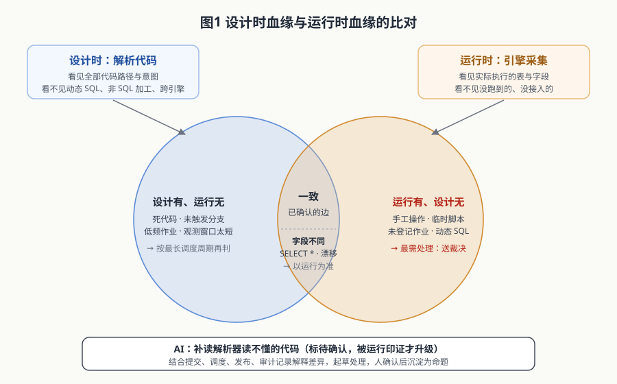
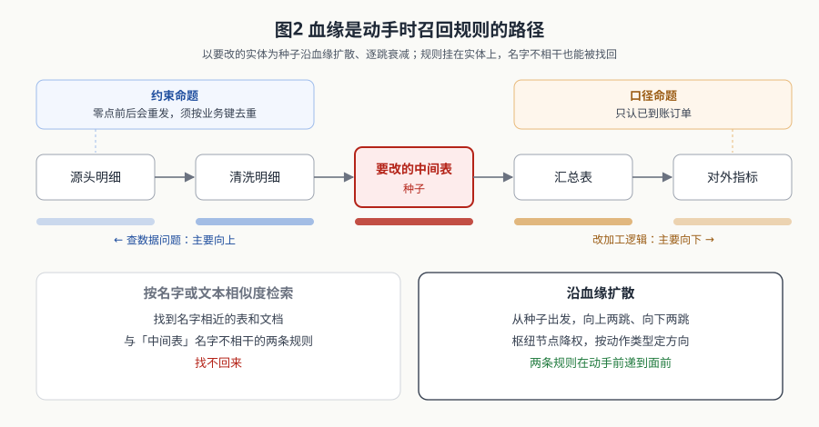

> 第二篇把血缘列为广义元数据的第二个方向，第三篇说召回要沿血缘扩散，第四篇说指标沿推导链彼此依赖。这三处都把血缘当成现成的东西在用。这一篇回头补上：血缘到底记录什么；设计时和运行时两种来源各自看见什么、看不见什么；怎样用它做影响分析和根因回溯；AI 在其中能补什么、能做什么，以及血缘为什么同时是「动手时召回规则」的那张图。

## 一、两个方向的问题

设想一个常见场景（数字为示意）。上游订单明细表的金额字段，为了支持多币种，从「按元存」改成「按最小货币单位存」。改动本身只有一行，发布前有人问：会影响谁？

翻代码，直接读这张表的作业有 14 个；再往下一层，读这 14 个作业产出的表，又有 41 个作业；第三层是报表和对外接口。其中真正用到金额字段的不到一半，另一半只用订单号和状态，不受影响。但到底是哪一半，翻代码要好几天。

反过来的问题同样常见。某天经营报表的付费金额比前一日低了 8%，业务说没有这回事。报表来自一张汇总表，汇总表来自三张中间表，中间表又来自五个源头。是哪一层出了问题，要一层一层往上核数。

这就是血缘要回答的两个方向：**向下的影响分析**——我改了这里，谁会受影响；**向上的根因回溯**——这里的数不对，问题出在哪。两个方向都要求同一张图：数据从哪来、经过什么加工、到了哪里。

## 二、血缘记录的是什么

### 2.1 学术上的三个问题

数据库领域对这个问题的系统研究始于数据仓库。Cui、Widom 和 Wiener 在 2000 年把「视图数据的血缘」形式化为：对物化视图中的一个数据项，找出产生它的那组源数据项，并给出了含聚合的关系视图的追溯算法[1]。

一年后，Buneman、Khanna 和 Tan 把「来源」分成两种[2]：

- **Why 来源**：哪些源数据促成了这个结果的**存在**。一条汇总行之所以存在，是因为有这些明细行满足了过滤和关联条件；
- **Where 来源**：这个结果的**值**是从源数据的哪个位置抄来的。

2007 年，Green、Karvounarakis 和 Tannen 用半环代数统一了这一类问题，回答第三个问题：**How**——源数据是怎样组合出这个结果的，经过了哪些联合、关联、投影[3]。Cheney、Chiticariu 和 Tan 的综述把这三个问题并列为数据库来源研究的主线[4]。

这三个问题在工程上有直接的对应。开源血缘标准 OpenLineage 的字段级血缘，把输入字段对输出字段的影响分成两类[5]：

- **直接（DIRECT）**：输出值由输入值得出，细分为原样取用、经过变换、经过聚合；
- **间接（INDIRECT）**：输入不进入输出值，但影响了输出——作为关联键、分组键、过滤条件、排序、窗口或条件分支。

直接对应 Where，间接对应 Why。这个区分在影响分析里很要紧：改了一个只做过滤条件的字段，下游的**值**不会变，变的是**有哪些行**，而行数的变化往往更难被发现。

### 2.2 两个维度：粒度和来源

把血缘拆开，至少有两个维度。

**粒度**分三档：

- **表级**：作业读哪些表、写哪些表。成本最低，能回答「依赖谁」，回答不了「依赖什么」；
- **字段级**：输出的每个字段来自哪些输入字段、以什么方式。开头那个金额字段的例子，只有字段级能把「真正受影响的那一半」挑出来；
- **数据项级**：一行结果来自哪几行源数据。学术研究的起点就在这一档[1]，但工程上全量记录的成本很高，一般只在审计和高价值场景按需追溯。

**来源**分两种：

- **设计时血缘**：解析代码得来，回答「按代码，数据应当怎样流」；
- **运行时血缘**：从引擎的执行过程采集，回答「这一次运行，数据实际怎样流」。

两种来源看见的东西不一样，下一节展开。

### 2.3 血缘的边挂在作业运行上

画血缘图时，常见的做法是把表直接连到表。W3C 的来源数据模型 PROV-DM 给了一个更完整的结构[6]：**实体**（数据）、**活动**（加工过程）和**代理**（对活动负责的人或系统）；活动**使用**实体、**生成**实体，实体由另一实体**派生**。OpenLineage 的核心模型与之对应：数据集、作业、运行；一次运行至少上报开始和结束两个事件，过程中发现新的输入输出可以追加上报[7]。

把边挂在「作业的某次运行」上，而不是表与表之间，多出来的是两样东西：**时间**和**责任**。表与表的连线只能说「A 流向 B」；挂在运行上，才能回答「昨天 B 的这个分区，是哪个版本的代码在几点从 A 的哪个分区算出来的，谁发布的这个版本」。根因回溯要的正是这个——问题出在**那一次**，而不是出在一般意义上的「A 到 B」。

## 三、设计时与运行时：两份证据

### 3.1 设计时血缘看见意图，看不见执行

设计时血缘靠解析 SQL 或代码。成熟的 SQL 解析器把语句拆成语法树，逐个判定每一列是直接贡献、被引用还是两者兼有[8]。它的长处是覆盖全部代码路径，包括还没有跑过的分支，适合在发布之前做影响分析。

它的盲区是结构性的：

- **动态拼接的 SQL**。表名、字段名、过滤条件由程序在运行时拼出来，解析器看到的只是字符串模板；
- **非 SQL 的加工**。DataFrame 接口、自定义函数、脚本里的文件搬运，SQL 解析器读不到；
- **跨引擎**。一个引擎写湖表，另一个引擎读，中间还有同步工具，每一段的解析器都只看得见自己那一段；
- **结构漂移**。`SELECT *` 的字段集合取决于运行那一刻的表结构，代码没改，血缘已经变了。

### 3.2 运行时血缘看见执行，看不见没跑到的

运行时血缘挂在引擎上采集。以 Spark 为例，开源的 Spline 代理嵌入 Spark 驱动程序，监听执行事件，抓取逻辑执行计划[9]；OpenLineage 的 Spark 集成同样从逻辑计划中提取字段依赖[10]。逻辑计划是引擎实际要执行的东西，动态拼出来的 SQL 到这里已经是确定的表和字段，这正好补上设计时的第一个盲区。

但运行时也有自己的盲区：

- **只看见跑过的**。一个月跑一次的作业，在一周的观测窗口里不存在；条件分支没走到的那一侧，也不存在；
- **只看见接入的**。没有挂采集代理的引擎、手工执行的语句、临时脚本，都不在图里；
- **字段级仍有缺口**。OpenLineage 的字段级血缘最初只覆盖 Spark SQL 算子和 DataSource V2，脱离 SQL 的 DataFrame 写出不在其内[10]；自定义函数里面做了什么，逻辑计划也只能看到一个黑盒。

### 3.3 比对两份证据

两种来源各有盲区，单看任何一份都会出错。Meta 在介绍其隐私基础设施中的血缘时说得很直接：静态代码分析模拟执行来推断数据流，但缺少运行时数据，会把没有执行的代码路径报成数据流，产生误报；他们的做法是把静态分析和运行时探针结合起来，精确匹配的标为高置信，经过变换的标为低置信，交给人复核[11]。

比对的结果可以分成四类：

| 设计时 | 运行时 | 含义 | 处理 |
|---|---|---|---|
| 有 | 有 | 一致 | 作为已确认的边 |
| 有 | 无 | 没跑到：死代码、未上线的调度、未触发的分支，或者只是观测窗口太短 | 按调度周期判断；超过最长周期仍无，再核实是否下线 |
| 无 | 有 | 代码之外的数据流：手工操作、临时脚本、未登记的作业、动态拼接的 SQL | **最需要处理**：要么补登记，要么查清来历 |
| 有 | 有，但字段不同 | 结构漂移、`SELECT *`、版本不一致 | 以运行时为准，回头修代码或登记 |

第三类最危险。它意味着生产上有数据在流动，而没有任何一份代码为它负责。这一类差异就是第三篇所说的「偏差」：它不应当被系统悄悄吸收进血缘图，而应当送去裁决——补登记、改代码，还是叫停。

## 四、影响分析与根因回溯

### 4.1 向下：按边的类型分级

开头的问题，用字段级血缘可以分三步回答：

1. 从被改的字段出发，沿血缘向下展开；
2. 按边的类型分级：**直接**边上的下游，值会变，要核对计算逻辑和取值范围；**间接**边上的下游，值不变但行集可能变，要核对行数；
3. 在每条路径的终点找消费方：报表、接口、对外文件，确定要通知谁、要重算哪些分区。

两点经验。第一，**过滤条件的变化最容易被漏掉**。值的变化有人看，行数少了几个百分点往往没人察觉。第二，**枢纽节点要剪枝**。用户维表、日历表这类被几百张表依赖的节点，如果不分边的类型一律展开，影响面会覆盖半个仓库，等于没有分析。

### 4.2 向上：沿运行逐跳核数

根因回溯走反方向，但不能只看表与表的连线。要沿着**那一天、那一个分区**的运行记录往上，每一跳核三件事：这次运行用的是哪个版本的代码；读到的上游分区是否完整、是否是当时应读的那一版；本跳的输入和输出在行数、金额上是否对得上。哪一跳对不上，问题就在哪一跳。

这里时间维度是关键。血缘本身会变：上周加了一个源，昨天换了一张中间表。回溯昨天的数，要用**昨天**的血缘，而不是今天的。第三篇说元数据的每次变化应当成为可回放的事件，血缘是最需要这一点的地方。

## 五、AI 与血缘

### 5.1 补解析器的盲区

解析器读不懂的，正是大模型擅长读的：动态拼接 SQL 的程序、DataFrame 代码、调度脚本、混在一起的多种语言。Yin 等人 2025 年的研究专门评估了这件事：从真实工业脚本中人工标注 1,700 条血缘，测试 12 个开源模型（13 亿到 320 亿参数）和两个闭源模型，从多语言加工代码中抽取源表、源字段、变换逻辑和聚合方式；320 亿参数的开源模型配合单次推理，可以达到与闭源模型相当的水平[12]。

怎么用比能不能用更要紧。AI 从代码推断出的血缘是**推断**，不是观测。合理的做法是三档：

- 解析器能确定的，直接入图；
- AI 推断的，标为**待确认**，与已确认的边分开存放；
- 待确认的边一旦被运行时事件印证，升为已确认；长期得不到印证的，进入第三节表格的第二类，送人核实。

这和 Meta 的高低置信分档是同一个思路[11]：机器负责把候选找全，证据负责把候选分级，人只处理证据不足的那一部分。

### 5.2 解释比对差异

第三节表格里的四类差异，每一类都需要有人去查原因：这个「运行有、设计无」的数据流是谁在什么时候起的；这个「设计有、运行无」的作业是下线了还是只是月度任务。AI 适合做这一步：把差异和代码提交记录、调度记录、发布记录、操作审计放在一起，解释最可能的原因，并起草处理建议——补登记的条目、要删的死代码、要改成显式字段列表的 `SELECT *`。人确认后执行，确认的结论写成命题沉淀下来，下次同类差异出现时直接召回。

### 5.3 血缘是召回的路径

第三篇提出「动手时召回」：以动作涉及的实体为种子，沿边扩散，把相关的规则递到面前。这里要回答的是：沿哪些边？

血缘是最主要的那一类边。改一张中间表，需要的规则不在这张表本身：上游有一条「这个源在每天零点前后会重发，必须按业务键去重」的约束，下游两跳处有一个对外指标「只认已到账订单」的口径。按关键词或文本相似度检索文档库，找到的是名字相近的东西；这两条规则和这张表的名字毫不相干，只在图上相连。

这在认知科学里有现成的模型。Collins 和 Loftus 的扩散激活理论认为，语义记忆是一张概念网络，激活从被触发的节点沿连接向外传播，逐跳衰减[13]。HippoRAG 把这个思路用到大模型的长期记忆上：以问题涉及的实体为种子，在知识图上做个性化 PageRank 扩散，召回多跳相关的内容[14]。数据平台的条件比通用知识图更好：实体（表、字段、指标、作业）本来就有稳定标识，血缘边可以由机器自动、持续地产生，而不必靠模型从文本里抽。

为什么需要这样做：数据平台的规则不是一次写成的，而是在一次次事故、裁决、口径调整中零碎地加进来，分散挂在不同的表和字段上。写一份长文档把它们汇总，第二天就会过时。只有让规则挂在实体上、让实体经由血缘相连，动手时才能从「我要改的这张表」出发，把散在上下游的那几条找回来。为什么能做到：血缘是机器可得的结构，不需要人维护；扩散的方向和跳数可以按动作类型设定——改加工逻辑主要看下游，查数据问题主要看上游。

### 5.4 起草影响分析

把 4.1 的三步交给 AI：沿字段级血缘展开下游，按直接和间接分级，对每个受影响的下游列出要核的内容（值域、行数、金额），估算要重算的分区范围，找出消费方和负责人，再沿同一张图召回下游各节点上已有的口径命题和禁忌，标出可能被这次改动违反的那几条。产出是一份草稿，由改动的负责人确认、补充后进入发布流程。

## 六、边界

AI 和血缘结合后能做的事很多，但有几条线要划清。

- **推断的血缘不用于删除和下线判断**。「没有下游」是一个否定性结论，证据要求最高。只有运行时观测覆盖了最长调度周期——月度任务至少一个月、年度任务至少一年——且没有任何读取，才能据此下线；AI 推断的边和设计时的边都不足以支持这个结论；
- **待确认的边不进入强约束**。影响分析可以把待确认的下游列出来提示，但发布闸门只按已确认的边拦截，否则误报会让人对闸门失去信任；
- **数据项级血缘按需而不是全量**。全量记录每一行的来源，成本远超收益；在审计、对账争议等场景按需追溯即可；
- **回溯用当时的血缘**。血缘随代码演进，用今天的图解释上个月的数，结论可能是错的。

## 七、方法：五条原则

1. **字段级为主，区分直接与间接**。表级只够回答「依赖谁」；影响分析要知道值会不会变、行集会不会变；
2. **两份证据，比对出偏差**。设计时与运行时都要，差异按四类处理，「运行有、设计无」优先；
3. **边挂在运行上，带版本和时间**。能回答「那一天、那一个分区，是谁、用哪个版本算出来的」；
4. **推断与观测分开存放**。AI 和解析器推断的边标为待确认，被运行时印证后才升级，否定性结论只用观测证据；
5. **血缘既是查询对象，也是召回路径**。规则挂在实体上，动手时以动作涉及的实体为种子沿血缘扩散，把上下游的约束递到面前。

## 八、结语

血缘常被当作一张画出来给人看的图。画出来当然有用，但它真正的价值在两件事上：在改动之前告诉你谁会受影响，在出错之后告诉你问题在哪一跳。这两件事都要求血缘是准的、带时间的、能区分直接和间接的。

准，靠的是两份证据互相校验；全，靠的是 AI 补上解析器读不懂的代码，再由运行时证据把推断变成事实。而当规则零碎地挂在各张表和各个字段上时，血缘又成了把它们串起来的那张图：从手上要动的那个实体出发，沿着数据流动的方向，找到上下游那几条不能违反的约束。

这个系列会持续更新。

## 参考资料

1. Y. Cui, J. Widom, J. L. Wiener. [Tracing the Lineage of View Data in a Warehousing Environment](https://dl.acm.org/doi/10.1145/357775.357777). ACM Transactions on Database Systems, 25(2): 179–227, 2000.（出版方页面）
2. P. Buneman, S. Khanna, W.-C. Tan. [Why and Where: A Characterization of Data Provenance](https://link.springer.com/chapter/10.1007/3-540-44503-X_20). ICDT 2001, LNCS 1973: 316–330.（出版方页面）
3. T. J. Green, G. Karvounarakis, V. Tannen. [Provenance Semirings](https://web.cs.ucdavis.edu/~green/papers/pods07.pdf). PODS 2007: 31–40.
4. J. Cheney, L. Chiticariu, W.-C. Tan. [Provenance in Databases: Why, How, and Where](https://dl.acm.org/doi/10.1561/1900000006). Foundations and Trends in Databases, 1(4): 379–474, 2009.（出版方页面）
5. OpenLineage. [Column Level Lineage Dataset Facet](https://openlineage.io/docs/spec/facets/dataset-facets/column_lineage_facet/).
6. L. Moreau, P. Missier (eds.). [PROV-DM: The PROV Data Model](https://www.w3.org/TR/prov-dm/). W3C Recommendation, 30 April 2013.
7. OpenLineage. [OpenLineage Specification](https://github.com/OpenLineage/OpenLineage/blob/main/spec/OpenLineage.md)；[Lineage Job Facet](https://openlineage.io/docs/spec/facets/job-facets/lineage/).
8. S. H. Zhang, Z. Miao, J. Wang. [LINEAGEX: A Column Lineage Extraction System for SQL](https://arxiv.org/abs/2505.23133). ICDE 2025（Demo）.
9. ABSA OSS. [Spline agent for Apache Spark](https://github.com/AbsaOSS/spline-spark-agent).
10. M. Robinson. [The Current State of Column-level Lineage](https://openlineage.io/blog/column-lineage/). OpenLineage Blog, 2022.
11. R. Mangla, D. Taieb, W. Dong et al. [How Meta discovers data flows via lineage at scale](https://engineering.fb.com/2025/01/22/security/how-meta-discovers-data-flows-via-lineage-at-scale/). Engineering at Meta, 2025.
12. J. Yin, Y.-W. Chen, M.-L. Lee, X. Liu. [Schema Lineage Extraction at Scale: Multilingual Pipelines, Composite Evaluation, and Language-Model Benchmarks](https://arxiv.org/abs/2508.07179). arXiv:2508.07179, 2025.
13. A. M. Collins, E. F. Loftus. [A Spreading-Activation Theory of Semantic Processing](https://eric.ed.gov/?id=EJ135579). Psychological Review, 82(6): 407–428, 1975.（ERIC 题录与摘要）
14. B. Jiménez Gutiérrez, Y. Shu, Y. Gu, M. Yasunaga, Y. Su. [HippoRAG: Neurobiologically Inspired Long-Term Memory for Large Language Models](https://arxiv.org/abs/2405.14831). NeurIPS 2024.
