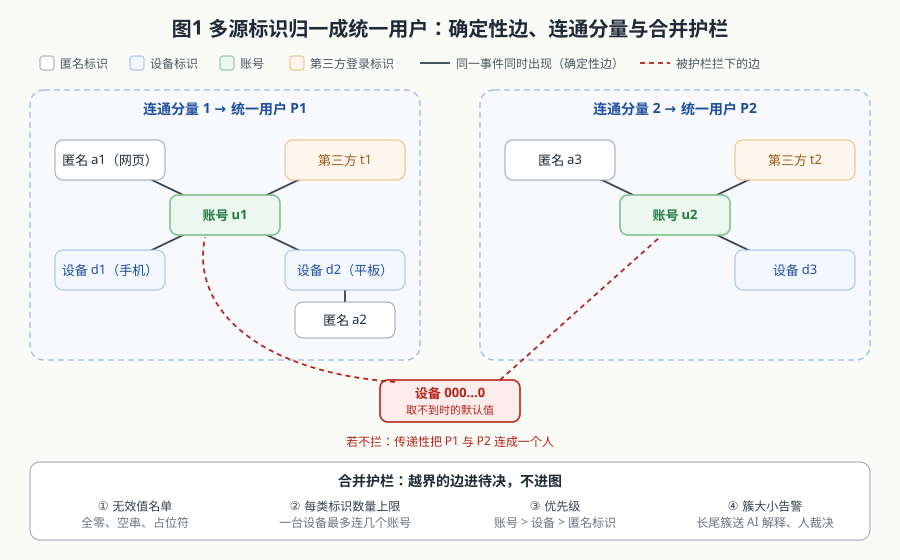
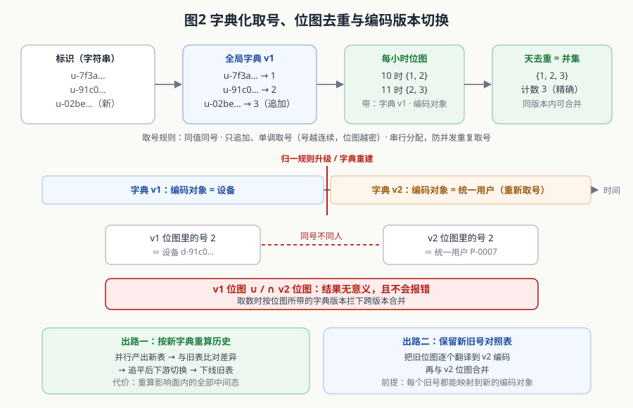

> 第四篇把「去重对象」列为指标的语义要素：按账号、按设备还是按归一后的用户，是三个不同的数。第六篇说指标的计数实体是账号，事件里就必须带账号标识，未登录时怎样处理要写明。这一篇回答这两处共同留下的问题：同一个人在多台设备、多种登录方式下留下的一组标识，怎样归成「一个人」；匿名行为怎样在登录后拼回去；工程上为什么要把标识字典化成整数、再用位图去重，这又带来什么约束；归一规则变了，历史怎么办；AI 在这里能做什么。

## 一、同一个人，几个标识

### 1.1 标识各有寿命和可信度

一个用户在数据里留下的标识通常不止一个，性质也各不相同：

| 标识 | 由谁产生 | 寿命 | 主要风险 |
|---|---|---|---|
| 匿名标识 | 客户端首次启动或首次访问时生成 | 卸载重装、清缓存即换 | 一个人多个，生命周期短 |
| 设备标识 | 操作系统或硬件提供 | 较长，但受系统隐私策略限制 | 共享设备、刷机、取不到时的默认值 |
| 账号 | 业务注册 | 长期稳定 | 一人多号、账号转让 |
| 第三方登录标识 | 外部平台签发 | 随授权存续 | 同一平台对不同应用签发不同值 |
| 联系方式（哈希后） | 用户填写 | 会更换 | 家庭共用、号码回收再分配 |

归一要解决的，是从这一组寿命不同、可信度不同的标识里，推断出背后的「同一个人」。

### 1.2 统一用户是推断，不是事实

账号和设备是被观测到的；「统一用户」是按一套规则推出来的。规则不同，同一批数据会得出不同的人数。Google Analytics 4 的报表身份就提供了三种口径：混合（先用户标识、再设备标识、再建模补全）、观测（先用户标识、再设备标识）、仅设备；并说明切换口径不影响数据采集与处理，只改变报表怎样把事件归到用户[1]。

这说明一件事：**归一方式是去重口径的一部分**。第四篇的去重对象如果写的是「用户」，就必须进一步写明是哪一套归一规则的哪个版本。

## 二、归一：把标识连成图

### 2.1 确定性匹配与概率匹配

判断两条记录是否属于同一实体，统计学上的经典框架是 Fellegi 与 Sunter 1969 年提出的概率记录链接：逐字段比较，按一致与不一致的似然比给记录对打分，再用阈值划分为匹配、不匹配和待人工复核三类[2]。实体解析的综述把现代流程概括为分块、匹配、聚类三步[3]。

用户标识的归一多数走**确定性匹配**：同一条事件里同时出现设备和账号，或账号绑定了某个第三方登录标识，就认为属于同一人。概率匹配（相近的设备型号、网络、活跃时段）能提高召回，也会引入误合并，适合分析，不宜进入对外指标的去重口径。

### 2.2 图与连通分量

把每个标识看作节点，把每次「同时出现」看作一条边，归一就变成求图的连通分量：连得通的标识属于同一个人，分量的标识就是统一用户的编号。Spark 生态的 GraphFrames 提供现成的连通分量算法，可以用分量内最小的原始顶点标签作为分量编号[4]。

图的麻烦在于**传递性**：A 连 B、B 连 C，A 与 C 就成了同一个人。一条错误的边足以把两个不相干的簇连起来。最常见的三种错边：

- **默认值**：取不到设备标识时上报全零、空串或固定占位符，所有取不到的人被连成一个巨簇；
- **共享设备**：门店的演示机、家庭共用的平板，一台设备挂着许多账号；
- **测试流量**：测试账号在大量设备上登录。

### 2.3 合并护栏

商业产品的做法可以借鉴。Segment 的身份解析提供三类规则：屏蔽值，例如 `null`、`-1`、全零等，不参与合并；每类标识在一个画像上允许的数量上限，例如账号标识只允许一个；以及标识的优先级，冲突时丢弃低优先级的标识，避免引入不该有的合并[5]。

归纳成平台规则，归一要有四道护栏：**无效值名单**（按标识类型登记）、**每类标识的数量上限**（一个统一用户最多挂几个账号、一台设备最多连几个账号）、**优先级**（账号高于设备，设备高于匿名标识）、**簇大小的告警阈值**。超过上限的边不进入归一，而是进入待决。

## 三、匿名到登录的拼接

### 3.1 登录那一刻建立映射

用户在登录前已经产生了浏览、搜索、加购等行为，只带着匿名标识。登录事件同时带匿名标识和账号，平台据此建立映射。Mixpanel 的简化身份合并就是这样：一条事件首次同时带设备标识与用户标识时，两者被合并为一个身份簇，并且会**回溯**地把该设备此前的事件归到这个用户上；同时要求在用户登出时重置设备标识，以防共享设备上的多人被误合并[6]。

### 3.2 回溯改变了历史

回溯归属的代价是：**昨天的数会在今天变**。一个匿名访客昨天浏览、今天注册登录，昨天的「新访客」随即变成今天这个账号的历史行为；按归一后用户统计的昨日人数，今天重算会变少。

所以拼接相关的指标要多声明一个要素：**按哪个时点的映射计数**。

| 口径 | 含义 | 特点 |
|---|---|---|
| 当时映射 | 用统计日结束时已知的映射 | 历史稳定，可对账；但登录前行为被算成另一个人 |
| 当前映射 | 用最新的映射重算全部历史 | 更接近真实的人；历史数每天都可能变 |
| 固定回看期 | 统计日后 N 天内出现的映射才回填 | 折中：N 天后封账，不再变 |

对外报表一般选前一种或第三种，分析用户路径时用第二种。三种都可以对，关键是写进口径、并与第四篇的时间基准一起登记。

## 四、字典化与位图去重

### 4.1 为什么要把标识变成整数

第四篇说，去重计数要存可合并的中间态，精确去重存位图，按并集合并。位图的下标是整数，标识是字符串，中间要一本字典。

Roaring 位图是目前主流引擎使用的压缩位图格式：把 32 位整数按高 16 位分桶，每桶按密度选数组或位图两种容器，比基于游程编码的方案压缩率更好、求交更快[7]。它对整数的分布敏感：编号越连续，每个桶里越密，存储越小、运算越快。

引擎文档给出的结论一致。Apache Kylin 用全局字典把字符串编码成整数来实现精确去重，其技术文章指出全局字典是只追加的结构，放弃了保序和由整数反查原值的双向映射，专为非整数值的精确去重而设：同一个值无论出现在哪个数据段，都要映射到同一个整数[8]。StarRocks 的文档说明位图去重要求整数输入；对字符串直接做哈希得到的结果是近似的、略偏低，而且哈希值分散，查询更慢、存储更大；推荐用自增列建全局字典，为每个字符串分配唯一整数[9]。

### 4.2 取号规则：只增不改

字典有三条硬规则：

1. **同一个值永远是同一个号**。号一旦分配，不回收、不重排；
2. **只追加，单调取号**。新值拿新号，号的增长顺序大致就是首次出现的顺序，越新的用户号越大，近期活跃用户的位图因此更密；
3. **取号是串行的**。并发写入时两个任务给同一个新值各分配一个号，同一个人就成了两个人；取号要有唯一约束或单点分配。

### 4.3 跨版本不可求交

这是字典化最容易被忽略的约束。位图里存的只是号，号的含义由字典决定。如果字典重建过（例如换了编码方式、从头重新取号），或者被编码的对象变了（例如从「设备」换成「归一后的统一用户」），那么新旧两版里同一个号指的已经不是同一个人。**用旧版位图和新版位图求并集、求交集，结果没有意义，而且不会报错。**这是由位图的定义推出来的结论，引擎不会替你检查。

所以每个位图中间态都要带上**字典版本**和**被编码对象**两个属性，跨版本的合并在取数时直接拦下。换版本时只有两条路：按新字典把历史重算一遍；或者保留新旧号的对照表，把旧位图逐个翻译到新版本后再合并。

### 4.4 几种去重方式的取舍

| 方式 | 精确性 | 可合并 | 代价 |
|---|---|---|---|
| 明细上直接去重计数 | 精确 | 否，每次回明细 | 窗口一长就算不动 |
| 字符串哈希后放位图 | 近似，有碰撞 | 是 | 号分散，存储大、运算慢 |
| 全局字典 + 位图 | 精确 | 是，同版本内 | 字典要维护，换版本要重算 |
| 基数估计草图 | 近似，误差可控 | 是 | 不能求交、不能取出名单 |

## 五、规则变了，历史怎么办

归一规则会变：新增一种第三方登录、把某个默认值加进无效名单、收紧共享设备的上限。每一次都会让一部分人被拆开或合并，按统一用户计的历史指标随之变化。

和第四篇「语义要素变即新版本」一样，**归一规则要版本化**，每个版本对应一份映射和一本字典，指标结果注明所用版本。规则变更后有三种处理：

- **只向前生效**：新规则从某日起用，历史不动，在指标上标出口径断点。最省，但跨断点的同比不可比；
- **全量重算**：用新规则重建映射和字典，再重算受影响的中间态。Kreps 在讨论流处理的重算时给出的做法可以照搬：启动第二个作业从头处理保留的数据，输出写到新表，追平后让应用切到新表，再停掉旧作业、删除旧表[10]。新旧并存期间正好用于比对差异；
- **双轨并行**：新旧两版同时产出一段时间，差异经确认后再切换。适合对外指标。

不论哪种，切换前都要回答：哪些指标的去重对象依赖这套规则，哪些位图中间态是旧字典编码的。这正是第五篇血缘要回答的影响面。

## 六、AI 这一层

### 6.1 发现归一冲突与异常合并

异常合并很少表现为报错，而表现为分布：簇大小出现长尾，一台设备一天内关联大量账号，某个标识值在许多簇里重复出现。信号可以用统计规则筛出，判断原因却要读懂上下文：是默认值、测试账号、共享设备，还是一次客户端发版改了标识的取法。

AI 适合做这一步：读簇的结构、标识值的分布、相关事件的客户端版本与发版记录，给出最可能的原因，并按原因把一批异常归并成一个待决事项，送第三篇的裁决台。Peeters 等人的研究表明，最好的大模型在零样本或少样本下的实体匹配效果，就能接近用数千个样本微调的预训练模型，还能给出结构化的匹配解释[11]。但这里的结论只用于**发现和解释**：进入对外指标的合并规则仍是确定性的，由人确认。

### 6.2 归一规则作为命题沉淀

裁决的结论写成命题，挂到对应的实体上，例如：

- 「设备标识为全零或空串时视为无效，不参与归一」，挂在设备标识字段上；
- 「一台设备关联账号超过上限时，该设备不作为合并边」，挂在归一规则上；
- 「以统一用户为去重对象的位图，只能与同一字典版本的位图合并」，挂在字典和位图中间态上；
- 「某日起归一规则升级，跨该日的同比需按新版本重算后比较」，挂在受影响的指标上。

### 6.3 去重类指标取数时召回

AI 或人取一个去重类指标时，以指标和涉及的表为种子，先召回它的去重对象、归一规则版本、映射时点和字典版本；生成 SQL 后再按这几项反校验：是否把设备数当成了用户数，是否把两个字典版本的位图并在了一起，是否用当前映射去对比按当时映射封账的历史数。不一致就退回，这与第四篇的「取数前召回、生成后按要素反校验」是同一流程。

边界也要写清：AI 不自动合并或拆分用户，不自行改无效值名单；拆分已合并的用户牵涉历史重算，只能由负责人决定。

## 七、方法：六条原则

1. **统一用户是推断**：归一规则与版本是去重口径的一部分，指标写明去重对象时一并写明；
2. **确定性边定账，概率边只做分析**：对外指标只用确定性归一，概率匹配结果标为推断；
3. **合并要有护栏**：无效值名单、每类标识上限、优先级、簇大小告警，越界的边进待决而不是进图；
4. **拼接要声明映射时点**：当时映射、当前映射或固定回看期三选一，写进口径；
5. **字典只增不改，位图带版本**：同值同号、单调取号、串行分配；跨字典版本的位图禁止合并；
6. **规则变更先看影响面，再选生效方式**：只向前、全量重算或双轨并行，结论写成命题，去重类指标取数时召回。

## 八、结语

「谁是谁」看起来是技术问题，实际是口径问题。账号和设备是观测，统一用户是推断；推断依赖规则，规则会变，字典与位图又把每一版规则固化进了中间态。治理的要点不在于找到完美的归一算法，而在于让每个去重数字都说得清：数的是什么对象，按哪一版规则，用哪个时点的映射，编码在哪本字典里。

归一之后，去重对象有了稳定的编号，下一个问题落到表上：一张表里的一行到底代表什么，靠什么判重。下一篇：数据模型的语义——一行代表什么。

## 参考资料

1. Google. [About reporting identity](https://support.google.com/analytics/answer/10976610). Analytics Help.
2. I. P. Fellegi, A. B. Sunter. [A Theory for Record Linkage](https://doi.org/10.1080/01621459.1969.10501049). Journal of the American Statistical Association, 64(328): 1183–1210, 1969.
3. V. Christophides, V. Efthymiou, T. Palpanas, G. Papadakis, K. Stefanidis. [An Overview of End-to-End Entity Resolution for Big Data](https://arxiv.org/abs/1905.06397). ACM Computing Surveys, 53(6), 2020.
4. GraphFrames. [Traversals and Connectivity](https://graphframes.io/04-user-guide/05-traversals.html).
5. Twilio Segment. [Identity Resolution Settings](https://www.twilio.com/docs/segment/unify/identity-resolution/identity-resolution-settings).
6. Mixpanel. [Identifying Users (Simplified)](https://docs.mixpanel.com/docs/tracking-methods/id-management/identifying-users-simplified).
7. S. Chambi, D. Lemire, O. Kaser, R. Godin. [Better bitmap performance with Roaring bitmaps](https://arxiv.org/abs/1402.6407). Software: Practice and Experience, 46(5): 709–719, 2016.
8. Apache Kylin. [Use Hive to build global dictionary](https://kylin.apache.org/docs/3.1.3/howto/howto_use_mr_hive_dict/)；Kyligence. [How Does Apache Kylin Achieve Precision with Count Distinct](https://kyligence.io/blog/how-does-apache-kylin-achieve-precision-with-count-distinct/).
9. StarRocks. [Accelerate COUNT(DISTINCT) and Joins with AUTO INCREMENT and Global Dictionary](https://docs.starrocks.io/docs/using_starrocks/query_acceleration_with_auto_increment/)；[Bitmap for Count Distinct](https://docs.starrocks.io/docs/using_starrocks/distinct_values/Using_bitmap/).
10. J. Kreps. [Questioning the Lambda Architecture](https://www.oreilly.com/radar/questioning-the-lambda-architecture/). O'Reilly Radar, 2014.
11. R. Peeters, A. Steiner, C. Bizer. [Entity Matching using Large Language Models](https://arxiv.org/abs/2310.11244). EDBT 2025.
