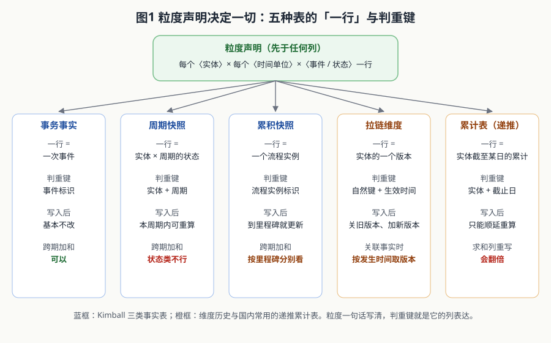
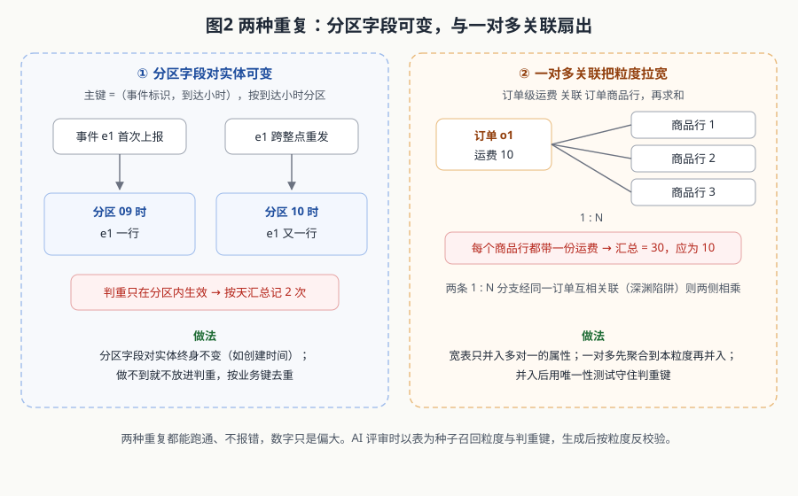

> 第一篇用一个反模式讲过模型：小表按小时分区，主键里带了小时，跨整点重发的同一事件被数了两次。那一节的结论是「分区和判重不能混在一起」。这一篇把它展开成一套方法：一张表的语义由什么决定；事务、快照、拉链、累计几种表各自的「一行」是什么；业务主键、分区、引擎主键三者怎样分工；宽表省掉了关联，代价又落在哪里；AI 怎样凭证据而不是凭表结构推断模型，为什么重点在维度。

## 一、粒度：先说清一行是什么

### 1.1 粒度声明是契约

Kimball 的维度建模把设计归纳为四步：选业务过程、声明粒度、确定维度、确定事实。他把第二步称为整个设计的关键：粒度要在加任何列之前声明，声明之后就是对这张表有约束力的契约[1]。

粒度可以用一句话写清：**每个〈实体〉、每个〈时间单位〉、〈每次事件 / 当时状态〉一行**。例如「每笔订单的每个商品行一行」「每个用户每天一行，记当天结束时的状态」。这句话决定了后面所有事情：哪些维度能挂上来，哪些度量能求和，哪几列合起来不许重复。

### 1.2 不写下来，消费者就只能从字段去猜

表名叫「用户日表」，一行可能是「用户 × 日」，也可能是「用户 × 日 × 渠道」。前者可以直接数行得到活跃人数，后者数行就会把多渠道用户多算一遍。表本身不会报错，下游拿到的数却差了一截。

粒度不写，下游只能从列名、样例数据和写入 SQL 去推断。人推断会错，模型推断也会错（第五节有数据）。所以第一条规范是：**每张表都要有一句粒度声明，和建表语句一起评审、一起登记。**

## 二、几种表，几种「一行」

### 2.1 Kimball 的三类事实表

Kimball 把事实表分为三类[2]：

- **事务事实表**：一行是某个时空点上的一次度量事件，例如一张小票上的一行。行写入后基本不变。
- **周期快照**：一行汇总一个标准周期（日、周、月）内的情况。它的承诺是「每个实体每个周期都有一行，即使这期没有活动」，所以数据是稠密的，可以放心按键关联。
- **累积快照**：一行对应一个有明确起止的流程，例如订单从下单、支付、发货到签收。每到一个里程碑就回头更新这一行。

三类表对「能不能加和」的回答不同。Kimball 把度量分为可加、半可加、不可加：余额、库存这类快照度量可以跨实体相加，但不能跨时间相加[3]。把三十天的日余额加起来，得到的不是任何有意义的数。

### 2.2 维度的历史：拉链

维度属性会变，例如用户等级、渠道归属。Kimball 的第二类缓慢变化维度（SCD Type 2）用「新增一行」记录变化：同一个自然键会有多行，每行带生效时间、失效时间和当前标记[4]。拉链表的一行代表「某实体在某段时间内的一个版本」，判重键是自然键加生效时间，而不是自然键本身。拿它关联事实时，必须按事实发生的时间去取对应版本，否则就是拿今天的属性去解释过去的行为。

### 2.3 中文语境的「累计表」：递推带来的约束

国内数仓常说的「累计表」与 Kimball 的累积快照不是一回事。它通常是「每个实体一行，记截至某天的累计状态」，例如首次活跃日、累计付费金额，每天用「前一天的结果 + 当天增量」算出来。

递推带来两条硬约束：

- **不能单独重跑历史中的某一天。** 第 T 天的结果依赖第 T−1 天，改了中间一天，之后每天都要顺延重算。
- **求和类列不幂等。** 同一天的增量写两次，累计值就翻倍，行数和标记都不变，事后很难发现。

把这四种表放在一起，差别在下表：

| 表的类型 | 一行代表什么 | 判重键 | 写入后会改吗 | 度量能否跨期加和 |
|---|---|---|---|---|
| 事务事实 | 一次事件 | 事件标识 | 基本不改 | 可以 |
| 周期快照 | 实体 × 周期的状态 | 实体 + 周期 | 本周期内可重算 | 状态类度量不行 |
| 累积快照 | 一个流程实例 | 流程实例标识 | 每到里程碑就更新 | 按里程碑分别看 |
| 拉链维度 | 实体的一个历史版本 | 自然键 + 生效时间 | 只关闭旧版本、新增新版本 | 不适用 |
| 累计表（递推） | 实体截至某日的累计状态 | 实体 + 截止日 | 依赖前一天，只能顺延重算 | 不行 |

## 三、判重：业务主键、分区与引擎主键

### 3.1 业务主键是粒度的列表达

粒度写成一句话，业务主键就是这句话的列表达。「每个用户每天一行」对应（用户，日期）。声明之后还要能验证：dbt 把唯一性、非空写成数据测试，随构建自动执行[5]；它的语义层让每个语义模型声明实体，并区分主键、外键、唯一键与自然键，后续的自动关联都基于这些声明[6]。这两件事的共同点是：**判重键是写下来、被机器检查的，而不是靠开发者记着。**

### 3.2 分区字段必须对实体不变

分区是物理组织，判重是业务语义，两者经常被同一个日期字段串在一起。湖表和 OLAP 的主键表，多数要求或建议主键包含分区列，判重也就只在分区内生效。Apache Paimon 的文档对分区字段的选择给了一个很清楚的判断[7]：

- **不变的创建时间**通常合适，它可以放进主键，实体不会在分区之间移动；
- **可变的事件时间**会让实体跨分区移动，需要提供旧分区的撤回记录和新分区的写入记录，或者维护一份跨分区索引；
- **变更操作时间**通常不适合做实体的分区键，因为每次变更都有新时间，找不到旧行在哪个分区。

归纳成一条规则：**分区字段的取值对一个实体必须终身不变；做不到，就不要把它放进判重。** 第一篇那个反模式，正是把一个会随重发变化的时间放进了主键。

### 3.3 引擎主键不等于判重完成

声明了主键，引擎会把同键的行合并成一行。但「怎样合并」是另一个语义选择。Paimon 提供四种合并方式：保留最新、按非空字段部分更新、按列聚合、保留首行[8]。它特别说明，「最新」指的是记录的写入顺序；如果到达顺序不代表业务顺序，要另配序列字段。聚合方式下，没有为字段指定函数时，默认取最后一个非空值[9]。

这意味着：同样一张以用户为主键的表，选「保留首行」记录的是首次状态，选「最新」记录的是最后到达的状态，而最后到达的并不一定是时间上最新的。补一条旧数据，就可能把新值覆盖成旧值。**合并方式要和粒度声明写在一起**：这一行记的是首次、最新还是累计，「最新」按什么排序。

## 四、宽表：省掉的关联，转成了哪些代价

宽表把维度属性预先关联进事实行，查询时不用再关联，取数简单，性能也好。它的代价不在存储，而在语义。

### 4.1 时点：写入时的值，还是当前的值

属性被冗余进事实行后，就固定在写入那一刻。用户后来升级了，宽表里的旧行仍是旧等级。这本身没错，「按发生时的属性分析」往往正是想要的口径；问题在于没有写明。一张宽表里，有的属性取写入时，有的属性在每天重刷时取了当前值，下游无从分辨。**每个冗余进来的属性都要标明时点：取写入时，还是取当前。**

### 4.2 扇出：一对多关联把粒度拉宽

把「订单 × 商品行」关联到订单级的运费上，每个商品行都会带上一份运费，按订单汇总时运费就被乘上了商品行数。这叫扇出陷阱：一对多关联在聚合之前就把「一」侧的行复制了；两条一对多分支经由同一个「一」侧相互关联，则是深渊陷阱，两侧会彼此相乘[10]。

宽表是这类重复计数最常见的来源，因为它把关联固化成了表。规则是：**宽表只并入与本粒度多对一的属性；一对多的内容，先聚合到本粒度再并入。** 并入之后，粒度声明不变，判重键不变，用唯一性测试守住。

### 4.3 两种「退化」不要混用

Kimball 的「退化维度」（degenerate dimension）指的是订单号这类没有描述属性、只剩一个键的维度，直接留在事实表里，不另建维表[11]。国内说的「维度退化」多指把维表属性冗余进事实表或宽表，正是本节讨论的做法。两个词指向不同的东西，规范文档里应当写明用的是哪一种。

## 五、AI 这一层：从证据推断模型，重点在维度

### 5.1 不能凭表结构猜，但可以凭证据推断

大模型取数和写 ETL 时，最容易出的错不是语法错，而是关联错：把一对多关联后的金额直接求和，把拉链维度不按时间关联，把快照余额跨天相加。这类 SQL 能跑，结果看上去合理，只是数字偏大或偏小。

只给表结构让模型去猜，结果确实不可靠。ICLR 2025 的多表问答评测 MMQA 专门考了「从多张表里选出主键和外键」：参评模型中表现最突出的 o1-preview，主键选择准确率为 46.84%，外键选择为 40.78%，作者仍把它评为对表结构理解较好的一档[12]。

但这个结果说明的是「信息不够」，不是「这件事不该交给 AI」。只看列名和类型，人同样猜不准。数据团队手里其实有三类表结构之外的证据：

- **元数据**：字段注释、血缘，以及下游报表和查询里实际被拿来分组、过滤的列。被反复分组的列，事实上就在充当维度；
- **业务记忆**：「注册渠道与归因渠道不是一回事」「某个页面标识早期有脏值」这类零碎知识。它们很少进入正式文档，散在评审记录和事故复盘里，只能靠持续沉淀、在动手时准确召回；
- **数据本身**：取值的基数与分布、列与列之间的依赖、取值随时间的变化、不同表之间取值集合的包含关系。

三类证据叠加之后，AI 做的就不再是猜测，而是**推断**：每个结论都有出处，并且能用一条查询证伪。数据剖析（data profiling）本身是数据库领域研究了几十年的问题，单列统计、唯一列组合、函数依赖、包含依赖都有成熟的算法和综述[15][16]。AI 的增量不在于重新发明这些算法，而在于把剖析结果和元数据、业务记忆放在一起读，提出一个有业务含义的模型。

### 5.2 为什么重点是维度

事实表通常有业务过程撑着：一行是一笔订单、一次浏览，粒度错了，对账很快就会暴露。维度则不同，它看上去语义简单，「渠道」「设备」「地区」谁都懂，于是往往没人专门设计，问题长期潜伏：

- **维度藏在事实表里**：渠道、机型、页面以裸字符串散在各张事实表，同一个值有多种写法（大小写、空格、新旧编码并存），每张报表各自清洗一遍，口径悄悄分叉；
- **层级不显式**：只存最细一层（城市、投放计划），上卷到省、渠道时靠每个人在 SQL 里写一段映射，映射彼此不一致；
- **一个名字，几种角色**：注册时的渠道、归因到的渠道、当前所属渠道都叫 channel。Kimball 把这种情况称为角色扮演维度，要求按角色分别命名[14]；不分开，按渠道看留存和按渠道看收入就是两套人群；
- **该缓变的被当成静态**：用户等级、设备归属、渠道归类会变，表里只存当前值，历史报表一重算数字就变（缓变维的处理见 2.2 与[4]）；
- **跨表不一致**：不同主题各维护一份应用清单或渠道清单，同一个维度在不同事实表上取值集合不同。Kimball 用一致性维度（conformed dimension）来约束这一点，同一维度在所有事实表上取值与含义必须一致，跨主题的比较才成立[13]。

这些问题都不会让 SQL 报错，只会让同一个数字在不同报表里对不上。也正因为不报错，它们最适合交给一个能系统读证据的 AI 去找。

### 5.3 从数据推断维度：五种证据，各有一条验证

| 要推断的 | 用到的证据 | 怎么验证 |
|---|---|---|
| 这一列是维度还是度量 | 基数、分布；下游是否被拿来分组 | 统计不同取值数与行数之比；查下游查询的分组列 |
| 层级 | 函数依赖：城市决定省份，子渠道决定渠道[16] | 按子级分组，数父级取值数大于 1 的子级个数，应为 0 |
| 取值规范化 | 取值聚类：大小写、空格、相近写法、新旧编码 | 给出映射表，映射后不同取值数下降，且无一对多 |
| 缓变方式 | 同一实体的属性随时间是否变化、多久变一次 | 按实体统计属性变化次数；变化且历史报表要保留旧值，就要拉链 |
| 是否应为一致性维度 | 包含依赖：A 表的取值集合是否包含于 B 表[15] | 数出在 A 中出现、在维度主表里找不到的取值个数 |

推断的产出是一份**维度模型提案**：维度实体是什么、主键是什么、层级怎样排列、有哪些属性、各属性用哪种缓变方式、哪些事实表上的同名列要统一映射到它。每一条都附上证据和验证查询的结果，验证没通过的就标成存疑，不进入提案。

原来的几项检查在这里成为校验环节：从写入 SQL 推断实际粒度并与声明比对，识别「一对多关联后求和」「快照跨时间加和」「拉链按当前版本关联」这几种重复计数模式，审分区字段与合并方式。它们回答的是「这张表做得对不对」，维度推断回答的是「这张表应该长什么样」。

### 5.4 推断结论写成命题，动手时召回

推断出来的结论，和人工评审的结论一样，写成挂在表、字段和关联上的命题：

- 「渠道列在本表是归因渠道，与注册渠道不同，不可互换」，挂在字段上；
- 「子渠道唯一决定渠道，上卷只能经渠道维度表，不在 SQL 里手写映射」，挂在维度表上；
- 「本表为按天递推的累计表，历史日期不得单独重跑，求和列重复写入会翻倍」，挂在表上；
- 「关联订单商品行时，运费需先在订单粒度聚合」，挂在两表之间的关联上。

AI 或人在建表、改表、写 SQL 之前，以涉及的表为种子召回这些命题；生成 SQL 之后按粒度和维度反校验：分组列是否等于判重键，关联后是否发生扇出，维度列是否经过统一映射，度量的加和方式是否与表的类型相符。不一致就退回。这与第四篇指标的「取数前召回、生成后反校验」是同一流程，只是种子换成了表。

模型会随业务变化：新渠道上线、新的地区划分、某个属性开始变化。推断因此不是一次性的，同一套验证查询定期重跑，结论失效时更新命题，而不是让旧结论继续被召回。

边界同样要写清：AI 可以推断、提出模型、给出映射和风险，但不自行修改主键、层级、分区、合并方式和缓变方式。这几样一改，历史数据的语义就变了，只能由表的负责人决定。

## 六、方法：六条原则

1. **先声明粒度，再加列**：每张表一句话说清一行是什么，和建表语句一起评审、一起登记；
2. **按表的类型决定能否加和**：事务可加，快照的状态类度量不跨时间加，拉链按时间关联，累计表只能顺延重算；
3. **判重键写下来并由机器检查**：唯一性、非空作为数据测试随构建执行，不靠记忆；
4. **分区字段对实体终身不变**：做不到就不放进判重；合并方式与序列字段和粒度声明写在一起；
5. **宽表只并入多对一的属性**：一对多先聚合再并入；每个冗余属性标明取写入时还是取当前；
6. **维度单独设计，推断要有证据**：层级、角色、缓变方式、一致性都写下来；AI 用元数据、业务记忆和数据剖析提出维度模型，每条结论附验证查询；建模约束写成命题挂在表上，动手前召回，生成后反校验；改主键、层级、分区、合并方式由负责人决定。

## 七、结语

一张表的语义，不在列名里，而在「一行代表什么」这句话里。粒度没有声明，业务主键就无从谈起；分区和合并方式选错，引擎会严格执行一个错误的判重；宽表把关联固化下来，也把扇出和时点问题一起固化了下来。

AI 让写 SQL 变得很快，也让一个没有声明的粒度更快地被复制到更多的表和报表里。建模评审因此更重要了。反过来，AI 也让过去没人有精力做的事变得可行：把元数据、业务记忆和数据本身放在一起读，系统地找出藏在事实表里的维度、没写出来的层级和混用的角色，再把结论写成动手时能召回的命题。粒度和维度都写清楚了，AI 才能在这些约束之内工作。

## 参考资料

1. Kimball Group. [Four-Step Dimensional Design Process](https://www.kimballgroup.com/data-warehouse-business-intelligence-resources/kimball-techniques/dimensional-modeling-techniques/four-4-step-design-process/).
2. R. Kimball. [Fact Tables](https://www.kimballgroup.com/2008/11/fact-tables/). Kimball Group, 2008.
3. Kimball Group. [Additive, Semi-Additive, and Non-Additive Facts](https://www.kimballgroup.com/data-warehouse-business-intelligence-resources/kimball-techniques/dimensional-modeling-techniques/additive-semi-additive-non-additive-fact/).
4. Kimball Group. [Type 2: Add New Row](https://www.kimballgroup.com/data-warehouse-business-intelligence-resources/kimball-techniques/dimensional-modeling-techniques/type-2/)；另见 [Kimball Dimensional Modeling Techniques](https://www.kimballgroup.com/wp-content/uploads/2013/08/2013.09-Kimball-Dimensional-Modeling-Techniques11.pdf)（PDF 汇编）.
5. dbt Labs. [Add data tests to your DAG](https://docs.getdbt.com/docs/build/data-tests).
6. dbt Labs. [Entities](https://docs.getdbt.com/docs/build/entities).
7. Apache Paimon. [Data Distribution](https://paimon.apache.org/docs/master/primary-key-table/data-distribution/)（Pick Partition Fields 一节）.
8. Apache Paimon. [Merge Engines](https://paimon.apache.org/docs/master/primary-key-table/merge-engine/).
9. Apache Paimon. [Aggregation](https://paimon.apache.org/docs/master/primary-key-table/merge-engine/aggregation/).
10. Coginiti. [Fan and Chasm Traps: Definition & Prevention](https://coginiti.co/glossary/fan-chasm-traps/).
11. Kimball Group. [Degenerate Dimensions](https://www.kimballgroup.com/data-warehouse-business-intelligence-resources/kimball-techniques/dimensional-modeling-techniques/degenerate-dimension/).
12. J. Wu, L. Yang, D. Li, Y. Ji, M. Okumura, Y. Zhang. [MMQA: Evaluating LLMs with Multi-Table Multi-Hop Complex Questions](https://proceedings.iclr.cc/paper_files/paper/2025/file/794a425a2e47e05d29d30f79b79a692d-Paper-Conference.pdf). ICLR 2025.
13. Kimball Group. [Conformed Dimensions](https://www.kimballgroup.com/data-warehouse-business-intelligence-resources/kimball-techniques/dimensional-modeling-techniques/conformed-dimension/).
14. Kimball Group. [Role-Playing Dimensions](https://www.kimballgroup.com/data-warehouse-business-intelligence-resources/kimball-techniques/dimensional-modeling-techniques/role-playing-dimension/)；层级见 [Fixed Depth Positional Hierarchies](https://www.kimballgroup.com/data-warehouse-business-intelligence-resources/kimball-techniques/dimensional-modeling-techniques/fixed-depth-hierarchy/).
15. Z. Abedjan, L. Golab, F. Naumann. [Profiling Relational Data: A Survey](https://link.springer.com/article/10.1007/s00778-015-0389-y). The VLDB Journal, 2015（[作者预印本 PDF](https://hpi.de/fileadmin/user_upload/fachgebiete/naumann/publications/PDFs/2015_abedjan_profiling.pdf)）.
16. T. Papenbrock et al. [Functional Dependency Discovery: An Experimental Evaluation of Seven Algorithms](https://www.vldb.org/pvldb/vol8/p1082-papenbrock.pdf). PVLDB 8(10), 2015.
