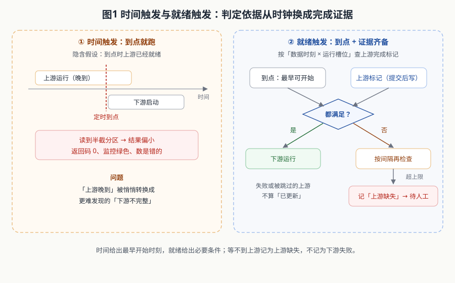
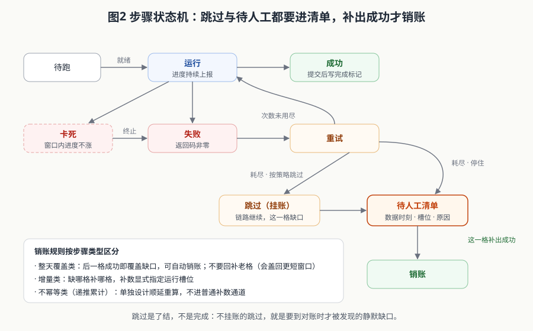
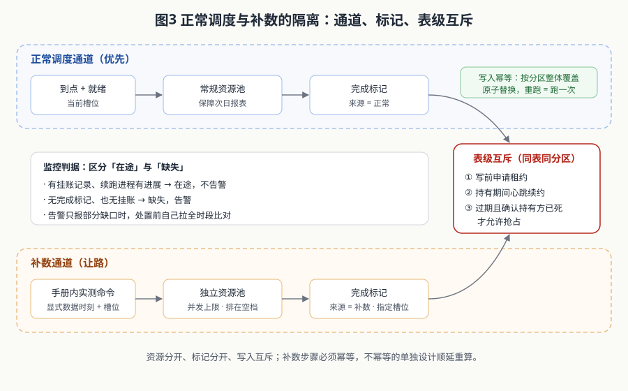

> 第二篇把过程元数据列为广义元数据的第一个方向：每次运行的起止、行数、重试、就绪状态。第五篇说血缘的边应当挂在「作业的某次运行」上。两处都默认有一个调度系统在按规矩产出运行记录。这一篇讲这个规矩本身：一步何时可以跑，跑完怎样算数，失败、跳过、卡死后怎样收口，补数怎样不搅乱正常调度，以及 AI 能判断什么、为什么只能用验证过的命令，又为什么同样是 AI 值班，分水岭在记忆。

## 一、两种触发：到点与就绪

### 1.1 时间触发的隐含假设

最常见的调度是时间触发：每天凌晨两点跑日汇总，每小时第十分钟跑小时表。它简单、可预期，但藏着一个假设：**到点时，上游已经就绪。**

某天上游晚了二十分钟，下游照常启动，读到半截分区，算出一个偏小但「成功」的结果：返回码是零，监控是绿的，数是错的。时间触发把「上游晚到」悄悄转换成了更难发现的「下游不完整」。

### 1.2 就绪触发：以上游的完成为条件

就绪触发把条件从时钟换成数据。Airflow 的传感器（Sensor）是专门等待条件成立、按间隔反复检查的任务[1]；它的资产调度让下游直接声明「某份数据更新时运行」，并规定只有生产任务成功才算更新，失败或跳过都不触发下游[2]。Dagster 的资产传感器以物化事件为信号触发下游[3]；DolphinScheduler 的依赖节点检查上游在指定周期是否成功，上游失败时可直接失败或继续等待[4]。

这些设计的共同点是：**下游判定的依据是上游留下的完成证据，而不是时钟。**

### 1.3 两者结合：到点是最早时刻，就绪是必要条件

实践中两者并用：时间给出最早可以开始的时刻，就绪给出必须满足的条件。等待要有上限，超限仍不就绪，应记为「上游缺失」进入待人工，而不是记为下游失败，否则排查的人会去下游代码里找一个不存在的问题。

## 二、完成标记与依赖判定

### 2.1 完成标记要在提交之后写

标记的语义决定了依赖判定是否可靠。Luigi 的设计很清楚：任务是否完成，看输出目标（Target）是否存在，目标只需实现「存在与否」的判断[5]。但存在不等于完整：文件可能写到一半，分区可能刚建好还没装数。

所以标记要**在数据提交（原子替换分区、事务提交）之后才写，并带上可核对的事实**：行数、数据时间范围、代码版本。下游不仅看标记在不在，还可以核对这些事实。

### 2.2 两段键：数据时刻与运行槽位

一个完成标记要回答两个问题：这份数据是**哪个时刻**的；它是**哪一次调度**产出的。Airflow 把前者叫数据区间，每次运行都有自己负责的时间范围，与实际启动时间分开记[6]。

在按批次换槽的链路上，后者同样要显式：下游问的是「本槽位的上游是否已完成」。补一个旧槽位时，若命令不指定槽位、默认取当前槽位，标记就落错了格：当前格被误判为已完成，真正缺的那一格仍是空的。**完成标记要落在「数据时刻 × 运行槽位」两段键上，补数必须显式指定槽位。**

### 2.3 依赖按数据时刻对齐

依赖判定要问「上游**同一数据时刻**是否完成」，而不是「上游最近一次是否成功」：今天成功不代表昨天那一格也成功。

换槽时没跑完的步骤也容易漏：旧槽位还有一步在跑或失败未处理，调度器若只看新槽位，它就被静默放行了。正确做法是**显式挂账**：把未完成的步骤记进待续跑清单，由新槽位或专门的续跑通道接着处理，处理完再销账。

## 三、失败、跳过、待人工：状态设计

### 3.1 状态要多于「成功」与「失败」

Airflow 的任务实例有十余种状态，除成功、失败外，还有跳过、因上游失败而不运行、等待重试、等待人工输入等[7]。每种状态对应一种处置：等待重试的不用管，上游失败的去查上游，等待人工的要有人接手。

传播规则同样重要。Airflow 的默认触发规则是「上游全部成功」，此时跳过会沿依赖向下级联[8]：一次跳过可能让一整串下游都不运行，而且不报错。

### 3.2 跳过也是一种了结，必须挂账

图 2 是一套建议的状态机：失败进入重试，重试耗尽后要么停在失败等人处理，要么按策略跳过，让同批次其他步骤继续。**跳过是一种了结状态，但不是完成。**它让链路继续走，代价是这一格缺了一块。所以跳过必须同时写入待人工清单，记清数据时刻、槽位与原因，这一格补出成功才能销账；否则它就是一个要到对账时才被发现的静默缺口。

销账条件要按步骤类型区分。**整天覆盖类步骤**（每次运行都重算当天从零点到当前的全部数据）有一个便利：后一格成功，就已经覆盖了前一格的缺口，可以自动销账。但它也有一个反直觉的陷阱：此时若再去补前一格，补数只算到前一格的时刻，反而把已经完整的整天数据**盖回了更短的窗口**。补数前必须先确认步骤类型，覆盖类步骤补最新一格，增量类步骤才逐格补。

### 3.3 卡死：返回码看不见

基于返回码的容错（失败即重试）对一类问题无效：**卡死**。进程不退出，就没有返回码；不报错，就不会重试。它占着资源和槽位，后面的步骤都在等它。

Airflow 用心跳超时回收「执行方已不在、状态还停在运行」的任务[7]，解决的是进程死了，解决不了进程活着却不干活。一刀切的绝对超时两头不讨好：设短了误杀数据量大的合法长跑，设长了真卡死要很久才发现。

更好的判据是**无进展检测**。Hadoop 的任务超时就是这样定义的：任务在规定时间内既不读输入、不写输出、也不更新状态，才被终止[9]。推广到调度层：为每类步骤选一个进度指标（已读行数、已写分区数、阶段计数），在一个观测窗口内不再增长，才判为卡死。慢不等于卡，进度在涨就不杀。

## 四、补数与正常调度的隔离

### 4.1 为什么要隔离

补数和正常调度争抢同一批资源和同一批表。Google 的 SRE 书讨论数据处理流水线时，描述过大量任务同时启动冲击共享资源、多条流水线执行周期偶然重叠共同挤占资源这两类问题[10]。几十天的补数就是这样一股额外负载，与正常调度同走一条通道，最先受影响的往往是次日早上的报表。

### 4.2 通道、资源与优先级

隔离分三层：

- **资源**：补数走独立的资源池或队列并限制并发。Airflow 的池可限制任意一组任务的并行度[11]；DolphinScheduler 的补数分串行与并行，并行可设最大并发实例数[12]；Dagster 可在代码里声明补数策略，逐分区运行或合并为一次运行[13]。
- **标记**：补数产出的完成标记带显式的槽位与「补数」来源，不与正常调度的标记混淆。
- **优先级**：正常调度优先，补数排在空档里。

### 4.3 同表写入要有表级互斥

通道分开了，写的仍可能是同一个分区，结果取决于谁后提交，甚至半新半旧。所以写同一张表的进程之间要有**表级互斥**：写前申请租约，持有期间心跳续约，写完释放。

难点在抢占：心跳停了，是持有方死了还是只是停顿？Kleppmann 讨论分布式锁时举过例子：持有方因长停顿错过续约，租约被别人拿走，它醒来仍以为自己持有，接着写入[14]。他的解法是递增的防护令牌，存储端拒绝过期令牌的写入。在存储不支持校验令牌的数据平台上，退而求其次的规则是：**租约过期只是可以抢占的必要条件，抢占前还要确认持有方进程确已不在。**

### 4.4 幂等是补数的前提

补数和重试都意味着同一格被写多次。Kleppmann 在《数据密集型应用系统设计》中把批处理容错建立在「输入不可变、输出整体替换」之上：失败可以直接重跑，结果与只跑一次相同[15]。流处理领域对「恰好一次」的讨论也落到同一点：要么写入幂等，要么写入与进度提交在同一个事务里[16]。对批处理而言，最实用的形式就是**按分区整体覆盖、原子替换**。不幂等的步骤（例如按天递推、求和累加的累计表）不能简单地进入补数通道，要单独设计顺延重算的计划。

### 4.5 监控要分清「在途」与「缺失」

换槽挂账后，旧槽位的步骤还在续跑，只看「标记在不在」的监控会把在途报成缺失。判据要区分：有挂账、续跑有进展的是在途；无标记也无挂账的才是缺失。

反过来，告警说「缺了某几格」时也不要只修那几格：告警规则往往只覆盖部分时段或部分表，**处置前要自己拉全时段比对**，确认缺口的真实范围。

## 五、AI 这一层

### 5.1 读运行事件，判断失败的性质

值班时最耗时的一步，是从运行事件里判断问题性质：同样是没完成，可能是卡死、资源被挤、上游缺失、数据异常或代码错误，处置完全不同。这一步适合交给 AI，第二篇的过程元数据就是输入：一次运行的状态序列、进度指标的时间曲线、重试次数、资源队列等待时长、上游标记的到达时间、日志尾部。微软的两项研究给了参照：对超过四万起线上事故的研究表明，大模型可以帮助工程师定位根因并给出缓解建议[17]；RCACopilot 按告警类型匹配处置流程、汇集诊断信息，再由大模型预测根因类别并给出解释，在一年的真实事故数据上准确率最高达到 0.766[18]。

0.766 意味着约四次错一次。所以判断必须附证据：判为卡死，指出进度从何时起不再增长；判为上游缺失，指出哪个上游哪一格没有标记。无证据的判断不进入处置。

### 5.2 起草恢复步骤

判断清楚之后，AI 可以起草恢复计划：

- 沿第五篇的血缘向下展开，列出受影响的下游与要补的格；
- 按步骤类型决定补法：覆盖类补最新一格，增量类逐格补，不幂等的单独设计；
- 为每条补数命令填上数据时刻与运行槽位；
- 标出需要表级互斥的写入，以及会与正常调度争抢的时段。

### 5.3 补数计划只用验证过的命令

调度与补数的命令有大量隐含约束：哪个参数必填，默认值落在哪一格，接口返回成功是否真的生效。这些只能在实测中积累，大模型凭通用知识推断的命令恰恰在这里最容易错，而补数出错的代价是把正确的数据覆盖成错误的。

规则因此很简单：**补数计划只使用命令手册里实测过的命令；动手前先打开手册，逐条核对；手册里找不到的命令，停下来先验证再入册。**这是前几篇「动手时召回」的又一处应用：以要补的表和步骤为种子，召回手册条目、步骤类型、累计语义和历史事故，人和 AI 都一样。

### 5.4 分水岭在记忆：一般 AI 只能读手册

前三小节的判断、起草与核对命令，现有的 AI 值班方案大多也在做，它们依靠的知识来源相同：预先写好的处置手册与元数据。RCACopilot 的第一步就是按告警类型匹配事先编写的处置流程[18]；Google SRE 的经验是，把最佳实践事先写进手册，平均恢复时间约为临场应对的三分之一[19]。手册当然有用，但它同时给 AI 划了上限：手册与元数据写到哪里，AI 就只能判断到哪里。

问题在于，值班时真正决定动不动手的规矩，大多不在手册里。Polanyi 指出「我们知道的比我们能说出来的多」[20]；专家系统时代，Feigenbaum 把从专家那里获取知识视为最关键的瓶颈[21]。即便说得出来，也未必有人去写：对 878 条文档相关讨论的实证研究表明，文档的编写与维护经常被搁置[22]。调度层这样的规矩随手可举：

- 某个回写步须等上游表重建后才能回补，在此之前它每天报出的失败无需处置；
- 某组任务固定越过所在槽位，半小时内自行续跑完成，夜间不必人工介入；
- 他人手工发起的补数失败，不在值班处置范围之内；
- 某个实体只认一种来源事件，其他事件携带的同名字段一律不采信。

这类规矩多半诞生于某一次处置或讨论，当场就决定了下一次怎么做，离整理成文却还很远，有的永远不会被整理。

一般的 AI 在这里无能为力。它的知识来自训练语料与本次会话的上下文，会话结束即被遗忘；接上文档库，能检索的也只是已成文的部分。不成文的规矩对它而言并不存在，同一个错误会在每个新会话里重犯一次。

分水岭在于有没有一套记忆体系。它做三件事：

- **持续沉淀**：每一次被纠正、每一次定下新做法，当场记成一条可检索的规则，不等整理成文；
- **动手时召回**：以要处置的表、步骤与告警为种子，把相关规则、教训与历史事故注入当前判断，这是前几篇「动手时召回」在值班中的应用；
- **随时修订**：规则被推翻时当场改写或作废，避免新旧并存、互相矛盾。

于是，值班 AI 依靠的就不只是手册，还有一份始终比手册更新的不成文规则集。这与 5.3 并不冲突，而是分层：执行层的命令不可逆，仍以实测入册的手册为准；判断层，即这件事该不该管、此刻要不要动手、这个口径认不认，依靠沉淀下来的规则。判断层中反复验证过的做法再提炼进手册，手册也随之越来越全。

这套体系能长到什么程度，取决于让 AI 参与多少。Nonaka 把组织中默会知识转为显性知识的关键，归于共同工作中的对话与表达[23]，AI 积累不成文的规矩也是同理：只在出事时才叫上它，它就只能读手册；日常的评审、答疑、口径讨论与事故复盘都让它在场，散落在对话里的规矩才会被它记下。因此首先要转变的是认识：不把 AI 当作查手册的工具，而当作一起干活的同事，参与本身就是它积累的途径。

AI 在生产环境里执行动作的权限与护栏，后面专门讨论。

## 六、方法：七条原则

1. **到点是最早时刻，就绪是必要条件**：等不到上游记为上游缺失，不记为下游失败；
2. **完成标记在提交之后写，带可核对的事实**，键为「数据时刻 × 运行槽位」，补数显式指定槽位；
3. **依赖按数据时刻对齐**；换槽时未完成的步骤显式挂账续跑，不静默放行；
4. **跳过是了结不是完成**：进待人工清单，补出成功才销账；覆盖类步骤后一格成功可自动销账，不要回补老格；
5. **卡死用无进展检测**：进度在窗口内不涨才算卡死，不用一刀切的绝对超时；
6. **补数与正常调度隔离**：独立资源与并发上限、独立标记来源、同表写入有租约与心跳，确认持有方已死才抢占；补数步骤必须幂等；
7. **AI 判断附证据，补数只用实测命令**：监控区分在途与缺失，处置前拉全时段比对；判断层的不成文规矩当场沉淀、动手时召回，并让 AI 参与日常，记忆才长得起来。

## 七、结语

调度系统常被看作定时器加依赖图。真正决定数据对不对的，是每条边判定的依据、每个状态的含义，以及失败后怎样收口：时间触发把上游晚到变成下游不完整，返回码藏起了卡死，不挂账的跳过是没人知道的缺口，不隔离、不指定槽位的补数会制造新的错误。

AI 能更快判断问题性质、更全地起草恢复计划，但判断要附证据，命令要来自实测过的手册。调度层的知识和别处一样零碎：哪个参数默认落在哪一格，哪类步骤不能回补，哪类告警为什么不必处置，很多从未写成文。只读手册的 AI，只能做到手册写到的地方；有记忆体系、并参与日常的 AI，能把这些规矩当场记下、动手时召回，越用越懂这套系统。

这个系列会持续更新。

## 参考资料

1. Apache Airflow. [Sensors](https://airflow.apache.org/docs/apache-airflow/stable/core-concepts/sensors.html).
2. Apache Airflow. [Asset-Aware Scheduling](https://airflow.apache.org/docs/apache-airflow/stable/authoring-and-scheduling/asset-scheduling.html).
3. Dagster. [Asset sensors](https://docs.dagster.io/guides/automate/asset-sensors).
4. Apache DolphinScheduler. [Dependent Node](https://github.com/apache/dolphinscheduler/blob/dev/docs/docs/en/guide/task/dependent.md)（官方文档源文件）.
5. Luigi. [Concepts: Target, Task, Parameter](https://luigi.readthedocs.io/en/stable/workflows.html).
6. Apache Airflow. [Dag Runs](https://airflow.apache.org/docs/apache-airflow/stable/core-concepts/dag-run.html)（Data Interval、Catchup 两节）.
7. Apache Airflow. [Tasks](https://airflow.apache.org/docs/apache-airflow/stable/core-concepts/tasks.html)（Task Instances、Task Instance Heartbeat Timeout 两节）.
8. Apache Airflow. [Dags](https://airflow.apache.org/docs/apache-airflow/stable/core-concepts/dags.html)（Trigger Rules 一节）.
9. Apache Hadoop. [mapred-default.xml](https://hadoop.apache.org/docs/stable/hadoop-mapreduce-client/hadoop-mapreduce-client-core/mapred-default.xml)（`mapreduce.task.timeout`）.
10. D. Dennison. [Data Processing Pipelines](https://sre.google/sre-book/data-processing-pipelines/). In B. Beyer et al. (eds.), Site Reliability Engineering, O'Reilly, 2016, Chapter 25.
11. Apache Airflow. [Pools](https://airflow.apache.org/docs/apache-airflow/stable/administration-and-deployment/pools.html).
12. Apache DolphinScheduler. [Workflow Definition](https://github.com/apache/dolphinscheduler/blob/dev/docs/docs/en/guide/project/workflow-definition.md)（Complement 一节，官方文档源文件）.
13. Dagster. [Backfilling data](https://docs.dagster.io/guides/build/partitions-and-backfills/backfilling-data).
14. M. Kleppmann. [How to do distributed locking](https://martin.kleppmann.com/2016/02/08/how-to-do-distributed-locking.html). 2016.
15. M. Kleppmann. [Designing Data-Intensive Applications](https://dataintensive.net/). O'Reilly, 2017（第 10 章批处理；书籍主页）.
16. N. Narkhede. [Exactly-Once Semantics Are Possible: Here's How Kafka Does It](https://www.confluent.io/blog/exactly-once-semantics-are-possible-heres-how-apache-kafka-does-it/). Confluent Blog, 2017.
17. T. Ahmed, S. Ghosh, C. Bansal, T. Zimmermann, X. Zhang, S. Rajmohan. [Recommending Root-Cause and Mitigation Steps for Cloud Incidents using Large Language Models](https://arxiv.org/abs/2301.03797). ICSE 2023.
18. Y. Chen, H. Xie, M. Ma et al. [Automatic Root Cause Analysis via Large Language Models for Cloud Incidents](https://arxiv.org/abs/2305.15778). EuroSys 2024.
19. B. Treynor Sloss. [Introduction](https://sre.google/sre-book/introduction/). In B. Beyer et al. (eds.), Site Reliability Engineering, O'Reilly, 2016（Emergency Response 一节）.
20. M. Polanyi. [The Tacit Dimension](https://press.uchicago.edu/ucp/books/book/chicago/T/bo6035368.html). University of Chicago Press, 1966（2009 再版主页）.
21. E. A. Feigenbaum. [The Art of Artificial Intelligence: Themes and Case Studies of Knowledge Engineering](https://www.ijcai.org/Proceedings/77-2/Papers/092.pdf). IJCAI 1977.
22. E. Aghajani, C. Nagy, O. L. Vega-Márquez et al. [Software Documentation Issues Unveiled](https://2019.icse-conferences.org/details/icse-2019-Technical-Papers/49/Software-Documentation-Issues-Unveiled). ICSE 2019.
23. I. Nonaka. [The Knowledge-Creating Company](https://hbr.org/2007/07/the-knowledge-creating-company). Harvard Business Review, 1991（2007 年重刊）.
