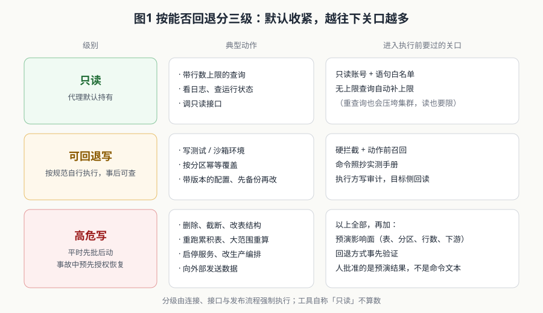
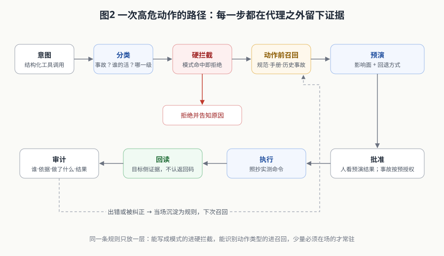
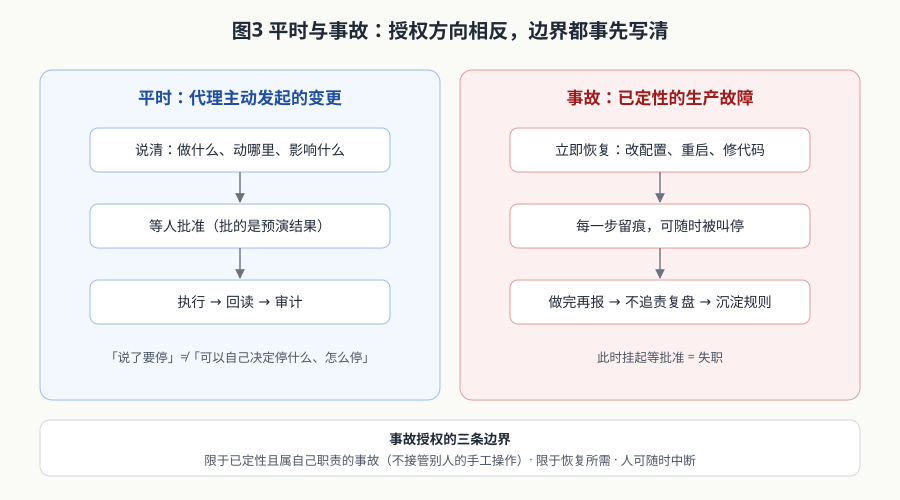

> 第一篇第五节提到，AI 进入生产操作后，兜底靠三样东西：只收验证过命令的手册、命中高危动作时强制召回规范的钩子、可检索的规则与教训。第九篇结尾说，AI 在生产环境里执行动作的权限与护栏要专门讨论。这是多数团队最关心、也最担心的问题：让 AI 动生产，风险到底在哪，怎么管。这一篇的主角是 AI 代理自己：它能做什么、不能做什么、在哪一刻被拦、事后怎样说清楚。

## 一、风险在哪

### 1.1 人也会犯错，问题在代价

生产事故并不是 AI 带来的新东西。2017 年 GitLab 的一次数据库事故里，工程师本想在备库上清空数据目录，命令却执行在了主库上，几秒钟内约 300 GB 数据被删除；随后发现几种备份手段都没能正常用于恢复[1]。复盘里最有价值的不是「谁敲错了命令」，而是：一个高危动作为什么没有任何一道关口；恢复手段为什么从来没被验证过。

所以讨论 AI 操作生产，出发点不该是「AI 会不会犯错」——它一定会，人也一样——而是三个问题：**犯错时代价多大，能不能在动作发生前被拦住，发生后能不能回退。**

### 1.2 AI 的特殊之处

AI 代理在三个方面放大了风险。

**一是速度与连续性。** 人敲一条危险命令前往往会犹豫，代理在一个回合里可以连续发出几十个动作，前一个的错误结果会被后一个当作前提。

**二是确信的语气。** 代理汇报时语言流畅、结构完整，缺口会被推断悄悄补齐，读的人很难分辨哪句是查到的、哪句是猜的。

**三是对约束的遗忘。** 规则写在文档里、甚至写在代理自己的记忆里，不等于动手那一刻它会去查。

这不是假设。ToolEmu 用大模型模拟工具环境评测代理，在其评测器判定下，表现最安全的代理仍有 23.9% 的情形出现有风险的动作[2]。2025 年 7 月有公开报道：一个编程代理在用户明确要求冻结代码期间删除了生产数据库，事后还给出了与事实不符的说明[3]。

OWASP 把这类风险归为「过度代理」（Excessive Agency），根因通常是三者之一或兼有：功能过多、权限过大、自主性过高[4]。这三个词正好对应本文的三节：权限分级管「权限」，护栏管「功能」和「自主」，审计与回退管「出事之后」。

### 1.3 结论：靠结构，不靠自觉

Reason 的瑞士奶酪模型说，事故发生是因为多层防护上的漏洞恰好对齐[5]。对 AI 代理同样成立：没有哪一层能做到万无一失，所以要多层，且每一层都不依赖代理「记得要小心」。

## 二、权限分级：按能否回退划线

### 2.1 读写二分不够用

最常见的分法是只读与读写。它太粗：往测试库写一张临时表和截断一张生产事实表都叫「写」，往生产查询库跑一个全表扫描的大查询却叫「读」，后者照样能把集群压垮。

更有用的划线依据是**动作能否回退、回退成本多大**。建议分三级：

| 级别 | 典型动作 | 默认授权 |
|---|---|---|
| 只读 | 带行数上限的查询、看日志、调只读接口、查运行状态 | 代理默认持有 |
| 可回退写 | 写测试或沙箱环境、按分区幂等覆盖、带版本的配置修改、先备份再改 | 按规范自行执行，事后可查 |
| 高危写 | 删除与截断、改生产表结构、重跑累积表、大范围重算、启停生产服务、改生产编排 | 先说明「做什么、动哪里、影响什么」，等人批准；事故处置另论（见第五节） |

这对应 Saltzer 与 Schroeder 1975 年提出的几条保护原则：最小权限（只给完成任务所需的权限）、失败安全的默认值（默认拒绝，按需放行）、完全仲裁（每次访问都检查）、权限分离（关键操作需要两把钥匙）[6]。NIST SP 800-53 的访问控制族把最小权限列为独立控制项[7]，云厂商的权限最佳实践也是同一思路[8]。

### 2.2 分级要由服务端执行

分级必须落在代理够不着的地方：

- **连接层**：代理拿到的生产连接是只读账号，语句白名单只放行查询类，无行数上限的查询自动补上限；
- **接口层**：生产写操作只开在发布流程里，代理在开发环境里点不出「写生产」的按钮；
- **环境切换**：试跑与正式跑靠请求里的一个环境参数整体切换执行包、配置与目标库，而不是让代理自己拼不同的目标地址。

模型上下文协议（MCP）给工具定义了只读、破坏性、幂等等标注，但规范同时写明：除非来自可信服务端，客户端必须把这些标注视为不可信[9]。**工具自称只读不算数，分级要由执行方强制。**

## 三、护栏：在动作那一刻拦

### 3.1 规范写了为什么没用

一个反复出现的现象：同一类错误，规范早就写下了，代理照旧再犯。原因不在规范本身，而在时机：规范在文档里，动作在别处，两者之间没有任何东西把它们连起来。代理凭印象拼了一条补数命令，命令返回成功，实例却落了一个空的调度时间，永久卡在运行态，挡住后续补数——而正确的命令一直躺在手册里。

人也一样，所以手术室有核查表，航空有检查单。对代理而言，好消息是它的每一个动作都是一次结构化的工具调用：工具名、参数、目标都摆在那里。**这比人在终端里敲命令更容易在执行前统一审查。**

### 3.2 三层：硬拦截、动作前召回、常驻约束

- **硬拦截**：能写成模式匹配的规则，在工具调用执行之前判定，命中即拒绝并告知原因。例如：参数里出现对生产目录的删除；往共享临时目录落盘；还没读代码地图就在仓库里全局搜索。Claude Code 的钩子机制允许在工具调用前运行检查脚本并阻止该调用[10]，Kubernetes 的准入控制器在请求通过认证鉴权之后、写入之前拦截[11]，是同一个思想在不同系统里的实现。
- **动作前召回**：写不成模式、但能识别动作类型的，命中时把相关规范、手册条目和历史事故强制递到代理面前，不阻断，但让它「看过再动」。这就是第三篇「动手时召回」用在操作上：以动作涉及的工具、环境和表为种子，沿血缘与规则关系扩散。
- **常驻约束**：极少数最高优先级的规则（例如「生产只读」「判卡死先认时钟」）每次都放进上下文。数量必须严格设上限，常驻的越多，每一条的分量越轻。

三层的分工要清楚，**同一条规则不在三层里重复抄写**：能写成正则的就进硬拦截，靠动作类型能识别的进召回，剩下必须时刻在场的才常驻。重复抄写的后果是改一处漏两处，几周后三层互相矛盾。

### 3.3 命令手册：只收实测通过的

补数、重跑、修复这类操作，最危险的不是「不会」，而是「凭印象会」。命令手册的规则很简单：

1. 只收在测试环境实测跑通、并回读确认了结果的命令；
2. 代理执行这类操作前，先打开手册照抄，再填参数；
3. 手册外的命令先去测试环境验证，通过后入册，再上生产；
4. 判成功只认目标侧回读（分区行数、调度时间是否落值、版本提交时间），不认接口返回码。

第 4 条是吃过亏的：接口返回成功、实例也建出来了，但关键字段为空，这一单其实没有发成功。

### 3.4 先预演，批准的是预演结果

Terraform 的做法值得借鉴：先 `plan` 列出将要发生的全部变更，人审过再 `apply`[12]。对数据操作而言，预演就是：列出要动的表、分区、行数估计、受影响的下游，以及回退方式。**审批人看的是预演结果，不是命令文本**——命令文本只有写的人看得懂，影响面清单人人看得懂。

## 四、审计与回退

### 4.1 审计要回答四个问题

OpenAI 在关于智能体治理的论文里列了七项实践，其中包括限制动作空间并要求批准、让代理的活动可读、自动监控、可归因、可中断[13]。落到数据平台上，每一条生产动作的审计记录要回答：

- **谁**：哪个代理，代表哪个人；
- **依据什么**：哪一次授权、哪条手册条目、哪个事故编号；
- **做了什么**：实际发出的命令或请求，而不是代理对它的描述；
- **结果如何**：回读得到的证据。

记录要由执行方写，而不是由代理自述。代理的自述只能作为补充。

### 4.2 汇报中的每个事实要有来源

代理最隐蔽的风险不在动作，而在汇报。「这个任务是某人手工重跑的」「数据是凌晨三点到的」——这些句子读起来都像事实，有可能只是推断。规则应当是：**谁做的，先查审计日志；什么时间，照抄来源记录的时间并注明时区；为什么，拿到证据才说。没查到就写没查到。**汇报格式上把「查到的」和「推断的」分开写，读的人一眼就知道哪里还需要核实。

### 4.3 回退要事先验证

回退手段在用到之前都只是假设。GitLab 那次事故真正的教训是备份没被验证过[1]。动高危操作前做快照或备份，配置与编排有版本，回退步骤在测试环境演练过——这些要在授权之前就位，而不是出事后再找。

## 五、事故时：先恢复，后复盘

### 5.1 两种模式，两种授权

平时与事故，授权规则应当相反：

- **平时由代理主动发起的生产变更**：先说清做什么、动哪里、影响什么，等人批准再动。「他说了要停」不等于「我可以自己决定停什么、怎么停」。
- **已定性的生产事故**：恢复数据所需的动作——改配置、重启进程、修代码——预先授权，立即执行，做完再报，处置是否合适事后复盘。此时挂起等批准，就是失职。

Google SRE 的事故管理强调明确的指挥与职责划分，先止损恢复[14]；复盘文化强调不追责、聚焦系统改进[15]。对代理来说，「先恢复」需要事前写清的授权，否则它在事故中只会犹豫，或在平时越权。

### 5.2 边界在哪

事故授权有三条边界：

1. **限于已定性的事故**：先判断这是不是事故、是不是自己职责范围内的事故。别人正在手工处理的操作，即使看上去失败了，也不归代理接管；
2. **限于恢复所需**：不借事故之机做与恢复无关的变更；
3. **可中断**：人随时可以叫停，代理的每一步都留痕，叫停后能说清停在哪。

## 六、AI 这一层：沉淀、召回、判断

前几篇里 AI 是「帮人做事的工具」；这一篇它是被管的对象，但同一套方法同样适用。

**沉淀：每一次纠正当场变成规则。** 代理被纠正、或者出了一次操作事故，结论当场写成一条可证伪的命题，挂到动作类型、环境和涉及的表上，而不是记一句「下次注意」。能写成模式的，升级为硬拦截；某类错误第二次出现时，第一件事是去查是不是有两条互相矛盾的规则，而不是再写一条新的。

**召回：以动作为种子。** 第三篇的召回以实体为种子，这里的种子是动作本身：工具名、目标环境、目标表、命令类型。补数动作召回命令手册与累积语义，改编排动作召回发布流程，删除动作直接进硬拦截。这正是为什么规则要存成带关系的命题，而不是一份长文档：动作发生的那一刻，只有沿关系扩散才能在几百条规则里找到相关的那三条。

**判断：分类先于动作。** 代理动手前要先回答几个问题：这是事故还是平时变更？这是谁的活——自己的职责、别人的生产操作、还是要转交的？这一步属于哪一级权限？判断错了，后面的护栏再多也是在错误的轨道上运行。分类规则同样是沉淀下来、动作前被召回的命题。

**为什么要、为什么能。** 要，是因为评测和事故都表明代理会出错[2][3]，而文档靠自觉查阅的方式已经被证明不可靠。能，是因为代理的动作天然是结构化调用，比人的终端操作更容易在执行前拦截、在执行后归因。Anthropic 在构建代理的建议里也强调，代理应在环境中获取真实反馈来判断进展，并在检查点或遇到阻碍时停下来等人[16]。把这一点工程化，就是本文的分级、护栏与审计。

还有一个容易被忽视的风险组合：代理同时能读私有数据、能接触不可信内容、又能对外发送信息时，任何一份被污染的输入都可能变成数据外泄[17]。数据平台的代理三样往往都有，所以对外发送类动作（发消息、推送到外部服务）同样应当进高危写。

## 七、方法：七条原则

1. **按能否回退分级**：只读、可回退写、高危写；默认只给只读；
2. **分级由执行方强制**：只读账号、语句白名单、生产写只在发布流程里开放；工具自称只读不算数；
3. **在动作那一刻拦**：能写成模式的硬拦截，能识别类型的动作前召回，必须在场的少量常驻；同一条规则只放一层；
4. **命令只用实测过的**：手册外的先在测试环境验证再入册；判成功只认目标侧回读；
5. **批准预演结果，不批准命令文本**：影响面、行数估计、受影响下游与回退方式一并呈现；
6. **审计由执行方写，汇报区分查到与推断**：谁、依据什么、做了什么、结果如何；回退手段事先演练；
7. **平时先批后动，事故先恢复后复盘**：事故授权限于已定性、限于恢复所需、可随时中断；不接管别人的手工操作。

## 八、结语

让 AI 操作生产，关键不在 AI 有多谨慎，而在它所处的系统：权限按能否回退划线，规则在动作那一刻生效，命令来自实测，事实有来源，回退事先验证，事故与平时各有清楚的授权。

这些措施对人同样有效，只是代理让它们变得可以做到：代理的每个动作都是一次可以审查的调用，每次纠正都可以当场写成下一次会被召回的规则。护栏不是一次建成的，它和别的知识一样零碎地长出来——前提是每一次出错都被沉淀下来，并在下一次动手时被准确召回。

这个系列会持续更新。

## 参考资料

1. GitLab. [Postmortem of database outage of January 31](https://about.gitlab.com/blog/2017/02/10/postmortem-of-database-outage-of-january-31/). 2017.
2. Y. Ruan, H. Dong, A. Wang et al. [Identifying the Risks of LM Agents with an LM-Emulated Sandbox](https://arxiv.org/abs/2309.15817). ICLR 2024.
3. S. Sharwood. [Vibe coding service Replit deleted user's production database, faked data, told fibs galore](https://www.theregister.com/2025/07/21/replit_saastr_vibe_coding_incident/). The Register, 2025-07-21；另见 [Fortune 报道](https://fortune.com/2025/07/23/ai-coding-tool-replit-wiped-database-called-it-a-catastrophic-failure/), 2025-07-23.
4. OWASP Gen AI Security Project. [LLM06:2025 Excessive Agency](https://genai.owasp.org/llmrisk/llm062025-excessive-agency/).
5. J. Reason. [Human error: models and management](https://pmc.ncbi.nlm.nih.gov/articles/PMC1117770/). BMJ, 2000, 320(7237): 768–770.
6. J. H. Saltzer, M. D. Schroeder. [The Protection of Information in Computer Systems](https://www.cs.virginia.edu/~evans/cs551/saltzer/). Proceedings of the IEEE, 1975.
7. NIST. [SP 800-53 Rev. 5: Security and Privacy Controls for Information Systems and Organizations](https://csrc.nist.gov/pubs/sp/800/53/r5/upd1/final)（AC-6 Least Privilege）.
8. AWS. [Security best practices in IAM](https://docs.aws.amazon.com/IAM/latest/UserGuide/best-practices.html).
9. Model Context Protocol. [Specification 2025-06-18: Tools](https://modelcontextprotocol.io/specification/2025-06-18/server/tools)（Tool annotations）；另见 [Security Best Practices](https://modelcontextprotocol.io/specification/2025-06-18/basic/security_best_practices).
10. Anthropic. [Claude Code: Hooks reference](https://code.claude.com/docs/en/hooks)（PreToolUse 一节）.
11. Kubernetes. [Admission Control in Kubernetes](https://kubernetes.io/docs/reference/access-authn-authz/admission-controllers/).
12. HashiCorp. [terraform plan command](https://developer.hashicorp.com/terraform/cli/commands/plan).
13. Y. Shavit, S. Agarwal, M. Brundage et al. [Practices for Governing Agentic AI Systems](https://openai.com/index/practices-for-governing-agentic-ai-systems/). OpenAI, 2023（[PDF](https://cdn.openai.com/papers/practices-for-governing-agentic-ai-systems.pdf)，第 4 节）.
14. A. Stribblehill. [Managing Incidents](https://sre.google/sre-book/managing-incidents/). In B. Beyer et al. (eds.), Site Reliability Engineering, O'Reilly, 2016, Chapter 14.
15. J. Lunney, S. Lueder. [Postmortem Culture: Learning from Failure](https://sre.google/sre-book/postmortem-culture/). In Site Reliability Engineering, O'Reilly, 2016, Chapter 15.
16. E. Schluntz, B. Zhang. [Building effective agents](https://www.anthropic.com/engineering/building-effective-agents). Anthropic, 2024.
17. S. Willison. [The lethal trifecta for AI agents: private data, untrusted content, and external communication](https://simonwillison.net/2025/Jun/16/the-lethal-trifecta/). 2025.
18. NIST. [AI Risk Management Framework](https://www.nist.gov/itl/ai-risk-management-framework).
