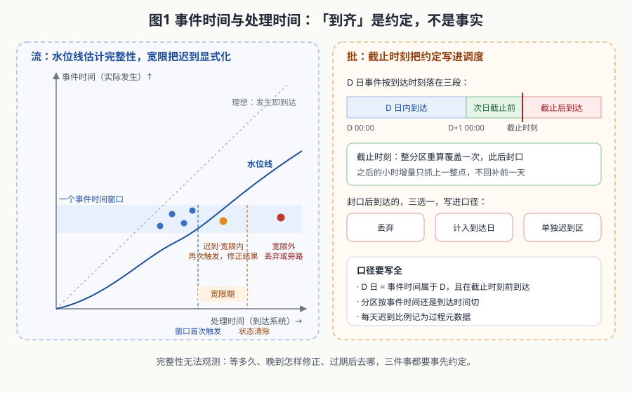
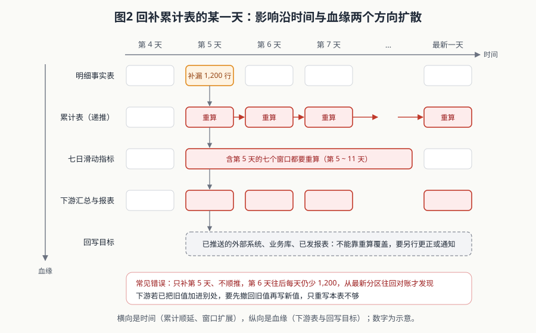
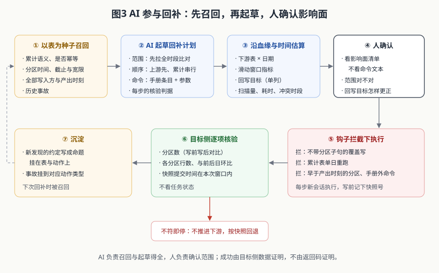

> 第三篇说，数据先于定义到达之后，「晚到数据怎样回补」往往是回补出错之后才定下的规矩。第八篇讲过按天递推的累计表只能顺延重算，第九篇把幂等列为补数的前提，第十篇讲了 AI 动生产时的护栏。这一篇把这些线索收到时间这条轴上：什么时候算「到齐」，晚到的怎样处理，补一天会牵动哪些表与日期，同一条覆盖写为什么有时幂等、有时清空整表，以及 AI 怎样起草回补计划、估算影响面，交人确认。

## 一、两种时间与一个不可知

### 1.1 事件时间与处理时间

Akidau 把流处理里的时间分成两种：事件时间是事件实际发生的时刻，处理时间是系统观测到它的时刻[1]。两者之差随网络、客户端离线、上游积压而变化。

批处理同样逃不开这个区分。一张按日分区的表，按事件时间分区，晚到的行要落回过去的分区，过去的分区因此会变；按到达时间分区，分区一旦写完就不再变，但某一天的分区里会混入前几天发生的事件。两种选择只是代价不同，但**必须在口径里写明分区按哪个时间切**。

Fowler 讨论双时态历史时用了另一组词：实际时间记录世界上发生了什么，记录时间记录我们何时知道它；追溯性的修改不只是改一条历史记录，还会牵连已经基于旧认识算出的结果[2]。回补的全部麻烦，都来自这句话的后半段。

### 1.2 完整性是不可知的

Dataflow 模型论文开篇就提出：我们不应再试图把无界数据整理成「终将完整」的有限集合，而要承认永远无法知道是否已看到全部数据，新数据会到，旧数据会被撤回[3]。水位线（watermark）是对完整性的估计：它声明此后不会再有时间戳早于它的事件[4]。但论文同时指出水位线有两种缺陷：太快，会有数据落在水位线之后；太慢，一条慢数据就能拖住整条流水线[3]。

所以「某天的数据到齐了」从来不是一个可以观测到的事实，而是一个**约定**：约定等到什么时刻，此后到的怎么处理。

## 二、迟到数据的可见性与宽限

### 2.1 流里的宽限

流引擎把这个约定做成了参数。Flink 的窗口有「允许迟到」（allowed lateness），默认为零，即落在水位线之后的元素直接丢弃；设了宽限，宽限内到达的元素会让窗口再次触发计算，宽限期满后窗口状态被清除，更晚的元素可以通过旁路输出单独收集[5]。Flink 的时间概念文档也承认，即使迟到有界，把水位线推迟太多也往往不可取[6]。Spark 结构化流的水位线同样由「事件时间列 + 迟到阈值」定义，阈值内的迟到数据参与聚合，超出阈值的开始被丢弃[7]。

### 2.2 批里的封口

批处理通常没有这样的参数，约定散落在调度时刻里。常见的组合是：日分区在次日某个固定时刻（比如凌晨三点）整分区重算覆盖一次，此后这一天就**封口**；之后的小时增量只抓上一个整点，不再回头往前一天补晚到的行。

这意味着：某日的数据实际等于「事件时间属于该日、且在次日三点前到达」的那部分。若口径里只写「某日」，不写截止时刻，下游拿它与另一个截止时刻不同的系统对账，就会出现一个永远对不平、也永远查不出错的差额。**截止时刻是口径的一部分**，要与粒度声明写在一起；封口之后到达的数据，丢弃、计入到达日、还是进入单独的迟到区，要明确选一种，并把每天迟到的比例作为过程元数据记下来，比例突变就是上游出问题的信号。

### 2.3 迟到的事实与迟到的维度

迟到不只发生在事实上。Kimball 定义迟到事实为：新事实行所对应的当前维度上下文与它不匹配，此时要回到事件发生时有效的维度版本去取键[8]。反过来，迟到维度是事实先于维度上下文到达，做法是先挂占位的维度行，维度到达后再覆盖更新，若涉及拉链维度的追溯变更，还要重述相关事实[9]。两种情况都说明：**回补不只是补行，还要按事件时间重新对齐维度。**

### 2.4 判定「缺数」之前的两件事

晚到与缺失在监控上长得一样：分区里行数偏少。区分它们要先做两件事。

第一，**列全一张表的所有写入方**。同一张表常由小时任务逐时追加、天任务次日凌晨整天覆盖；只看小时任务，会把「天任务还没到点」误判为缺数。

第二，**查清产出方的触发时刻**。当天分区在产出时刻之前本来就不完整，此时去「补」，等于用半截数据覆盖一个尚未成形的分区，自己制造脏数据。

## 三、回补的连锁影响

### 3.1 三类表，三种补法

补一个分区，代价取决于表怎样依赖时间：

- **覆盖类**：每个分区只由同一天的源数据算出，可单独重算、整体覆盖，补哪天动哪天。
- **日内表**：随一天推进逐格写入，整天覆盖的补最新一格，增量的逐格补，第九篇已经讲过。
- **累计表**：第 T 天 = 第 T−1 天的结果 + 第 T 天的增量。补第 T 天，T 之后每一天都要按日期顺序依次重算。

最常见的错误是只补中间一天。设某累计表第 5 天漏了 1,200 个新增实体，补完第 5 天后，第 6 天往后的分区仍是基于旧的第 5 天算出的，每一天都少 1,200，直到有人从最新分区往回对账才发现。

### 3.2 影响面沿两个方向传播

回补的影响沿**血缘**与**时间**两个方向展开：沿血缘，到下游的表、指标与报表；沿时间，到累计表的所有后续日期，以及用滑动窗口计算的指标（补了第 5 天，含第 5 天的七日指标要重算七天）。还有第三类常被漏掉的终点：**回写目标**，即已经推送到外部系统、业务库或发出去的报表。前两类可以重算覆盖，第三类往往要另行更正或通知。

Dataflow 模型讨论同一窗口多次触发时，区分了三种修正方式：丢弃、累积、累积并撤回，并指出下游若会再次聚合，就需要先撤回旧值再写新值[3]。批处理的回补本质上是一次迟来的触发：下游如果把旧结果加进了别处，只重写本表是不够的，旧值必须在每一个用过它的地方被撤回。

### 3.3 回补之前留好退路

表格式提供了退路。Iceberg 支持回滚到指定快照或时间点，但过期快照的清理会删除旧快照及其文件[10]；Paimon 同样支持回滚到快照，并提示快照保留太短会让依赖旧快照的读取失败[11]。所以大范围回补前要做两件事：记下每张目标表当前的快照号，确认快照保留期覆盖回补与核验所需的全部时间。

## 四、幂等：不只是 SQL 的写法

### 4.1 分区覆盖的两种模式

批处理的幂等通常靠按分区覆盖写入[12]。但「覆盖哪些分区」并不完全由 SQL 决定。Spark 对数据源表的分区覆盖有静态与动态两种模式：静态模式下，写入前删除所有与分区子句匹配的分区；动态模式下，只覆盖运行时实际写入了数据的分区；默认是静态[13]。

这就带来一个推论：**一条不带分区子句的覆盖写，在静态模式下匹配的是全部分区。**同一条语句，在动态模式下只替换当天，在静态模式下清空整张表的历史。

### 4.2 会话级配置泄漏

这个推论在实践中会以一种难以察觉的方式出现。Spark 的 `SET` 设置的是当前会话的属性[14]。一个多步作业在同一会话中依次执行：前一步为了写一个特定分区把覆盖模式设成静态，没有复位；后一步是一条依赖动态模式、不带分区子句的覆盖写，于是整表被覆盖成只剩当天，全部历史被清空。两步各自的代码都没有问题，完成标记照样写了成功。

结论有三层：幂等不仅取决于 SQL 的写法，还取决于**执行环境的状态隔离**；回补与重跑要在干净的会话中执行，每步显式声明它依赖的配置；判断成功不看任务状态，看**目标侧判据**：分区数、各分区行数、快照提交时间是否落在本次运行窗口内。写前写后各取一次，分区数少了就立即停下。

### 4.3 命令来自手册

回补命令的隐含约束很多：参数默认落在哪一天，返回成功是否真的生效。只用命令手册里实测过的命令，手册外的先在测试环境验证再入册，第九、十篇讲过，回补是它最常用到的场合。

## 五、AI 这一层：先召回，再起草，人确认

### 5.1 回补前召回

回补出错的原因，很少是不会写 SQL，多半是不知道这张表的时间语义。前几篇的命题图在这里以要补的表为种子召回：

- **累计语义**：是否递推，求和列是否不幂等，重算是否必须顺延；
- **时间约定**：分区按哪个时间切，截止时刻、宽限与封口之后的去向；
- **写入方与触发时刻**：哪些任务写这张表，各自几点产出；
- **历史事故**：例如上文的会话配置泄漏，挂在「覆盖写」这一动作上，凡是生成覆盖写都会被召回。

这些知识大多不在表结构和代码里，是第三篇所说「出错之后才定下的规矩」，沉淀过才召回得到。

### 5.2 起草回补计划

AI 据此起草计划，每一项都要可核对：

- **范围**：先拉全时段比对确认缺口的真实范围，再定要补的分区；
- **顺序**：上游先于下游，累计表按日期升序串行，任何分区都不早于其产出时刻；
- **命令**：从手册中逐条取用并填参数，标出每条的出处。大模型凭印象生成的名字可能根本不存在：对 16 个代码模型的研究发现，生成代码中虚构软件包的平均比例商用模型至少 5.2%，开源模型 21.7%[15]，命令参数同理；
- **核验判据**：每一步写明执行后查什么、期望值是多少。

### 5.3 估算影响面，人确认

计划之外，AI 沿血缘和时间展开影响面：哪些下游表、哪些日期、哪些滑动窗口指标、哪些回写目标，预计扫描量与耗时，与正常调度冲突的时段。呈现给人的是这份清单，而不是命令文本，这与第十篇「批准预演结果」是同一原则。人确认的是两件事：范围对不对，回写目标要不要另行更正。

### 5.4 动手那一刻拦，执行后逐项核验

执行时，第十篇的钩子在动作发生前拦截几类模式：不带分区子句的覆盖写，累计表的单日重跑，早于产出时刻的分区，手册外的命令。每一步在新会话中执行，执行后按计划里的判据回读目标侧；不符即停，不往下游推进。

最后一步是沉淀：这次回补新发现的约定（例如某张表实际还有第三个写入方），当场写成挂在表上的命题，下次回补时被召回。

## 六、方法：七条原则

1. **分区按哪个时间切，写进口径**；事件时间与到达时间不混用；
2. **到齐是约定，不是事实**：截止时刻、宽限、封口后去向三者写明，迟到比例记为过程元数据；
3. **判缺数前先列全写入方、查清产出时刻**；未到产出时刻不补；
4. **按表的时间依赖决定补法**：覆盖类单独补，累计表顺延串行重算，滑动窗口按窗口长度扩展；
5. **影响面沿血缘与时间双向展开**，回写目标单列，已被引用的旧值要撤回；
6. **幂等取决于写法与环境**：显式分区子句，干净会话，写前记快照，写后按目标侧判据核验，不看任务状态；
7. **AI 先召回再起草，人确认影响面**：命令出自手册，钩子在动作那一刻拦，新约定当场沉淀。

## 七、结语

同一份数据，在不同时刻被知道，结果就不同。流引擎把等多久、晚到怎么办做成了参数，批处理则常把这些约定藏在调度时刻和会话配置里，直到某次回补把它们翻出来。

回补本身并不难，难的是知道补一处会动到哪里。这类知识零碎、多半不成文，正适合沉淀成命题，在动手前被召回；AI 能把计划和影响面起草得更全，但范围由人确认，成功由目标侧的数据证明。

这个系列会持续更新。

## 参考资料

1. T. Akidau. [The world beyond batch: Streaming 101](https://www.oreilly.com/radar/the-world-beyond-batch-streaming-101/). O'Reilly Radar, 2015.
2. M. Fowler. [Bitemporal History](https://martinfowler.com/articles/bitemporal-history.html). 2021.
3. T. Akidau, R. Bradshaw, C. Chambers et al. [The Dataflow Model: A Practical Approach to Balancing Correctness, Latency, and Cost in Massive-Scale, Unbounded, Out-of-Order Data Processing](https://www.vldb.org/pvldb/vol8/p1792-Akidau.pdf). PVLDB 8(12), VLDB 2015.
4. T. Akidau, E. Begoli, S. Chernyak et al. [Watermarks in Stream Processing Systems: Semantics and Comparative Analysis of Apache Flink and Google Cloud Dataflow](https://www.vldb.org/pvldb/vol14/p3135-begoli.pdf). PVLDB 14(12), 2021.
5. Apache Flink. [Windows](https://nightlies.apache.org/flink/flink-docs-stable/docs/dev/datastream/operators/windows/)（Allowed Lateness、Getting late data as a side output 两节）.
6. Apache Flink. [Timely Stream Processing](https://nightlies.apache.org/flink/flink-docs-stable/docs/concepts/time/)（Event Time and Watermarks、Lateness 两节）.
7. Apache Spark. [Structured Streaming Programming Guide: APIs on DataFrames and Datasets](https://spark.apache.org/docs/latest/streaming/apis-on-dataframes-and-datasets.html)（Handling Late Data and Watermarking 一节）.
8. Kimball Group. [Late Arriving Fact](https://www.kimballgroup.com/data-warehouse-business-intelligence-resources/kimball-techniques/dimensional-modeling-techniques/late-arriving-fact/).
9. Kimball Group. [Late Arriving Dimension](https://www.kimballgroup.com/data-warehouse-business-intelligence-resources/kimball-techniques/dimensional-modeling-techniques/late-arriving-dimension/).
10. Apache Iceberg. [Spark Procedures](https://iceberg.apache.org/docs/latest/spark-procedures/)（rollback_to_snapshot、rollback_to_timestamp、expire_snapshots）.
11. Apache Paimon. [Manage Snapshots](https://paimon.apache.org/docs/master/maintenance/manage-snapshots/).
12. Apache Spark. [INSERT TABLE](https://spark.apache.org/docs/latest/sql-ref-syntax-dml-insert-table.html)（Insert Overwrite 一节）.
13. Apache Spark. [Configuration](https://spark.apache.org/docs/latest/configuration.html)（`spark.sql.sources.partitionOverwriteMode`）.
14. Apache Spark. [SET](https://spark.apache.org/docs/latest/sql-ref-syntax-aux-conf-mgmt-set.html)；另见 [RESET](https://spark.apache.org/docs/latest/sql-ref-syntax-aux-conf-mgmt-reset.html).
15. J. Spracklen, R. Wijewickrama, A. H. M. N. Sakib, A. Maiti, B. Viswanath, M. Jadliwala. [We Have a Package for You! A Comprehensive Analysis of Package Hallucinations by Code Generating LLMs](https://arxiv.org/abs/2406.10279). USENIX Security 2025.
