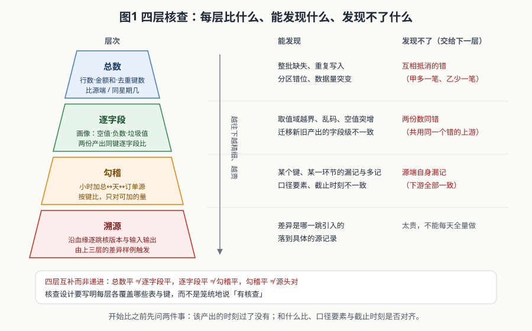
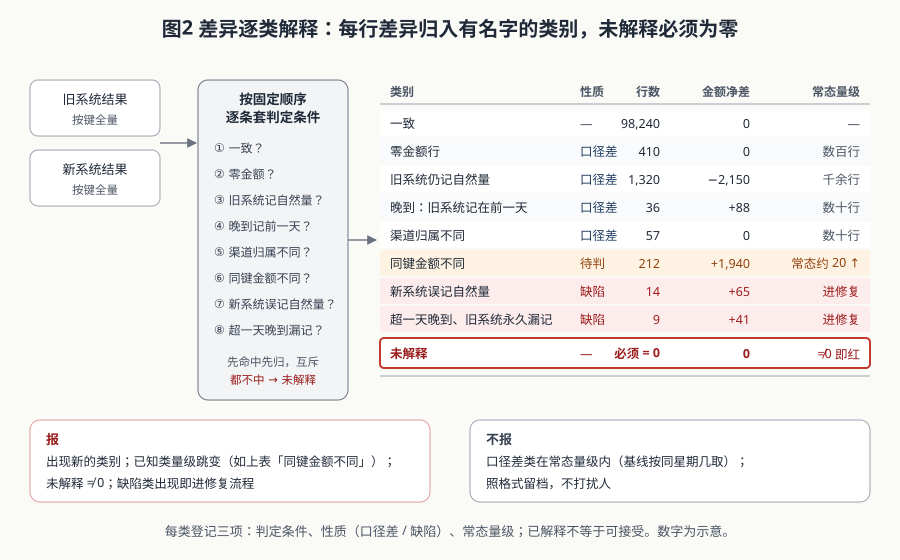
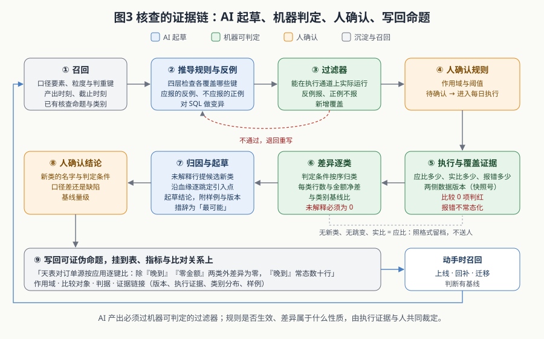

> 第一篇 4.3 说，规则配了不等于执行了：只配不验，比没有规则更糟，所有人都以为有。第四篇讲一个数字为什么有三个答案，第五篇讲出了偏差怎样沿运行逐跳核数，第十一篇留下一个永远对不平、也永远查不出错的差额。这一篇回到「怎么证明数是对的」：核查分哪几层，每层能发现什么、发现不了什么；对不平的差异怎样逐类解释；核查自己怎样证明自己真的执行了；核查结果怎样形成一条站得住的证据链；以及 AI 在其中推导规则、构造反例、按血缘归因、起草结论，人确认。

## 一、核查能证明什么

### 1.1 只能证明有错

Dijkstra 在 1972 年的图灵奖演讲里说：程序测试可以非常有效地显示错误的存在，却完全不足以显示错误的不存在[1]。数据核查同样如此。一张报告上所有检查都通过，只说明「这些检查没有发现问题」，至于没有检查的地方、检查本身失效的地方，它什么也没说。

由此推出两个问题，本文的大部分篇幅都在回答它们：**核查能发现哪些类型的错**，这由检查的层次决定；**核查实际上查了什么**，这由执行证据决定。前者是设计问题，后者是运行问题，很多团队只做了前者。

### 1.2 质量的维度与核查的对象

ISO/IEC 25012 给出的数据质量模型有 15 个特性，包括准确性、完整性、一致性、可信性、时效性等，并分为数据固有的与依赖系统的两类[2]。数据可观测性的说法则把关注点归纳为新鲜度、质量、数据量、结构、血缘五根支柱[3]。

这些框架回答的是「数据应当好在哪些方面」。落到日常核查，可以把手段分成两类：一类是**看数据自己**，把今天的数与它的历史、与它的定义比，回答「看起来是否正常」；另一类是**对账**，把它与另一份独立产生的数比，回答「与别处是否一致」。前者便宜、覆盖面广，但同错的两份数看起来都正常；后者贵，但能抓住前者看不见的系统性偏差。

### 1.3 两条前提

开始比之前，先回答两件事。

第一，**它该产出的时刻过了没有**。第九篇讲过，日分区在产出时刻之前本来就不完整；第十一篇讲过，某日的数据实际等于「截止时刻前到达」的那部分。未到产出时刻去核，得到的「缺数」是假的。

第二，**和什么比**。比行数，要比同星期几，而不是比昨天：周末与工作日量级不同，周一比周日少两成可能完全正常。比金额，要先确认两边口径要素一致：第四篇列过的聚合函数、统计窗口、时间基准、去重对象、状态限定，再加上第十一篇的截止时刻，任何一项不同，差额都会存在且永远存在。

## 二、四个层次

按「比什么」由粗到细，核查可以分四层：总数、逐字段、勾稽、溯源。

### 2.1 总数层

比整张表或整个分区的行数、金额总和、去重键数，对象是源端、上一周期、同星期几的历史。迁移校验工具通常从这一层起步：谷歌开源的数据校验工具把「列校验」定义为 count、sum、avg、min、max、stddev 以及按维度分组后的这些聚合，另有逐行校验与结构校验[4]。

总数层能发现整批缺失、重复写入、分区错位、数据量突变。它发现不了**互相抵消的错**：一个渠道多记了一笔、另一个渠道少记了一笔，总数照样平。

### 2.2 逐字段层

逐字段层有两种做法。

**一是画像**：对每一列统计空值数、负数个数、垃圾值个数（如一个横杠「-」、乱码的渠道码、超出取值域的枚举），与已知基线比。Deequ 把这种做法称为数据的「单元测试」：用声明式接口写约束，翻译成聚合查询批量执行，支持随数据增长增量校验，并在历史质量指标的时间序列上做异常检测[5]。谷歌在机器学习流水线中的数据校验系统给出过一条很实用的经验：值班人员会忽略那些泛滥或不可操作的告警，重要错误因此被漏掉，所以告警必须高精度并带足够上下文[6]。落到画像上就是一条规矩：**已知的问题单列为「已知」类，带上它的常态量级，不每天重复告警**；只有新出现的问题或已知问题的量级跳变才报。

**二是两份产出逐字段比对**，典型场景是迁移：旧引擎写影子表，新引擎写正式表，两边同键逐字段比，数百个比对项，每个不一致项逐条解释。上述校验工具的逐行校验按主键关联两侧的行，再用哈希或逐字段比较[4]。

开源工具对这一层的表达形式很一致：dbt 的数据测试是一条选出「失败记录」的查询，返回零行即通过[7]；Great Expectations 把期望定义为「关于数据的可验证断言」，用来把隐含假设显式化[8]。

### 2.3 勾稽层

勾稽是同一事实在不同表、不同粒度上的数必须相互印证：小时表加总等于天表，天表等于订单源，明细加总等于汇总。它对应会计里账与账之间的核对。

勾稽有三条要点。

**按键比，不按总数比。** 按应用、按渠道逐键比，除事先标注的项外每个键的差都应为零。按总数比会退回到总数层，抵消的错又藏起来了。

**只对可加的量做加总勾稽。** 第一篇说过对明细行求平均是误用，同理，小时去重人数加总不等于天去重人数。哪些指标能从下往上加，由第四篇的聚合函数要素和第八篇的粒度声明决定；不可加的量只能在同一粒度上与另一份来源比对。

**两边口径必须先对齐。** 勾稽失败首先要排除的是口径差，而不是数据错。这一点到第三节展开。

以一套每日结算核查为例，勾稽有三组：小时表加总对天表，天表对订单源，明细对汇总，都按应用逐键比。每组事先登记「标注项」，即已知会有差、且知道为什么有差的键，例如天表在次日凌晨整天覆盖时吸收了小时表已经封格之后才到达的订单，两者在这部分订单上必然不同。标注项之外，每个键的差都应为零；标注项本身也有常态量级，超出就不再算「已知」。

### 2.4 溯源层

前三层回答「哪里不一致」，溯源回答「是哪一步引入的」。第五篇 4.2 讲过向上沿当天分区的运行记录逐跳核：每一跳的代码版本、输入是否完整、输入与输出是否勾稽，直到找到第一个输入对、输出错的环节，再落到具体的源记录。

溯源最贵，不能每天对所有数做；它由前三层的差异触发，并以差异样例行作为起点。

### 2.5 四层的关系

越往下越精细、越贵，能发现的问题也越隐蔽。但它们不是递进关系，而是互补关系：总数平了不代表逐字段平，逐字段平了不代表勾稽平（两边可能同错，比如两份产出共用了同一个错的上游），勾稽平了也不代表源头对（源端自身漏记，下游全部一致）。所以核查设计要写明**每一层各覆盖哪些表与键**，而不是笼统地说「有核查」。

## 三、差异逐类解释

### 3.1 「对不平」不是结论

勾稽和比对的结果，常被汇报为一个差额：「新旧结果差 0.3%」。这个数既不能说明对，也不能说明错。可用的做法是**把每一行差异归入一个有名字的类别**。以新旧两套系统的结算结果比对为例，类别可能是：

- 旧系统仍记自然量（新口径已改为不记）；
- 晚到：旧系统记在前一天；
- 同键金额不同；
- 渠道归属不同；
- 零金额行；
- 新系统误记自然量（违反归因规则）；
- 超过一天晚到、旧系统永久漏记；
- 一致。

每一类给出**行数与金额净差**，规则只有一条：**未解释类必须为零**。

### 3.2 已解释不等于可接受

类别分两种性质。一种是**口径差**：旧系统仍记自然量、晚到记在前一天，是两边约定不同造成的，可以长期存在，第十一篇说的截止时刻差额就属于此类。另一种是**缺陷**：「新系统误记自然量」违反了归因规则，「超过一天晚到、旧系统永久漏记」说明旧系统有真实的漏数。缺陷类的名字本身就是一个结论，它要进修复流程，而不是进基线。

所以每个类别除了名字，还要登记三项：判定条件、性质（口径差还是缺陷）、常态量级。

### 3.3 判读看变化

每类每天都有差异，逐一报出来就是噪声。判读的规则是：**出现新的异常类，或已知类的量级跳变，才报；历史常态量级不报。** 这与 2.2 的画像规矩是同一个道理。量级基线按同星期几取，避免把周末的正常回落当成异常。

### 3.4 类别要可执行

类别不能靠人每天读样例行来判。每个类别写成一个判定谓词，按固定顺序互斥归类，先命中的先归，剩下的全部落入「未解释」。顺序本身有语义：「零金额行」若排在「同键金额不同」之后，一行零金额差异就会被算成金额不同。归类逻辑也要回归：拿一批已经人工判定过类别的样例行，定期回放，检查归类结果不变。

## 四、规则配了不等于执行了

### 4.1 一份全绿的报告

一套每日核查，经由一个受限的只读查询接口执行。接口有语句白名单，拒掉了一批含特定函数的语句。于是报告里每天有几十条显示「检查语句报错」，时间一长被当作常态。更隐蔽的是其中一整节「按应用聚合比对」：它每天显示「比较 0 项，不一致 0 项」，看上去全绿，实际上一项都没有比。

这里没有任何一步「出错」：接口按设计拒绝，核查按设计统计不一致项，不一致项确实为零。问题在于报告把「没有比」与「比了没差」呈现成了同一个样子。dbt 把「零行失败记录」定义为通过[7]，这在语义上没错；但一条没有执行的检查，返回的也是零行。

### 4.2 应比多少，实比多少

由此得出三条规矩：

- **每一节报告「应比多少、实比多少」**，应比数来自规则定义（这一节覆盖哪些应用、哪些键），实比数来自执行结果；两者不等就判红。
- **比较 0 项判红，不判绿。** 空结果先当「没跑成」，再去证明它是「没有数据」。
- **报错不允许常态化。** 检查语句报错是一个类别，和差异类一样有「未解释必须为零」的约束；接口不支持的写法要改写或换通道，而不是每天带着报错过日子。

实比与应比之比就是核查的覆盖率。它应当和差异一样每天出数、有基线：某一节的覆盖率从百分之百掉到零，比任何一个差异类的跳变都更值得先看，因为它意味着这一节此后的「全绿」都不可信。

### 4.3 核查的核查

要知道一条检查是否有效，办法是故意给它一个错，看它能不能抓住。软件测试里这叫变异测试：自动向代码植入错误，再跑测试，测试失败说明变异被「杀死」，测试仍通过说明测试有缺口；行覆盖率只能说明代码被执行过，不能说明测试能发现其中的错[9]。谷歌的实践报告说，变异测试被普遍认为是发现错误能力最强的测试准则，但传统做法计算代价过高，他们改为只对代码变更做概率抽样的变异，并把结果放进代码评审[10]。

搬到数据核查上，就是给每条规则配反例：一份**应当被它报出来**的数据，一份**不应被误报**的数据。规则上线、核查执行通道变更（例如换了查询接口）、口径调整时回放一遍，反例没被报出来，这条规则就视同未配置。这正是第一篇 4.3「构造超长、非法、缺失的样例逐条核对」的推广。

### 4.4 判成功只认目标侧证据

同一个教训的另一种形态：一次改动只在计算引擎一侧做了语法检查，就认定「与目标表结构一致」，没有在写入端核对列数，结果每小时的写回连续失败了好几天。判一个步骤成功，同样不能看日志里打了「OK」，日志可能在中途断掉，而后续语句照常执行。

两件事是一回事：**证据要取在数据落地的地方。** 判写入成功，看目标分区的行数及与同星期几的环比、表格式快照的提交时刻是否落在本次运行窗口内；判结构一致，在写入端按目标表的列数与类型核。计算侧的检查只是必要条件。

## 五、核查结果怎样形成证据链

### 5.1 审计证据的两个属性

财务审计对「证据」的要求可以直接借来。国际审计准则 ISA 500 把审计证据的要求概括为充分性与适当性：充分性是证据的数量，所需数量取决于错报风险的评估；适当性是证据的质量，即相关性与可靠性。关于可靠性，准则给出几条一般规律：来自被审计单位之外独立来源的证据更可靠；审计人员直接取得的证据比间接取得或推断得出的更可靠；书面形式的证据比口头陈述更可靠[11]。

对照到数据核查：

- **独立来源**：与订单源、外部账单对账，比本系统两张表互相对账更有说服力；后者可能共享同一个错的上游。
- **直接取得**：在目标表上直接查出的行数，比「任务日志显示成功」可靠，后者是推断。
- **书面形式**：核查结果写进表里留存，比「当时看过没问题」可靠。

### 5.2 一条核查结论要附什么

一份可复核的结论，至少带上：

- **作用域**：哪张表、哪个分区、哪些键，对照的是哪一份来源；
- **数据版本**：两侧读取时的快照号或提交时刻，事后能按同一版本重查；
- **执行证据**：执行了哪些语句，应比多少、实比多少、报错多少；
- **差异分布**：每个类别的行数与金额净差，未解释类为零，附每类若干样例行；
- **判读**：与类别基线相比有无新类、有无量级跳变。

Kimball 的两种设计可以作为存放这些证据的结构参照：错误事件模式把每一次质量筛查发现的错误记成一行，粒度是单个错误事件[12]；审计维度把加载时已知的处理元数据挂到事实行上，包括质量指标、生成该行的代码版本与执行时间，以便合规与审计时回答「这行数是怎么来的」[13]。

### 5.3 结论写成可证伪的命题

最后一步是把核查结论写成命题，例如：「结算天表与订单源按应用逐键比对，除『晚到记前一天』与『零金额行』两类外差异为零；『晚到』类在工作日通常不超过数十行」。这句话有作用域、有比较对象、有可被下一次核查推翻的判据。它不是一份「核查已通过」的记录，而是一条下次能被召回、能被证伪的知识。

## 六、AI 这一层：推导、反例、归因，人确认

### 6.1 从口径与模型推导核查规则

写核查规则最费时的地方，不是写 SQL，而是想清楚「这张表应当满足什么」。这件事 AI 能做，因为答案多半已经在前几篇沉淀的元数据里：

- 第八篇的**粒度与判重键**推出唯一性与非空检查；
- 第四篇的**聚合函数要素**决定哪些指标能做小时加总到天的勾稽，哪些只能同粒度比对；
- 第四篇的**状态限定与去重对象**推出画像中的取值域与基数检查；
- 第九篇的**完成标记与产出时刻**推出新鲜度检查与「何时开始核」；
- 第十一篇的**截止时刻**推出勾稽中预期存在的「晚到」类别。

Deequ 已经用机器学习辅助生成约束建议[5]，谷歌的数据校验系统从数据推断结构、让结构与数据共同演进[6]。大模型的不同在于它能读口径文字与 SQL，把「规则为什么存在」一并写出来。推导出的规则进入待确认状态，人确认作用域与阈值后才进入每日执行。

### 6.2 构造反例，回归核查本身

每条规则同时要有反例，这一步 AI 做起来成本很低：按规则的语义构造应被报出的数据，同时把被测 SQL 改一处（去掉去重、换一个时间基准、丢掉状态限定），看核查能否抓住这个「变异」。

这有成熟的先例。基于性质的测试由 QuickCheck 推广：把程序应满足的性质写成断言，在随机生成的输入上自动检验[14]；「小时加总等于天表」「判重键唯一」本身就是性质。一项研究用大模型从接口文档合成性质测试，并用「性质变异」衡量这些测试检出违反的能力；最好的模型平均 2.4 次采样能得到一个有效且可靠的测试，但只为约 21% 可从文档提取的性质合成出正确的测试[15]。Meta 的 ACH 系统先针对关心的问题生成当前测试抓不住的变异，再生成能杀死它们的测试，同时用大模型判断等价变异，精确率 0.79、召回率 0.47[16]。

两组数字说明同一件事：AI 生成的规则与反例**要过机器可判定的过滤器**，不能靠它自己的确信。Meta 的另一项工作把这一点做成了流程：生成的测试必须依次通过可构建、稳定通过、提升覆盖率三道过滤，结果 75% 构建成功、57% 稳定通过、25% 提升了覆盖率[17]。落到数据核查上，过滤器就是：规则能在执行通道上实际运行，在正例上不报、在反例上报，覆盖了此前未覆盖的键或字段。

### 6.3 差异按血缘归因，起草结论

出现差异后，AI 做三件事：

- **归类**：先套已有的类别谓词；剩下的未解释行，读样例、比字段，提出候选新类别，并给出判定条件草稿；
- **归因**：沿第五篇的血缘上溯，对照每一跳的运行记录、代码版本与该表上挂的命题（归因规则、截止时刻、已知类别），指出差异最可能从哪一跳引入，附证据；
- **起草结论**：按 5.2 的格式写出作用域、版本、执行证据、类别分布与判读。

举一个归因的形态：比对中出现一批「新系统误记自然量」的行，AI 沿血缘上溯，发现这批行在归因明细层已经带上了投放渠道，而在原始事件层没有任何投放标识，于是把引入点定在归因这一跳；再召回挂在归因规则上的命题，指出它违反了「无投放标识的安装记为自然量」这一条，附上样例行与当天该跳的代码版本。结论的措辞是「最可能」，证据摆在旁边，由人判定。

人确认的是三件事：新类别的名字与判定条件对不对，它是口径差还是缺陷，基线量级怎么定。这三件事决定差异最终是被接受还是被修复，AI 起草，但不能自己定。

### 6.4 沉淀、召回、判断

确认之后，结论写成 5.3 那样的命题，挂到表、指标与对应的比对关系上。

它在三类动手时刻被召回：**上线**新口径或新 SQL 时，召回这张表的核查规则与已知类别，先在测试环境跑一遍；**回补**时，召回勾稽关系，补完按勾稽核平再推进下游，这与第十一篇的目标侧核验是同一件事；**迁移**时，召回逐字段比对的类别与基线，新旧并行期间每天出类别分布。

判断时，AI 拿当次的类别分布与命题里的基线比：新类出现、量级跳变、实比少于应比，三者任一成立就送人裁决；都不成立，结论照格式留档，不打扰人。

## 七、方法：八条原则

1. **核查只能证明有错**：报告要写明查了什么，不写「数据正确」；
2. **先问该产出了没有，再问和什么比**：未到产出时刻不核，数量比同星期几，比较前口径要素与截止时刻先对齐；
3. **四层各司其职**：总数、逐字段、勾稽、溯源互补而非递进，写明每层覆盖的表与键；
4. **勾稽按键比，只对可加的量做加总**；
5. **差异逐类解释，未解释必须为零**：每类登记判定条件、性质、常态量级，判读只看新类与量级跳变；
6. **报应比与实比**：比较 0 项判红，报错不常态化，每条规则配反例回放；
7. **证据取在数据落地处**：写入端核结构，目标侧核行数与提交时刻，结论附版本、执行证据与类别分布；
8. **AI 推导规则、构造反例、归因起草，人确认类别性质与基线**：AI 产出过机器可判定的过滤器，结论写成可证伪命题，上线、回补、迁移时召回。

## 八、结语

「数对不对」从来不是一次核查能回答的问题，能回答的只是「按这些规则、在这份数据上、实际比了这些项，差异都有了解释」。这句话的每个部分都需要证据：规则从口径与模型推出，执行留下应比与实比，差异归入有名字的类别，结论附上版本与样例。

AI 让写规则、造反例、读差异的成本大幅下降，但它同样会生成一条从未真正执行的检查，同样会把未解释的差异说得头头是道。所以核查的可信度，最终落在两处：机器可判定的执行证据，和人对差异性质的确认。确认过的结论沉淀成命题，下一次动手时被召回，判断才有依据。

这个系列会持续更新。

## 参考资料

1. E. W. Dijkstra. [The Humble Programmer](https://www.cs.utexas.edu/~EWD/transcriptions/EWD03xx/EWD340.html)（EWD340）. ACM Turing Lecture, 1972.
2. ISO 25000 Portal. [ISO/IEC 25012: Data Quality Model](https://iso25000.com/index.php/en/iso-25000-standards/iso-25012).
3. B. Moses. [What Is Data Observability? 5 Key Pillars To Know](https://www.montecarlodata.com/blog-what-is-data-observability/). Monte Carlo.
4. Google Cloud Platform. [Data Validation Tool (professional-services-data-validator)](https://github.com/GoogleCloudPlatform/professional-services-data-validator).
5. S. Schelter, D. Lange, P. Schmidt, M. Celikel, F. Biessmann, A. Grafberger. [Automating Large-Scale Data Quality Verification](https://www.amazon.science/publications/automating-large-scale-data-quality-verification). PVLDB 11(12), VLDB 2018；实现见 [awslabs/deequ](https://github.com/awslabs/deequ).
6. E. Breck, N. Polyzotis, S. Roy, S. E. Whang, M. Zinkevich. [Data Validation for Machine Learning](https://mlsys.org/Conferences/2019/doc/2019/167.pdf). MLSys 2019；工具文档见 [TensorFlow Data Validation](https://www.tensorflow.org/tfx/guide/tfdv).
7. dbt Labs. [Add data tests to your DAG](https://docs.getdbt.com/docs/build/data-tests).
8. Great Expectations. [Expectation](https://docs.greatexpectations.io/docs/reference/learn/terms/expectation/)（术语表）.
9. PIT. [PIT Mutation Testing](https://pitest.org/)（首页「What is mutation testing?」与「What's wrong with line coverage?」两段）.
10. G. Petrović, M. Ivanković. [State of Mutation Testing at Google](https://research.google/pubs/state-of-mutation-testing-at-google/). ICSE-SEIP 2018.
11. IAASB. [International Standard on Auditing 500: Audit Evidence](https://www.ifac.org/_flysystem/azure-private/publications/files/A022%202013%20IAASB%20Handbook%20ISA%20500.pdf)（2013 Handbook，A4、A31 段）.
12. Kimball Group. [Error Event Schemas](https://www.kimballgroup.com/data-warehouse-business-intelligence-resources/kimball-techniques/dimensional-modeling-techniques/error-event-schema/).
13. Kimball Group. [Audit Dimensions](https://www.kimballgroup.com/data-warehouse-business-intelligence-resources/kimball-techniques/dimensional-modeling-techniques/audit-dimension/).
14. K. Claessen, J. Hughes. [QuickCheck: A Lightweight Tool for Random Testing of Haskell Programs](https://www.cs.tufts.edu/~nr/cs257/archive/john-hughes/quick.pdf). ICFP 2000.
15. V. Vikram, C. Lemieux, J. Sunshine, R. Padhye. [Can Large Language Models Write Good Property-Based Tests?](https://arxiv.org/abs/2307.04346). arXiv:2307.04346.
16. C. Foster, A. Gulati, M. Harman, I. Harper, K. Mao, J. Ritchey, H. Robert, S. Sengupta. [Mutation-Guided LLM-based Test Generation at Meta](https://arxiv.org/abs/2501.12862). arXiv:2501.12862, 2025.
17. N. Alshahwan, J. Chheda, A. Finegenova et al. [Automated Unit Test Improvement using Large Language Models at Meta](https://arxiv.org/abs/2402.09171). FSE 2024.
