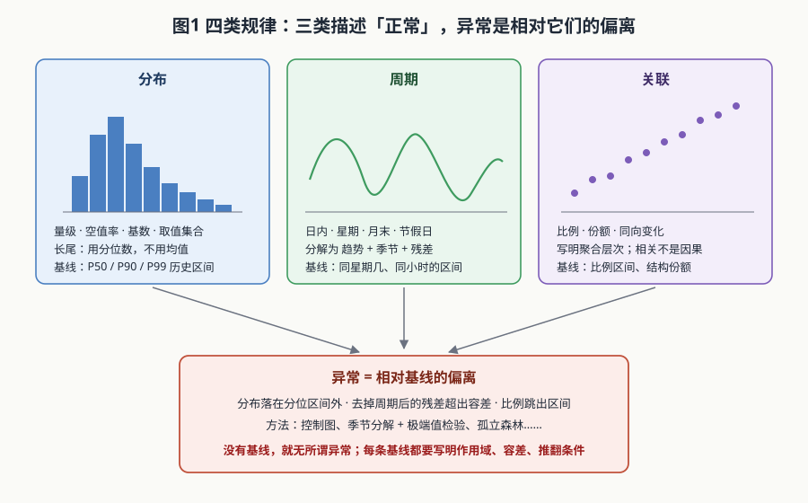
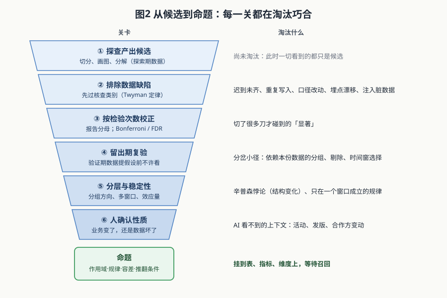
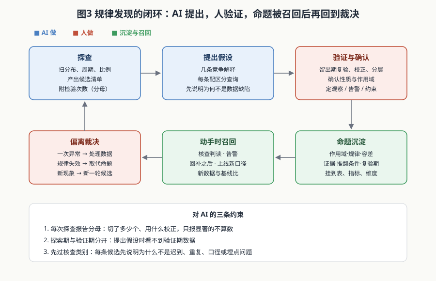

> 第三篇讲事件到达时要和已知的东西比，第十二篇讲核查差异要按类别量级的基线判读。两处都默认有一条「正常是什么样」的基线，却没有回答它从哪来。基线不是拍出来的，是从数据里读出来的规律。这一篇讲规律发现：数据里有哪几类规律，怎样把规律和巧合分开，验证过的规律怎样变成基线与规则，以及 AI 在其中做探查与假设生成，人做验证。

## 一、规律是什么

### 1.1 先探索，后确认

Tukey 在 1977 年的《探索性数据分析》里把数据分析分成两种工作：探索性的，像侦探找线索，不预设模型，从数据里看出值得追问的东西；确认性的，像法官审案，拿一个事先提出的假设去检验[1][2]。NIST 的工程统计手册把两者的区别概括为：经典分析是「问题 → 数据 → 模型 → 分析 → 结论」，探索性分析把模型放到了分析之后[2]。

两种工作缺一不可，但不能混。探索得到的只是候选，确认才产出结论。很多「数据洞察」的问题，就出在把探索看到的东西直接当成了结论。

### 1.2 规律是带作用域的可证伪命题

休谟早就指出，从过去的观察推不出未来必然如此[3]。数据里读出的规律同样只是「迄今为止没有被推翻」。波普尔把这一点变成了方法：一个陈述有价值，在于它明确说出了什么情况会推翻它[4]。

落到数据上，一条可用的规律要写清四件事：**在什么范围内**（哪张表、哪些维度取值、哪段时间），**规律本身**（量级、形状、比例或关系），**容差**（偏离多少算异常），**什么情况推翻它**。「周末流量低」不是规律，它不可证伪；「某类应用的日活，周六周日约为工作日均值的 0.80 到 0.90 倍，连续两周落在区间外即视为规律失效」才是。

### 1.3 先看图再算数

Anscombe 在 1973 年构造了四组数据：均值、方差、相关系数、回归直线几乎完全相同，画出来却是四种截然不同的形状，一组线性、一组弯曲、一组被一个离群点拉偏、一组几乎全部堆在同一个横坐标上[5]。摘要统计量会把形状藏起来。规律发现的第一步总是画出来：分布看直方图和分位数，周期看按时间展开的曲线，关联看散点和分组对比。

## 二、四类规律

数据仓库里反复出现、值得沉淀的规律，大致是四类：分布、周期、关联、异常。前三类描述「正常是什么样」，第四类是相对前三类定义的。

### 2.1 分布

分布规律回答「一列数据通常长什么样」：量级、取值范围、空值率、基数、分位数、长尾的形状。

业务数据大多偏斜：金额、时长、次数通常是长尾的，少数用户贡献大部分量。这时均值会被少数极端值拉动，**用分位数描述比用均值稳**：中位数、90 分位、99 分位各自的历史区间，比「均值 ± 三倍标准差」更不容易误报。离散列看取值集合与占比：一个状态字段历来只有五个取值，今天出现第六个，本身就是值得记录的事件；某个取值的占比从 2% 变成 20%，比总行数的变化更早暴露问题。

### 2.2 周期

周期规律回答「数据随时间怎样起伏」：日内的高峰低谷、一周内工作日与周末、月初月末、节假日。

时间序列分析的标准做法是分解：把序列拆成趋势、季节和残差三部分，常用的方法之一是 STL（基于局部加权回归的季节-趋势分解）[6]。分解的意义在于，**判断「今天是否正常」应该看残差，而不是原值**。周一的量比周日高三成，原值看是突变，去掉星期效应之后残差可能为零。这也是第十二篇说「行数要比同星期几、不比昨天」的理由。

周期往往不止一层。小时级的数据同时有日内周期和星期周期，节假日又会打破两者。哪些周期存在、强度多大、例外有哪些（春节、大促、版本发布），本身就是需要沉淀的规律。

### 2.3 关联

关联规律回答「几样东西怎样一起变」：两个指标同涨同跌，某个维度上的比例关系稳定，某类行为之后常跟着另一类行为。

关联规则挖掘用支持度与置信度刻画「A 出现时 B 出现的频率」[7]；更常见的是比例关系：付费人数与活跃人数之比、新增与安装之比、各渠道份额。这类比例在数据仓库里格外有用，因为它们往往比绝对量稳定，而且一旦变化，指向的是结构问题而不是规模问题。

关联不是因果。Vigen 收集了大量这样的例子：两条毫不相干的时间序列，相关系数高达 0.9 以上[8]。只要两条序列都有趋势，它们就很容易高度相关。所以关联类规律只能写成「在某范围内两者的比例稳定在某区间」，不能写成「A 导致 B」，除非另有设计好的实验，那是另一类问题。

### 2.4 异常

异常不是一类独立的规律，它是**相对前三类的偏离**：分布上落在历史分位区间外，周期上残差超出容差，关联上比例跳出区间。没有基线，就无所谓异常。

检测方法很多。统计过程控制的控制图用历史数据给出中心线与上下控制限，点落在限外或连续出现特定模式即为失控[9]；Twitter 的 S-H-ESD 先做季节分解，再对残差用广义极端学生化偏差检验找离群点，并用中位数代替均值以抵抗异常值本身对基线的污染[10]；孤立森林等方法用于多维数据[11]。选哪种不是本文重点，重点是：**每一种都需要先回答「正常是什么样」**，而这正是前三类规律的作用。

## 三、规律与巧合

从数据里「看出点什么」很容易，难的是区分规律与巧合。下面几种陷阱，在数据仓库里天天发生。

### 3.1 多重比较

按 0.05 的显著性水平检验一个假设，碰巧显著的概率是 5%。同时检验二十个，至少一个碰巧显著的概率是 1 − 0.95²⁰，约 64%。数据仓库的维度动辄几十个，按渠道、版本、地区、机型、时段逐个切下去，总能切出一片「显著不同」的地方。

统计学的应对是校正：Bonferroni 把显著性水平除以检验次数，控制「至少错一次」的概率，严格但保守；Benjamini 与 Hochberg 在 1995 年提出控制错误发现率（FDR），即在所有宣称的发现里错的比例，在检验数量大时更实用[12][13]。不管用哪种，前提是**知道自己检验了多少次**。只报告显著的那一个、不报告分母，校正就无从做起。

### 3.2 分岔的花园

更隐蔽的是没有意识到的多重比较。Gelman 与 Loken 称之为「分岔小径的花园」：研究者并没有刻意试遍所有分析，但分组怎么划、异常值怎么剔、时间窗怎么取，每一步都是看了数据之后才定的；换一份数据，这些选择就会不同，于是名义上只做了一次检验，实际上走的是一条依赖数据的路径[14]。Ioannidis 2005 年的论文讨论了在灵活的设计、定义与分析之下，已发表的研究结论为什么多半不可靠[15]。

Dwork 等人从理论上说明了同一件事：分析是自适应的，下一个假设是看了上一个结果才提出的；在同一份数据上反复这样做，连留出集也会被过拟合[16]。对数据团队的含义很直接：**探索用的数据和确认用的数据要分开**。在过去八周上看出的规律，拿接下来四周去验证；验证期的数据在提出假设之前不许看。

### 3.3 辛普森悖论

1973 年加州大学伯克利分校研究生录取的数据里，男性总体录取率约 44%，女性约 35%，看起来存在明显偏向；按院系拆开，多数院系女性的录取率并不低于男性，差异来自女性更多申请了录取率低的院系[17]。总体方向与分组方向相反，这就是辛普森悖论。

Pearl 指出，该看总体还是看分组，统计本身给不出答案，取决于背后的因果结构[18]。数据仓库里最常见的形态是**结构变化**：各渠道的转化率都没变，某个低转化率渠道的份额涨了，总体转化率就下降。只看总数会以为「转化变差了」，按渠道拆开才看到真正变的是结构。所以关联与比例类规律要写明聚合层次，总体规律和分组规律分别登记，结构份额本身也作为一条规律监控。

### 3.4 Twyman 定律：越有趣越可疑

Twyman 定律说：任何看起来有趣或与众不同的数字，通常是错的[19]。在数据仓库里，一个新奇规律的最常见来源不是业务，而是数据本身的缺陷：迟到的数据让最近几天偏低（第十一篇），重复写入让某天翻倍，口径改了而历史没重算（第四篇），某个客户端版本的埋点语义漂移（第六篇），注入探测的脏数据混进了汇总。

所以规律发现的流程里，**排除数据缺陷要排在解释之前**。看到一个「发现」，先问它能否被第十二篇的核查类别解释：该产出了没有、两边口径是否一致、是不是已知的差异类。排除这些之后，剩下的才值得当作业务规律去解释。

### 3.5 不止看显著性

2019 年，Amrhein、Greenland、McShane 与八百多位联署者在《自然》上撰文，呼吁停止用「统计显著」做二分判断[20]。对规律发现，这句话的意思是：p 值小不等于规律重要，p 值大也不等于没有规律。比显著性更值得看的是两件事：**效应量**，即差异有多大、有没有业务意义；**稳定性**，即换一段时间、换一个子集，规律是否依然成立。一条在连续多个窗口、多个分组里都站得住的规律，比一次检验 p 值极小的结论可靠得多。

## 四、规律怎样变成基线与规则

### 4.1 基线是规律的可执行形态

一条验证过的规律，要变成机器可以拿来比的东西，才算有用。这就是基线：**期望值、容差、作用域、条件**四件事的机器可读形式。

例如：「某天表的日行数，按星期几分组，取近八周同星期几的中位数为期望，容差为近八周同星期几的最小与最大值各外扩 10%；节假日不适用；月初第一个工作日另有一组」。第三篇的事件比对、第十二篇的类别量级判读、日常的数据量告警，用的都是这种形态。

### 4.2 基线分三种用途

同一条规律落成基线后，按偏离的后果分三种用途：

- **观察**：偏离只记录，进日报，供人周期性回看。适合刚验证、样本还少的规律；
- **告警**：偏离通知值班，人判断是否处理。适合稳定的分布与周期规律；
- **约束**：偏离即阻断，下游不许继续。只适合几乎不可能被业务打破的规律，比如「汇总表各小时之和等于天表」这种勾稽，它其实是定义而不是统计规律。

一条规律从观察升级到告警，要有足够的验证窗口；从告警升级到约束，要证明它几乎没有误报。反过来，误报多了要降级，而不是放宽到形同虚设。

### 4.3 自动更新的基线会学会坏习惯

基线用滑动窗口自动更新，省事，但有一个陷阱：**慢性问题会被学成常态**。某个字段的空值率每周涨一点，每一周都落在「近八周」的容差内，半年后空值率翻了几倍，告警一次也没响。

对策是让基线有版本。人确认过的基线是一个锚，自动更新的滑动基线与锚并行；滑动基线相对锚的漂移超过一定幅度，本身作为一个事件送人确认：是业务真的变了（确认后更新锚），还是数据在慢慢变坏。

### 4.4 规律会过期

业务变化、产品改版、渠道结构调整、客户端版本更替，都会让规律失效。所以登记规律时就要写下**推翻条件和复验周期**：连续多少个窗口落在容差外视为失效，每隔多久用新数据复验一次。失效的规律不是删掉，而是标记为被取代，写明何时、因何失效、由哪条新规律接替；下次有人看到老数据里的旧形态，还能查到当时为什么是那样。

## 五、AI 这一层：探查与假设生成，人验证

### 5.1 AI 让探查变得便宜

探查的工作量主要在体力活：写几十条切分查询，画分布与分解图，一个维度一个维度地对比。这正是 AI 代理擅长的。Data Interpreter 一类工作让代理把数据分析任务拆成可执行的计划，边写代码边根据结果调整[21]；InsightBench 用一百份埋入了已知洞察的业务数据集，评估代理从提出问题到归纳洞察的端到端能力[22]。在日常工作中，让代理先把一张表的分布、周期、主要比例关系扫一遍，产出一份「候选规律清单」，人在清单上挑值得追的，效率比人从头写查询高得多。

### 5.2 AI 能提出假设

AI 不只会扫维度，也能提出解释。Zhou 等人让大模型从少量样例出发生成假设，再按新样例迭代修正，所得假设在多个分类任务上比少样本提示与部分监督方法预测得更好，其中一些与人类验证过的理论一致[23]。Li、Fox 与 Goodman 把语言模型放进 Box 循环：模型交替扮演建模者与领域专家，提出统计模型、再批评它，找到的模型与人类专家设计的相当[24]。

在数据仓库里，这意味着：看到「某渠道付费率下降」，代理可以同时提出几条竞争的解释（结构变化、版本埋点漂移、迟到未齐、口径改动），并为每条写出能区分它们的查询。

### 5.3 为什么必须由人验证

但 AI 不能替代验证，理由有三。

第一，**能力上还不够**。DiscoveryBench 从已发表论文中整理了 264 个数据驱动发现任务，最好的系统得分只有 25%[25]。从数据里得出可靠结论，比写对一条查询难得多。

第二，**AI 是多重比较的放大器**。人切二十个维度要一下午，代理切两千个只要几分钟。如果只把显著的那几个报上来，第三节的所有陷阱都会被放大一百倍。所以对代理的约束必须是：**每次探查报告分母**（检验了多少个切分、用的什么校正），**探索期与验证期分开**（代理提出假设时看不到验证期数据），**先过核查类别**（每条候选先说明为什么不是已知的数据缺陷）。

第三，**规律的意义需要人判断**。一个比例的变化，是业务变了、产品改了，还是数据坏了，常常要靠代理看不到的上下文：一次运营活动、一次版本发布、一个合作方的变动。人确认的不是计算，而是性质。

### 5.4 沉淀、召回、判断

验证过的规律写成命题，格式与第十二篇的核查结论一致：作用域、规律、容差、证据（探索窗口、验证窗口、检验次数与校正方法）、推翻条件、复验周期、确认人。命题挂到它描述的表、指标和维度上。

它在四类时刻被召回：**核查判读**时，作为类别量级的基线；**告警**时，作为容差的来源；**回补之后**，用来检查补完的数据是否回到规律上；**上线新口径**时，提醒哪些规律会随之失效、需要重新验证。

判断的逻辑是一个闭环：新数据与命题比，偏离送人裁决；裁决的结果要么是一次异常（处理数据），要么是规律失效（取代命题），要么是新的候选（进入下一轮探查）。

这类知识为什么难以放在传统文档里：规律数量多而琐碎，每张核心表都有几条到几十条；它们在不断变化，一次改版就可能让一批失效；而它们被用到的时刻，恰恰是人最没有空去翻文档的时刻——告警响了、回补刚跑完、新口径正要上线。它需要的是按表、指标、维度被准确召回，并带着作用域与推翻条件一起出现，而不是写成一篇没人会在那一刻打开的长文。

## 六、方法：八条原则

1. **探索与确认分开**：探索产出候选，确认产出结论，确认用的数据在提出假设前不许看；
2. **规律写成带作用域的可证伪命题**：范围、规律、容差、推翻条件四件事缺一不可；
3. **先画图，再算数**：分布看分位数，周期看分解后的残差，关联看分组对比；
4. **报告分母**：每次探查写明检验了多少个切分、用了什么校正；
5. **先排除数据缺陷，再解释业务**：越有趣的发现越先过核查类别；
6. **写明聚合层次**：总体与分组规律分别登记，结构份额本身也是规律；
7. **基线分观察、告警、约束三级，并保留人确认的锚**：滑动基线相对锚的漂移本身是事件；
8. **AI 探查与提出假设，人验证与确认性质**：验证过的规律沉淀为命题，在核查、告警、回补、上线时召回，失效时取代而不是删除。

## 七、结语

从数据里读出规律，最大的风险不是读不出来，而是读出来太多：维度足够多、时间足够长，总能看到些什么。区分规律与巧合的，不是更复杂的模型，而是几条朴素的纪律：探索与确认分开，报告检验了多少次，先排除数据本身的错，写清规律在哪里成立、什么情况下不再成立。

AI 让探查的成本降了几个数量级，也就让巧合的产量涨了几个数量级。它带来的真正变化，是让「提出假设」不再稀缺，于是「验证假设」成了瓶颈和价值所在。验证过的规律沉淀成命题、在需要时被召回，成为下一次核查与告警的基线，数据里读出的东西才真正变成了知识。

这个系列会持续更新。

## 参考资料

1. Wikipedia. [Exploratory data analysis](https://en.wikipedia.org/wiki/Exploratory_data_analysis)（J. W. Tukey, *Exploratory Data Analysis*, Addison-Wesley, 1977）.
2. NIST/SEMATECH. [e-Handbook of Statistical Methods, 1.1.1 What is EDA?](https://www.itl.nist.gov/div898/handbook/eda/section1/eda11.htm).
3. Stanford Encyclopedia of Philosophy. [The Problem of Induction](https://plato.stanford.edu/entries/induction-problem/).
4. Stanford Encyclopedia of Philosophy. [Karl Popper](https://plato.stanford.edu/entries/popper/)（证伪与划界一节）.
5. Wikipedia. [Anscombe's quartet](https://en.wikipedia.org/wiki/Anscombe%27s_quartet)（F. J. Anscombe, Graphs in Statistical Analysis, *The American Statistician* 27(1), 1973）.
6. R. J. Hyndman, G. Athanasopoulos. [Forecasting: Principles and Practice (3rd ed.), 3.6 STL decomposition](https://otexts.com/fpp3/stl.html).
7. R. Agrawal, R. Srikant. [Fast Algorithms for Mining Association Rules](https://www.vldb.org/conf/1994/P487.PDF). VLDB 1994.
8. T. Vigen. [Spurious Correlations](https://www.tylervigen.com/spurious-correlations).
9. NIST/SEMATECH. [e-Handbook of Statistical Methods, 6.3.2 What are Variables Control Charts?](https://www.itl.nist.gov/div898/handbook/pmc/section3/pmc32.htm).
10. J. Hochenbaum, O. S. Vallis, A. Kejariwal. [Automatic Anomaly Detection in the Cloud Via Statistical Learning](https://arxiv.org/abs/1704.07706). arXiv:1704.07706, 2017；实现见 [twitter/AnomalyDetection](https://github.com/twitter/AnomalyDetection).
11. scikit-learn. [Novelty and Outlier Detection](https://scikit-learn.org/stable/modules/outlier_detection.html)（Isolation Forest 一节）.
12. Y. Benjamini, Y. Hochberg. [Controlling the False Discovery Rate: A Practical and Powerful Approach to Multiple Testing](https://www.jstor.org/stable/2346101). *JRSS Series B* 57(1), 1995.
13. Wikipedia. [False discovery rate](https://en.wikipedia.org/wiki/False_discovery_rate).
14. A. Gelman, E. Loken. [The garden of forking paths](http://www.stat.columbia.edu/~gelman/research/unpublished/p_hacking.pdf). 2013.
15. J. P. A. Ioannidis. [Why Most Published Research Findings Are False](https://journals.plos.org/plosmedicine/article?id=10.1371/journal.pmed.0020124). *PLoS Medicine* 2(8), 2005.
16. C. Dwork, V. Feldman, M. Hardt, T. Pitassi, O. Reingold, A. Roth. [Generalization in Adaptive Data Analysis and Holdout Reuse](https://arxiv.org/abs/1506.02629). NeurIPS 2015.
17. Stanford Encyclopedia of Philosophy. [Simpson's Paradox](https://plato.stanford.edu/entries/paradox-simpson/)（伯克利录取案例；原始研究 P. J. Bickel, E. A. Hammel, J. W. O'Connell, *Science* 187, 1975，出版方页面不对脚本开放，未附链接）.
18. J. Pearl. [Comment: Understanding Simpson's Paradox](https://ftp.cs.ucla.edu/pub/stat_ser/r414.pdf). *The American Statistician* 68(1), 2014.
19. Wikipedia. [Twyman's law](https://en.wikipedia.org/wiki/Twyman%27s_law).
20. V. Amrhein, S. Greenland, B. McShane. [Scientists rise up against statistical significance](https://www.nature.com/articles/d41586-019-00857-9). *Nature* 567, 2019.
21. S. Hong, Y. Lin, B. Liu et al. [Data Interpreter: An LLM Agent For Data Science](https://arxiv.org/abs/2402.18679). arXiv:2402.18679, 2024.
22. G. Sahu, A. Puri, J. Rodriguez et al. [InsightBench: Evaluating Business Analytics Agents Through Multi-Step Insight Generation](https://arxiv.org/abs/2407.06423). arXiv:2407.06423, 2024.
23. Y. Zhou, H. Liu, T. Srivastava, H. Mei, C. Tan. [Hypothesis Generation with Large Language Models](https://arxiv.org/abs/2404.04326). arXiv:2404.04326, 2024.
24. M. Y. Li, E. B. Fox, N. D. Goodman. [Automated Statistical Model Discovery with Language Models](https://arxiv.org/abs/2402.17879). arXiv:2402.17879, 2024.
25. B. P. Majumder, H. Surana, D. Agarwal et al. [DiscoveryBench: Towards Data-Driven Discovery with Large Language Models](https://arxiv.org/abs/2407.01725). arXiv:2407.01725, 2024.
