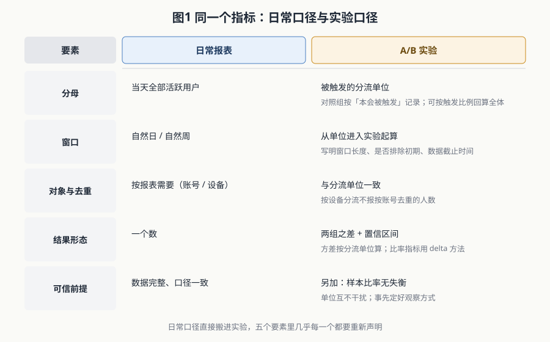
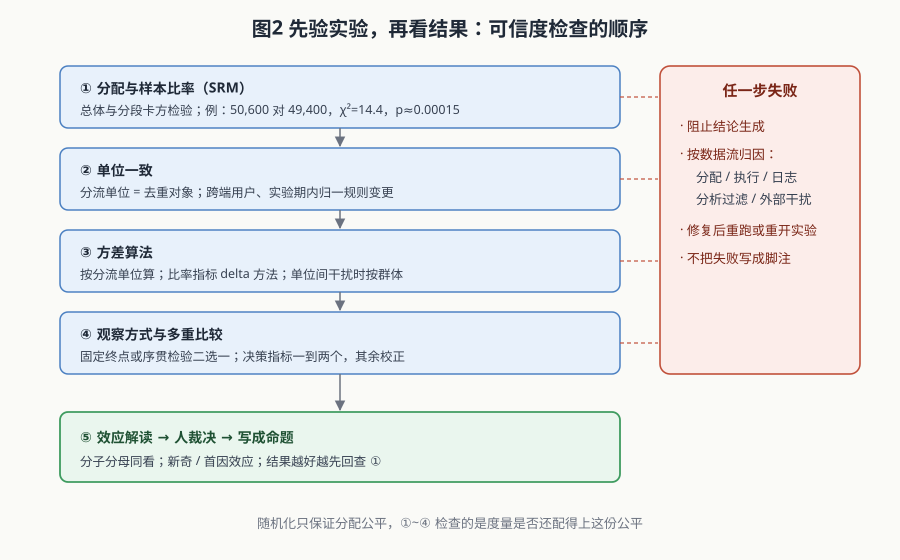
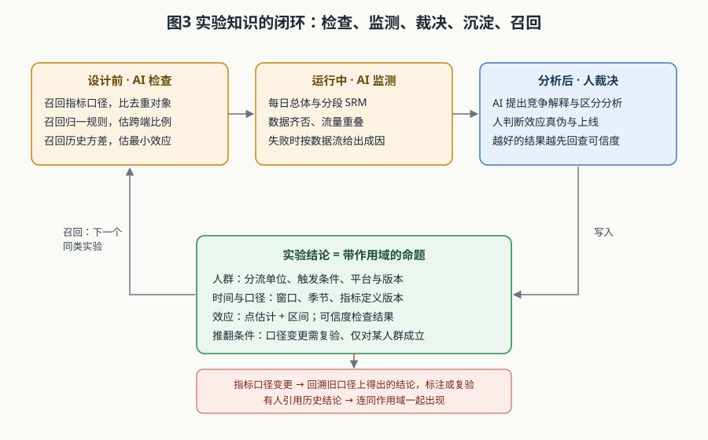

> 第四篇讲一个指标由哪些要素构成，第七篇讲去重对象是谁，第十三篇讲怎样把规律和巧合分开。三篇都停在「观察」上：数据里看到了什么，看到的东西是否可信。要回答「改了这个东西，指标会不会变」，观察不够，需要实验。实验是数据团队手里唯一能直接确认因果的工具，它的结论却比日常报表更容易被口径悄悄带偏。这一篇讲实验指标和日常指标在口径上差在哪里，分流单位与去重对象为什么必须一致，样本比率失衡和比率指标方差这两个最常见的技术陷阱，以及 AI 在实验前检查、实验中监测、实验后沉淀里能做什么。

## 一、实验在问什么

### 1.1 反事实与随机化

一个改动的效果，严格说是同一批用户「用了新版本」和「没用新版本」两种结果之差。两种结果不可能同时观察到，这是因果推断的基本难题：没有发生的那一种叫反事实。Rubin 的潜在结果框架把这一点形式化：每个单位有两个潜在结果，我们只能看到其中一个[1]。

Fisher 在二十世纪二三十年代的农业试验里给出的解法是随机化：把单位随机分到处理组和对照组，两组在一切已知和未知的因素上，在期望意义上都相同，于是两组结果之差就是效果的无偏估计[2]。在线 A/B 实验就是这个思想的工程化：流量随机切成两份，一份看到新版本，一份不看，比较两组的指标[3][4]。

随机化保证的是**分配**的公平，它不保证**度量**的正确。两组被分得再公平，如果数的东西不对、数的对象不对、数的方式算错了不确定性，结论照样会错。实验的口径问题，就出在度量这一侧。

### 1.2 一个实验至少要三类指标

Kohavi 等人把实验要优化的目标称为总体评价准则（OEC），并强调它必须在实验前确定，而且应当预示长期价值，而不是只反映短期点击[3]。实践中一个实验通常要定三类指标[4][5]：

- **决策指标**：即 OEC，决定上不上线；
- **护栏指标**：不允许变坏的东西，如崩溃率、加载时长、付费转化；
- **诊断指标**：解释为什么变，如各步转化、功能使用次数。

此外还有一类常被忽略的**可信度指标**：它们本来不该因为实验而变化，一旦变了，说明实验本身出了问题。下文的样本比率就是最重要的一个。

古德哈特定律说，一个度量一旦变成目标，就不再是好的度量[6]。实验把这一点放大了：团队会围绕决策指标反复迭代，口径里任何一个能被「优化」而不代表真实价值的漏洞，都会在实验里被找出来。这是实验指标需要单独定义、单独审查的第一个理由。

## 二、实验口径和日常口径差在哪里

第四篇把一个指标拆成对象、度量、过滤、窗口、去重几个要素。日常报表里的「日活」「付费率」直接拿进实验，几乎每个要素都要重新审视。

### 2.1 分母：从全部用户到被触发的用户

日常付费率的分母是当天全部活跃用户。实验里，如果改动只影响进入某个页面的用户，那么没进这个页面的用户在两组里完全一样，他们只贡献噪声。

假设只有 10% 的用户会触发改动，改动让这部分人的付费率相对提升 2%，那么放到全部用户上看，相对提升只剩约 0.2%。要检测出的效应缩小到十分之一，所需样本量大约要增加到一百倍（样本量与效应大小的平方成反比）。所以实验分析要按**触发**口径：只统计真正走到改动处的单位，并且两组用同一个触发条件。对照组没有新功能，它的触发要用「如果在处理组就会被触发」的反事实条件记录下来，否则两组的分母就不可比[4][7]。

触发口径带来的另一个要求是**可回算**：最终决策关心的是对全体用户的影响，要能把触发人群上的效应按触发比例稀释回全体，这一步需要明确写出触发人群占比是怎么数的。

### 2.2 窗口：从自然日到暴露之后

日常指标按自然日切，实验指标按单位**进入实验之后**的窗口算。一个用户周三进入实验，他的「七日留存」应当从周三算起，而不是从实验开始的周一。用自然日去切，早进入的用户会被多算几天、晚进入的被少算，两组如果进入的节奏有差别，就会出现与改动无关的差异。

窗口还关系到两个时间效应。新奇效应：用户因为新鲜而多用，几天后回落；首因效应：用户需要时间适应新版本，指标先降后升[4]。只看前三天的实验，可能把这两种效应误读为长期效果。实验口径要写明：窗口从何时起算、算多长、是否排除实验初期，以及结论在多长的时间尺度上成立。

第十一篇讲迟到数据，这里同样适用：实验的分析如果在最后一天数据还没有齐时就跑了，最后一天两组都偏少，单看比例可能没有问题，看总量就会失真。实验报告的数据截止时间应当是一个显式的字段，而不是「跑的时候有什么就算什么」。

### 2.3 对象与去重

日常的「付费用户数」按账号去重，实验如果按设备分流，同一个账号可能落在两组里。这一点牵涉到实验最根本的一致性要求，单独放在第三节。

### 2.4 不确定性是口径的一部分

日常报表给的是一个数。实验给的必须是一个数加一个区间。区间怎么算，取决于分流单位、分析单位、指标的形态（均值、比率、分位数），同一个指标换一种算法，区间可能差出几倍。所以**方差的计算方法应当和指标定义写在一起**，而不是交给分析的人临场决定。这是第五节的内容。

## 三、分流单位与去重对象必须一致

### 3.1 分流单位决定实验的对象

分流单位是随机化作用的对象：可以是请求、会话、设备、账号，也可以是更大的群体。它决定了「谁和谁是可以比较的」。

第七篇讲过，设备、账号、第三方标识之间要做归一，归一规则还会变。实验把这个问题变得更尖锐：

- 按**设备**分流，同一个人在手机和电脑上可能分进不同组，看到两套体验，他的行为是两种处理的混合；
- 按**账号**分流，未登录的访客没有账号，要么被排除，要么退回到设备，于是实验的对象从一开始就只是登录用户的子集；
- 实验期间如果归一规则发生了变化（比如匿名设备在实验中途登录、被并入某个账号），这个人可能从一组「搬」到另一组。

所以一个实验在设计时就要回答：**它想影响的是谁，就按谁分流；结论想推广到谁，就只在谁身上统计**。决策指标的去重对象应当与分流单位一致：按账号分流，就按账号去重；按设备分流的实验，不应该直接报一个按账号去重的人数。

### 3.2 分析单位比分流单位细时，方差会被低估

实验按用户分流，指标却常常是「点击数 / 浏览数」这类以浏览为单位的比率。同一个用户的多次浏览彼此相关：一个爱点的人，每次浏览都更可能点。如果把每次浏览当成独立样本去算方差，相当于假装样本量比实际大得多，区间会过窄，显著性会被高估[8][9]。Deng 等人报告，这类分析单位与分流单位不一致的错误在实践中相当常见，并给出了用 delta 方法正确计算的办法[9]。

规则很简单：**方差按分流单位算**。分析单位可以更细，但统计推断的独立样本是分流单位。

### 3.3 单位之间不独立时

随机化的推断依赖一个假设：一个单位的结果只取决于它自己被分到哪组，与别人无关。这在统计上称为稳定单位处理值假设（SUTVA）[1]。社交关系、双边市场、共享库存都会打破它：处理组的用户把内容分享给对照组的朋友，处理组的买家抢走了对照组也想买的商品。这时两组之差不再是效果的无偏估计。常见的应对是把联系紧密的单位整体分进同一组，即按群体随机化[10]。代价是有效样本量变小，方差变大，这又回到了上一节：分流单位变粗了，方差就要按更粗的单位算。

## 四、样本比率失衡：先验实验，再看结果

### 4.1 是什么

一个按 50/50 设计的实验，两组人数理应只差随机波动。若实际是 50,600 对 49,400，卡方检验的统计量是 14.4，p 值约为 0.00015，几乎不可能是随机造成的。这就是样本比率失衡（SRM）。

SRM 的意思是：**进入分析的两组人，已经不是随机分出来的两组人了**。某种与处理有关的机制，让一组多丢了人或多进了人。这时任何指标的差异都可能来自这个机制，而不是来自改动。Fabijan 等人对四家公司、二十五个以上产品的实验做了整理，在微软约 6% 的实验出现了 SRM[11]；Kohavi 等人的五个「令人困惑的实验结果」里，有几个的根因最后就是这类问题[12]。

### 4.2 从哪来

SRM 的成因可以按实验的数据流归类[11]：

- **分配**：分流逻辑有错，哈希不均，或与别的实验发生了串扰；
- **执行**：新版本加载更慢或更容易崩溃，部分用户在被记录前就离开了；
- **日志**：新版本的埋点有改动，部分事件丢失或重复（第六篇讲的源头问题在这里会直接改变实验的分母）；
- **分析**：过滤条件与处理有关，比如按「至少完成一次某操作」筛人，而这个操作正是改动影响的对象；机器人流量在两组被过滤的比例不同；
- **外部干扰**：实验中途调整了比例、上线了别的改动。

这张表很像第十二篇的差异分类。SRM 本质上是一条**核查规则**：两组人数之比是一个已知的、本不应该变的量，它变了，就要先归因再谈结果。

### 4.3 怎么用

SRM 检验应当**在看任何业务指标之前**自动跑，失败就阻止结论生成，而不是附在报告末尾当脚注[11][13]。它也应当**分段**跑：总体比率正常，不代表每个平台、每个版本、每天都正常；某一个客户端版本的失衡，常常就是那个版本埋点出了问题。

## 五、比率指标的方差与另外两个陷阱

### 5.1 比率指标

实验里大量指标是比率：人均时长、点击率、每单金额。它们的分子分母都是随机量，比值的方差不能按普通均值的公式算。delta 方法用一阶泰勒展开近似比率的方差，同时处理分子分母的相关，是计算这类指标区间的标准工具[9]。Deng、Knoblich 和 Lu 用四个实际案例说明，误用方差公式会让区间偏窄或偏宽，后者让真实的效果被埋没[9]。

比率指标还有一个口径层面的问题：**分子分母要同时受处理影响**。点击率上升，可能是点击多了，也可能是浏览少了。护栏与诊断指标里要同时放分子和分母，否则「点击率提升」可能只是「把不点击的人赶走了」。Dmitriev 等人总结的十二个指标解读陷阱里，比率指标的分母变化就是其中之一[8]。

### 5.2 降方差

方差大，实验就要跑得更久、用更多流量。CUPED 用实验前同一指标的历史值作协变量做调整，在必应的实验里把方差降低约一半，相当于用一半的用户或一半的时长达到同样的检测能力[14]。它对口径的要求是：**实验前的协变量必须与实验指标同口径**。实验前的「人均时长」按自然日、实验中的按暴露窗口，调整的效果就会打折扣。这又回到第二节：实验口径要在实验前就固定下来，包括它的历史回算版本。

### 5.3 窥视与多重比较

固定样本的显著性检验，前提是只在预定的终点看一次。每天看一次、显著就停，假阳性率会远高于名义水平。Johari 等人提出「始终有效」的 p 值与序贯检验，让持续监测在统计上合法[15]。要么预先定好时长并只在终点决策，要么用支持持续监测的检验方法，二者择一，并写进实验设计。

第十三篇的多重比较在实验里同样存在：一个实验有几十个指标、十几个分段，总有几个「显著」。决策指标事先只定一到两个；其余指标的显著要按检验次数校正，或只作为下一轮实验的假设。

## 六、AI 这一层：检查、监测、沉淀

### 6.1 设计前：检查口径与分流单位是否匹配

实验设计是一份结构化文档：改动影响谁、按什么分流、决策指标与护栏指标是什么、窗口多长、怎么算方差。AI 代理在这里最有用的工作，不是生成文档，而是**对着已有的知识逐项检查**：

- 召回决策指标的口径命题（第四篇），比对它的去重对象与实验的分流单位，不一致时指出来；
- 召回用户标识的归一规则（第七篇），提示按设备分流时跨端用户的比例，以及实验期内归一规则是否有计划内的变更；
- 召回指标的方差记录（历史实验或第十三篇沉淀的分布规律），估算在给定流量下能检测出的最小效应，提示样本是否够；
- 检查触发条件是否在两组都有记录，比率指标的分子分母是否都在诊断指标里。

这些检查之所以能交给 AI，是因为每一项都有明确的依据可召回、明确的判据可比对；之所以必须交给 AI，是因为它们分散在指标、模型、标识、历史实验四类知识里，人在写设计时很少会把四处都翻一遍。

### 6.2 运行中：自动做可信度检验

SRM 检验、分段 SRM、两组的数据完整性（第十一篇的迟到）、与同期其他实验的流量重叠，这些都是机械的检查，应当由代理在实验运行期间每天自动做，失败时按第四节的分类给出最可能的成因与需要查的数据，而不是只报一个 p 值。Vermeer 等人在 Booking 的实践就是把 SRM 检查做成对每个实验、每个分段的自动看板[13]。

### 6.3 分析后：AI 能解读，但不能裁决

大模型在因果推理上的能力正在被认真研究。Kıcıman 等人报告，大模型在成对因果方向判断、反事实推理等基准任务上超过了此前的算法，同时也指出它会以不可预测的方式出错，适合作为人的辅助，而不是替代严谨的因果分析[16]。落到实验上：代理可以读诊断指标，提出几条竞争的解释（真实的行为变化、新奇效应、埋点改动、分母变化），并为每条写出能区分它们的分析；但「这个效果是真的吗、能不能上线」，要由人在可信度检查全部通过后做决定。第十三篇说「越有趣越可疑」，实验同理：一个改动带来远超预期的提升，第一反应应当是先查 SRM 和口径。

### 6.4 沉淀：实验结论是带作用域的命题

实验最常见的浪费，是结论只留在一份报告里。半年后有人做相似的改动，没人记得上次的结果，也没人记得上次为什么不可信。

一条实验结论应当写成命题：在什么人群（分流单位、触发条件、平台与版本）、什么时间（窗口、季节）、用什么口径（指标定义的版本），改动带来了多大的效应（点估计与区间）；可信度检查的结果；推翻条件（比如「指标口径变更后需复验」「仅对新用户成立」）。命题挂在被改动的功能、决策指标与护栏指标上。

它在三个时刻被召回：**设计下一个同类实验**时，作为先验效应和方差的来源，也提醒上次踩过的坑；**指标口径变更**时，列出哪些历史结论是在旧口径上得出的、需要标注或复验；**有人引用历史结论**时，连同它的作用域一起出现，避免「上次实验证明了 X」被推广到不成立的人群上。

这类知识的特点，与前几篇反复说的一样：数量多、细碎，每个实验都有几条；会过期，一次口径调整就让一批结论需要重新标注；被用到的时刻，是有人正在设计实验或正在引用结论的那一刻。它需要的是按功能、指标、人群被准确召回，带着作用域出现，而不是存进一个按时间排序、没人会回头翻的实验报告库。

## 七、方法：七条原则

1. **实验指标单独定义**：分母（触发条件）、窗口（从暴露起算）、对象、去重、方差算法五项写明，不直接沿用日常报表口径；
2. **分流单位与去重对象一致**：想影响谁就按谁分流，结论推广到谁就在谁身上统计；
3. **方差按分流单位算**：分析单位可以更细，推断的独立样本是分流单位；比率指标用 delta 方法；
4. **先验实验，再看结果**：SRM 及分段 SRM 在任何业务指标之前自动检验，失败即阻止结论；
5. **事先定决策指标与观察方式**：决策指标只定一到两个，要么固定时长终点决策、要么用序贯检验；
6. **比率指标同时看分子和分母**：护栏与诊断指标覆盖分子分母，警惕分母被处理改变；
7. **AI 检查、监测、提出解释，人裁决**：设计前召回口径与历史结论做逐项检查，运行中自动做可信度检验，结论写成带作用域的命题，口径变更时回溯。

## 八、结语

实验之所以可信，是因为随机化消除了一切混杂；实验之所以常常不可信，是因为随机化只管分配，不管度量。两组人分得再公平，分母不同、窗口不同、去重对象不同、方差算错，结论都会偏，而且偏得比日常报表更隐蔽：它带着 p 值和置信区间，看上去比任何一张报表都更科学。

所以实验口径的问题，归根到底还是第一篇说的那件事：数对不对，由定义决定。实验只是把定义的要求提得更高了一层，除了「数的是什么」，还要写明「和谁比」「不确定性怎么算」。AI 让这些检查可以在每个实验上都做一遍，让每个实验的结论都能在下一次被想起；而判断一个结论能不能用，仍然是人的事。

这个系列会持续更新。

## 参考资料

1. Wikipedia. [Rubin causal model](https://en.wikipedia.org/wiki/Rubin_causal_model)（潜在结果框架与 SUTVA）.
2. Wikipedia. [The Design of Experiments](https://en.wikipedia.org/wiki/The_Design_of_Experiments)（R. A. Fisher, 1935；随机化原则）.
3. R. Kohavi, R. Longbotham, D. Sommerfield, R. M. Henne. [Controlled experiments on the web: survey and practical guide](https://ai.stanford.edu/~ronnyk/2009controlledExperimentsOnTheWebSurvey.pdf). *Data Mining and Knowledge Discovery* 18, 2009.
4. R. Kohavi, D. Tang, Y. Xu. *Trustworthy Online Controlled Experiments: A Practical Guide to A/B Testing*. Cambridge University Press, 2020. 配套网站 [experimentguide.com](https://experimentguide.com/).
5. A. Deng, X. Shi. [Data-Driven Metric Development for Online Controlled Experiments: Seven Lessons Learned](https://exp-platform.com/Documents/2016KDDMetricDevelopmentLessonsDengShi.pdf). KDD 2016.
6. Wikipedia. [Goodhart's law](https://en.wikipedia.org/wiki/Goodhart%27s_law).
7. R. Kohavi, R. Longbotham. [Online Controlled Experiments and A/B Tests](https://exp-platform.com/Documents/2023-03-11EncyclopeiaMLDSABTestingFinal.pdf). *Encyclopedia of Machine Learning and Data Science*, 2023.
8. P. Dmitriev, S. Gupta, D. W. Kim, G. Vaz. [A Dirty Dozen: Twelve Common Metric Interpretation Pitfalls in Online Controlled Experiments](https://exp-platform.com/Documents/2017-08%20KDDMetricInterpretationPitfalls.pdf). KDD 2017.
9. A. Deng, U. Knoblich, J. Lu. [Applying the Delta Method in Metric Analytics: A Practical Guide with Novel Ideas](https://arxiv.org/abs/1803.06336). KDD 2018.
10. H. Gui, Y. Xu, A. Bhasin, J. Han. [Network A/B Testing: From Sampling to Estimation](https://experts.illinois.edu/en/publications/network-ab-testing-from-sampling-to-estimation/). WWW 2015.
11. A. Fabijan, J. Gupchup, S. Gupta, J. Omhover, W. Qin, L. Vermeer, P. Dmitriev. [Diagnosing Sample Ratio Mismatch in Online Controlled Experiments: A Taxonomy and Rules of Thumb for Practitioners](https://exp-platform.com/Documents/2019_KDDFabijanGupchupFuptaOmhoverVermeerDmitriev.pdf). KDD 2019.
12. R. Kohavi, A. Deng, B. Frasca, R. Longbotham, T. Walker, Y. Xu. [Trustworthy Online Controlled Experiments: Five Puzzling Outcomes Explained](https://ai.stanford.edu/~ronnyk/puzzlingOutcomesInControlledExperiments.pdf). KDD 2012.
13. L. Vermeer, K. Anderson, M. Acebal. [Automated Sample Ratio Mismatch (SRM) Detection and Analysis](https://www.lukasvermeer.nl/publications/2022/07/06/automated-srm-detection-and-analysis.html). EASE 2022.
14. A. Deng, Y. Xu, R. Kohavi, T. Walker. [Improving the Sensitivity of Online Controlled Experiments by Utilizing Pre-Experiment Data](https://exp-platform.com/Documents/2013-02-CUPED-ImprovingSensitivityOfControlledExperiments.pdf). WSDM 2013.
15. R. Johari, L. Pekelis, D. J. Walsh. [Always Valid Inference: Bringing Sequential Analysis to A/B Testing](https://arxiv.org/abs/1512.04922). arXiv:1512.04922, 2015.
16. E. Kıcıman, R. Ness, A. Sharma, C. Tan. [Causal Reasoning and Large Language Models: Opening a New Frontier for Causality](https://arxiv.org/abs/2305.00050). arXiv:2305.00050, 2023.
